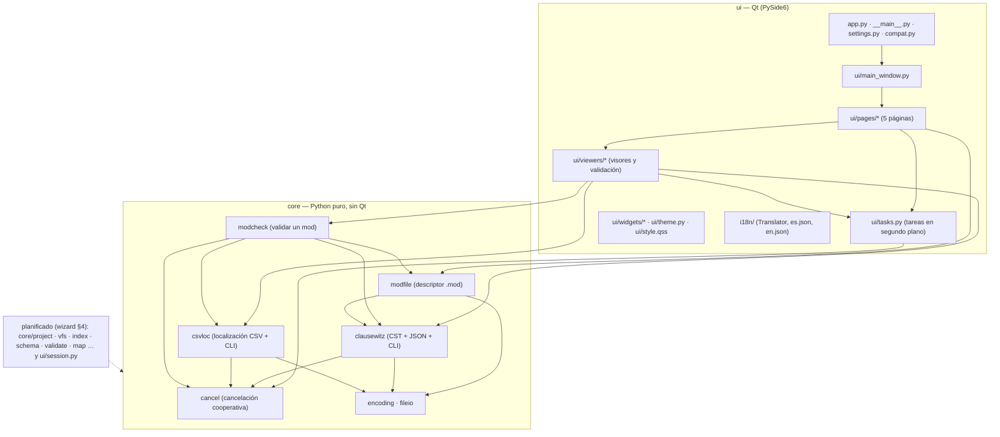

# Victoria II Mod Studio — Arquitectura

Documento de referencia de la arquitectura de **Victoria II Mod Studio**, la
aplicación de escritorio (Windows + Linux) para crear y editar mods de
Victoria II (motor Clausewitz de Paradox, con *A House Divided* y *Heart of
Darkness*) de forma visual.

Estado: **iteración 1**, cerrada salvo dos tareas: la segunda revisión
adversarial de la última ronda de la interfaz, que está en curso, y T5, el
informe final al usuario (§6.1). Este documento describe el código que hay hoy
en el repositorio. El diseño de las
iteraciones 2 a 10 está en [`docs/diseno/wizard.md`](docs/diseno/wizard.md)
(«wizard» en adelante), que sustituye a lo que aquí estaba planificado: §2.2–2.4,
§3 y §6 remiten a él. Lo marcado *(planificado)* no existe todavía en el código.

Índice:

1. [Stack tecnológico](#1-stack-tecnológico)
2. [Arquitectura por capas](#2-arquitectura-por-capas)
3. [Herencia Vanilla + Mod (VFS)](#3-herencia-vanilla--mod-vfs)
4. [Motor de parseo](#4-motor-de-parseo)
5. [Árbol de directorios](#5-árbol-de-directorios)
6. [Hoja de ruta y riesgos](#6-hoja-de-ruta-y-riesgos)
7. [Estrategia de pruebas](#7-estrategia-de-pruebas)
8. [Interfaz de escritorio](#8-interfaz-de-escritorio)

---

## 1. Stack tecnológico

### 1.1 Requisitos que condicionan la elección

- **Mapa interactivo**: `map/provinces.bmp` de vanilla mide 5616 × 2160 px a
  24 bits (≈12,1 Mpx, ≈36 MB de píxeles). Hay que leerlo, convertir colores a
  ID de provincia, recolorear por modo de mapa y responder al clic al instante.
- **Windows y Linux** con un único código fuente.
- **Fidelidad absoluta a los archivos**: el juego lee Windows-1252, los mods
  mezclan CRLF/LF, tabs y comentarios; abrir y guardar sin cambios debe dar los
  mismos bytes.
- **Interfaz a medida** con estética victoriana (bronce, pergamino, terciopelo,
  madera, serifas) que siga siendo rápida y usable.
- **i18n en tiempo real** (Español/Inglés) sin reiniciar.
- **Entorno real de desarrollo**: sin red garantizada para instalar
  dependencias; hay que poder ejecutar y probar todo con lo que ya está
  instalado.

### 1.2 Comparativa

| Criterio | Python + PySide6 (Qt 6) | Tauri 2 + Rust + React | Electron + React/TS |
|---|---|---|---|
| Rendimiento del mapa | numpy vectoriza todo el pipeline (ver 1.4); `QGraphicsView` para zoom/paneo; `QOpenGLWidget` con shader si hiciera falta. Medido: decenas de ms por modo de mapa. | Procesado en Rust muy rápido, pero la imagen se dibuja en el WebView: pasar 12 Mpx de Rust a JS por IPC es costoso y WebGL en webkit2gtk es irregular en Linux. | Decodificar BMP en JS/WASM y pintar en Canvas/WebGL es viable, con más memoria y trabajo en *workers*. |
| Tamaño del ejecutable (estimado) | ≈120–200 MB en carpeta (Qt + numpy + intérprete); ≈50–80 MB comprimido. | ≈5–15 MB: usa el WebView del sistema. | ≈150–250 MB en carpeta (Chromium + Node). |
| Empaquetado Windows/Linux | PyInstaller *one-folder* en cada sistema (no compila en cruzado); AppImage opcional. | Bundler propio (MSI/NSIS, deb/rpm/AppImage); en Linux exige webkit2gtk-4.1 en el sistema. | electron-builder (NSIS, AppImage, deb): muy maduro. |
| Curva de aprendizaje | Un solo lenguaje; Qt Widgets es extenso pero estable y bien documentado. | Dos lenguajes (Rust + TS) y un puente IPC entre ellos; Rust (ownership) tiene la curva más alta. | TS/React muy conocidos; acceso a disco vía Node/IPC. |
| Ecosistema útil aquí | `QTableView` con modelo para CSV de 15 000 filas, `QGraphicsView`, `QSettings`, `QPainter` para texturas; numpy y Pillow leen BMP/TGA directamente. | crates `image`, `serde`; librerías de UI de React. | npm enorme; `sharp`/`jimp` para imágenes. |
| Entorno al decidir (iteración 1) | **Instalado**: Python 3.14, PySide6 6.11.2, numpy 2.4.6, Pillow 12.3.0. Se podía ejecutar y probar ya (también *offscreen*). | **No disponible**: no había `rustc`/`cargo` ni webkit2gtk-4.1. | Node.js estaba, pero Electron no, y sin red no se podía hacer `npm install`. |

### 1.3 Decisión: Python + PySide6 + numpy + Pillow

En la primera propuesta se recomendó **Tauri + Rust/React** por el tamaño del
ejecutable y el rendimiento nativo de Rust. Se cambió al comprobar el entorno:
en aquella máquina **no había toolchain de Rust ni webkit2gtk-4.1**, y sin red
garantizada no se podían instalar. En cambio **PySide6 6.11 y numpy ya estaban
instalados**, así que cada pieza (parser, CSV, ventana principal, capturas
*offscreen*) se pudo ejecutar y probar desde el principio contra el corpus real.

Lo que se acepta a cambio:

- Un ejecutable más grande (≈120–200 MB frente a ≈10 MB de Tauri). Para una
  herramienta de escritorio que se descarga una vez es asumible; se reduce
  excluyendo módulos de Qt no usados.
- Arranque algo más lento del intérprete (decenas a cientos de ms), sin impacto
  en el uso.
- El código Python va dentro del ejecutable de forma legible: no es un
  problema para una herramienta de modding.

Versiones: `pyproject.toml` (y `requirements.txt`) exigen Python ≥ 3.10,
PySide6 ≥ 6.5 (< 6.12 en Python 3.10 y 3.11), numpy ≥ 1.24 y Pillow ≥ 10. El
tope se debe a un fallo de PySide6 6.12.0: suelta referencias de más a `None`,
`True` y `False` (una por cada tarea de `QThreadPool`), y antes de Python 3.12,
donde esos objetos aún no son inmortales, el proceso acaba abortando («Fatal
Python error: none_dealloc»). Para quien ya tenga instalada esa combinación,
`vic2studio/compat.py` la detecta leyendo `PySide6.__version_info__`, sin cargar
QtCore: `app.main` avisa con un `QMessageBox` antes de abrir la ventana y sale
con 1 (§8.1), y `tests/_qt.py` lanza `RuntimeError` al importarse (§7.1).
`VIC2STUDIO_ALLOW_BROKEN_PYSIDE=1` (cualquier valor que no sea vacío ni `0`)
desactiva la comprobación, para probar una PySide6 posterior que quizá lo
corrija. Las cifras de §7 se midieron con
Python 3.13.17, PySide6 6.12.0, numpy 2.5.3 y Pillow 12.3.0. El código evita lo
que no existe en los mínimos: por ejemplo, `ui/tasks.wait_for_tasks` pasa el
plazo como entero a `QThreadPool.waitForDone`, porque la sobrecarga con
`QDeadlineTimer` no existe antes de Qt 6.8.

### 1.4 Por qué el rendimiento del mapa no es un problema en Python

El trabajo pesado nunca se hace píxel a píxel en Python: cada paso es una
operación vectorizada de numpy sobre el array completo.

1. **Lectura**: `provinces.bmp` (24 bits) da un array `(H, W, 3) uint8`. Las
   medidas de abajo usan Pillow y `np.asarray`; el diseño usa un códec BMP
   propio con numpy para garantizar la ida y vuelta byte a byte (wizard D11).
   La fila del array es la `y` del motor: el mapa sale con el norte abajo y solo
   la vista se voltea (wizard H1).
2. **Empaquetado**: `rgb = (r << 16) | (g << 8) | b` en `uint32`.
3. **Color → ID**: se lee `map/definition.csv` (una fila por provincia con su
   ID y su color en rojo, verde y azul, separados por `;`, cp1252) y se obtiene
   un **ráster `uint16` de ID de
   provincia** (24 MB), con `np.searchsorted` sobre los colores ordenados o con
   una tabla directa de 2²⁴ entradas `uint16` (32 MB). Los colores que no están
   en `definition.csv` reciben el ID 0 y generan un diagnóstico (`np.unique` del
   array empaquetado lista los colores presentes).
4. **Modo de mapa**: cada modo es una **LUT `(N+1, 3) uint8`** (fila 0 = sin
   provincia) calculada a partir del modelo (dueño → color del país, RGO →
   color del bien, `life_rating` → degradado, etc.). La imagen es `lut[raster]`.
   Para pintar, la LUT se empaqueta además como `uint32` ARGB y
   `np.take(lut32, raster)` produce directamente un buffer que `QImage`
   (`Format_RGB32`) usa sin copiar.
5. **Fronteras**: comparación del ráster con sus versiones desplazadas una fila
   y una columna (`raster[:, 1:] != raster[:, :-1]`, ídem vertical) → máscara
   booleana que se dibuja como capa superpuesta.
6. **Picking del clic**: `raster[y, x]` tras convertir la posición de la vista
   a coordenadas de imagen: O(1).
7. **Visualización**: `QGraphicsView` + `QGraphicsPixmapItem` con zoom (rueda,
   `setTransform`) y paneo (arrastre); transformación rápida (sin suavizado) a
   zoom alto para ver píxeles nítidos. Si cambiar de modo tuviera que ser
   instantáneo, se pasa a un `QOpenGLWidget` con un *fragment shader*: el ráster
   se sube una vez como textura entera (`R16UI`) y la LUT como textura de
   (N+1) × 1; cambiar de modo es subir unos 13 KB en lugar de 48 MB.

Mediciones de la iteración 1 con un script sintético del mismo tamaño que
vanilla (5616 × 2160, 3248 provincias; Ryzen 9 7950X3D, numpy 2.4.6, mejor de
hasta 5 ejecuciones), cuando el corpus aún no tenía la carpeta `map/`:

| Paso | Operación | Tiempo |
|---|---|---|
| Lectura | Pillow → `np.asarray` | 26 ms |
| Empaquetado | `(r<<16)\|(g<<8)\|b` | 30 ms |
| Color → ID (una vez al cargar) | `np.searchsorted` → `uint16` | 164 ms |
| Colores presentes | `np.unique` | 85 ms |
| Modo de mapa, LUT `(N+1,3) uint8` | `lut[raster]` | 104 ms |
| Modo de mapa, LUT `uint32` ARGB | `np.take(lut32, raster)` + `QImage` sin copia | 34 ms |
| Fronteras | comparación de rásteres desplazados | 13 ms |
| Picking | `raster[y, x]` | < 1 µs |

Con el `provinces.bmp` real, wizard §16.5 midió 0,9 s para leer el BMP y
traducir colores con la tabla directa de 2²⁴ entradas, frente a 1,5 s con
`np.searchsorted`; el diseño elige la tabla directa y fija los criterios del
editor de mapa (primera carga ≤ 4 s, cambio de modo ≤ 150 ms).

Editar el dueño de una provincia solo cambia una fila de la LUT; el repintado
puede limitarse a la caja envolvente de esa provincia (precalculada al cargar).

Otros archivos del mapa:

- **`map/default.map`** (sintaxis Clausewitz, se lee con el mismo parser; por
  eso `.map` está en `CLAUSEWITZ_SUFFIXES`): `max_provinces` (los ID válidos van
  de 1 a `max_provinces - 1`; fija el tamaño de las LUT), `sea_starts = { ... }`
  (lista de ID de provincias de mar), y los nombres del resto de archivos:
  `definitions`, `provinces`, `positions`, `terrain`, `rivers`,
  `terrain_definition`, `tree_definition`, `continent`, `adjacencies`, `region`,
  `region_sea`, etc. Nunca se asumen los nombres: se leen de aquí.
- **`map/terrain.bmp`**: imagen **indexada de 8 bits** (paleta). Pillow la abre
  en modo `P` y `np.asarray` devuelve directamente los índices; `terrain.txt`
  traduce índices de paleta a tipos de terreno. El modo Terreno usa el índice
  mayoritario de cada provincia (`np.bincount` sobre `id * 256 + índice`), y
  respeta las anulaciones `terrain = ...` de `history/provinces`.
- `rivers.bmp` también es indexado de 8 bits (capa opcional).

---

## 2. Arquitectura por capas



Dentro de core el diagrama tiene todas las dependencias, las mismas que
enumeran las reglas que siguen; en la interfaz muestra solo las principales
(por ejemplo, `ui/pages/project_page.py` importa también `csvloc`, `encoding` y
`modcheck`, y los visores, `cancel`).

Reglas de dependencia:

- **core** no importa PySide6 nunca. Se puede usar desde la línea de comandos,
  desde pruebas sin pantalla y desde otros programas. Sus diagnósticos y casi
  todos sus errores traen sus propias tablas de mensajes `es`/`en`
  (`Diagnostic.message(lang)`, `EditError.message(lang)`,
  `CsvDiagnostic.message(lang)`, `InvalidFieldError.message(lang)`,
  `Issue.message(lang)`, `FileChangedError.message(lang)`,
  `DescriptorFieldError.message(lang)`), así que no dependen del traductor de
  Qt: la UI les pasa el idioma activo (`ui/viewers/common.core_language`). Las
  excepciones son `encoding.UnencodableTextError`, los `ValueError` de
  `csvloc.from_json` y el `LookupError` de `normalize_encoding`, que solo
  tienen texto en español; quien los muestra usa sus campos (`encoding` y
  `problems` en el primero), como hace la CLI de localización. Hoy no hay una
  prueba automática de esta regla (§7.5).
- Dentro de **core**: `encoding` y `cancel` no dependen de nada (`encoding`
  nombra `fileio.FileStamp` solo en las anotaciones de tipos); `fileio` usa
  `encoding`; `clausewitz` y `csvloc` usan `encoding`, `fileio` y `cancel`;
  `modfile` usa `encoding`, `fileio` y `clausewitz`; y `modcheck` usa
  `cancel`, `clausewitz`, `csvloc` y `modfile` (los diagnósticos de
  codificación le llegan de `parse_file` y de `read_csv_file`). Todos los recorridos
  largos aceptan `cancelled=` de `cancel` (§2.5). El contrato de cada
  subpaquete es lo que exporta su `__init__.py`.
- **ui** presenta y no escribe nada en el juego ni en el mod: sus únicas
  escrituras son las preferencias (`QSettings`, §8.5) y los PNG de los glifos
  del tema, en una carpeta temporal
  (`tempfile.mkdtemp(prefix="vic2studio-theme-")`). Lee a través de core
  (`parse_file`, `read_csv_file`, `find_descriptor`, `check_mod`), salvo dos
  lecturas directas: las imágenes, con Pillow (`image_viewer.load_image`), y los
  primeros 2 MiB de un archivo sin visor propio para su ficha
  (`project_page.gather_facts`, que los decodifica con `decode_bytes`, con
  `partial=True` si el archivo es más largo).
- Ningún trabajo largo corre en el hilo de la interfaz: los visores y la
  validación usan `ui/tasks.py` (§2.5), y el análisis del archivo anterior se
  suelta por trozos en un hilo propio. Excepciones conocidas (§6.3):
  `gather_facts` y la maquetación y destrucción del documento de la pestaña
  Código con un archivo enorme.
- **i18n** pertenece a la capa de UI: `Translator(QObject)` emite
  `languageChanged(str)` y cada página implementa `retranslate()`.
- No hay capa `services/`: el estado de la aplicación vivirá en
  `core/project/` y el único puente con Qt será `ui/session.py` (wizard D2 y §4).

### 2.1 Flujo de datos

```text
 carpeta del juego             carpeta del mod
          \                     /
           +--- VFS (planif.) -+      hoy la UI trabaja con rutas absolutas (explorador, «Validar mod»)
                     |
          +----------+-----------+
          v                      v
   clausewitz.parse_file    csvloc.read_csv_file
   read_bytes               fileio.read_text: read_bytes ──> encoding.decode_bytes
   ──> decode_bytes         ──> DecodedText: texto, codificación y huella (FileStamp.of)
   ──> match_bom,           ──> parse_csv: split_bom, split_extra_boms
       split_bom,                |
       split_extra_boms          |
   huella: FileStamp.of          |
          |                      |
          v                      v
   ParseResult: CST sin     LocalisationFile: filas
   pérdidas, diagnósticos   crudas, diagnósticos de
   (con el de la            lint, stamp
   codificación), stamp
          |                      |
          v                      v
   visores en una tarea de fondo (TaskRunner): estructura, código, diagnósticos, JSON, tabla CSV
                     |
                     v
   edición por API (hoy solo desde código y pruebas; la UI es de solo lectura):
   Block.set / insert / move / remove_entry …      LocalisationFile.set / add_row / rename_key …
                     |
                     v
   to_source / LocalisationFile.to_source (sin pérdidas: solo cambia lo editado)
                     |
                     v
   write_file(verify=True): relee el texto y compara el árbol; write_csv_file
   encode_text: UnencodableTextError con línea y columna; huella esperada: FileChangedError
                     |
                     v
   fileio.atomic_write_bytes: temporal en la misma carpeta + fsync + os.replace, copia .bak
```

### 2.2 Modelo de dominio *(planificado)*

Lo diseña wizard. El principio (wizard §0, punto 2) es que el CST sin pérdidas
es la única fuente de verdad: formularios, mapa, árbol de condiciones y lienzo
de interfaz son vistas sobre `Block`/`Entry` y `LocRow`, y la interfaz guarda
referencias (`RecordRef`), nunca nodos. Las entidades se declaran con el motor
de esquemas (`core/schema` + `core/schemas`, wizard §10): `Record` es una vista
sobre el `Block` real que lee y escribe con la API de §4.1 (wizard §10.5), y la
historia fechada (`1861.1.1 = { … }`) la resuelve `HistoryView` para una fecha
de trabajo (wizard §10.6).

### 2.3 Índice de símbolos *(planificado)*

Lo diseña wizard §7 (iteración 3): `core/index` con hechos por archivo
(`FileFacts`: definiciones `Symbol` y referencias `SymbolRef`), caché JSON-lines
comprimida por capa e invalidada por la versión de cada extractor, actualización
incremental (por `(size, mtime_ns)` al abrir y por cada cambio sin guardar
durante la sesión) y construcción en segundo plano con `ui/tasks.TaskRunner`, en
un grupo de hilos propio, con `gc.freeze()` del resultado tras la pasada en
frío. Con el contrato actual (§2.5), esa congelación la haría `ui/tasks.py` al
terminar la tarea del índice, porque es el único módulo que congela; el índice
no tendría que llamar a `gc.freeze()`. La tabla de tipos (TAG, partidos,
provincias, culturas, claves de localización…) y sus fuentes está en wizard §7.

### 2.4 Deshacer/rehacer *(planificado)*

Lo diseña wizard §6.2–6.5: cada acción es una transacción con nombre sobre el
`Workspace`; deshacer y rehacer usan instantáneas de texto por documento
(wizard D3 y §6.3), exactas porque `to_source` reproduce el texto original; las
vistas re-resuelven su `RecordRef` cuando cambia la versión del documento.
Guardar es una transacción multiarchivo con diario y recuperación tras un corte
(wizard §6.5), y se conservan las copias `.bak` (wizard D4). Nada se escribe en
disco hasta guardar.

La API actual ya permite deshacer sin instantáneas algunas ediciones:
`remove_entry` devuelve el índice que necesita `insert_entry`, y devolver a una
entrada su valor, su clave o su operador leídos da el texto original exacto
(§4.1, §7.3). Los cambios de comentarios y `close()` no tienen esa inversa.
De todos modos, wizard D3 usa instantáneas de texto para todo el deshacer y
descarta los comandos con mementos, que dependen de partes privadas del CST y
de la trivia de los vecinos.

### 2.5 Tareas en segundo plano y cancelación

**Contrato del núcleo** (`core/cancel.py`): `CancelCheck` es
`Optional[Callable[[], bool]]`; las funciones largas reciben `cancelled=`, lo
consultan cada cierto trabajo y lanzan `Cancelled` (con
`raise_if_cancelled(cancelled)`). Lo aceptan `tokenize`, `parse` y `parse_file`;
`parse_csv`, `read_csv_file`, `lint_file`, `LocalisationFile.lint` y
`LocalisationDB.from_dirs`; y `collect_files`, `check_file` y `check_mod`. La
regla de wizard §4 pide a toda función larga `cancelled=` y también
`progress=`; hoy solo informan de progreso las dos que recorren carpetas,
`collect_files` y `check_mod`, y en las demás `progress=` está pendiente. Las
funciones nuevas que puedan tardar deben aceptar los dos.

**Ejecución en la UI** (`ui/tasks.py`):

- `TaskRunner(parent=None, *, pool=POOL_PREVIEW)` mantiene una sola tarea vigente:
  `start(fn)` cancela la anterior y devuelve un número de generación; lo que
  llegue tarde de una generación vieja se descarta. `cancel()` solo avisa: la
  tarea para cuando consulta `TaskContext.cancelled`, y una tarea cancelada que
  aún esperaba en la cola no llega a empezar. Las señales `finished(result)`,
  `failed(TaskFailure)` y `progress(valor)` llegan en el hilo de la interfaz.
- La función de la tarea recibe un `TaskContext`: `cancelled()` se pasa tal cual
  como `cancelled=` al núcleo, y `report(valor, *, force=False)` notifica
  progreso como mucho cada `PROGRESS_INTERVAL` (0,04 s). Nunca toca widgets.
- Los resultados viajan por un único despachador que vive toda la aplicación y
  entrega con una referencia débil al runner: un widget destruido a mitad de
  tarea no deja señales huérfanas. `TaskFailure` guarda la excepción sin traza
  y la traza ya formateada.
- Grupos de hilos por área (`thread_pool(nombre)`): `POOL_PREVIEW` (`"preview"`,
  2 hilos: visor de scripts, JSON y localización), `POOL_IMAGES` (`"images"`, 1),
  `POOL_VALIDATION` (`"validation"`, 1) y `POOL_RELEASE` (`"release"`, 1). Así
  una validación larga no deja en cola la vista previa.
- `release_in_background(value, dismantle)` suelta en `POOL_RELEASE` un
  resultado grande que ya no se usa: tras `RELEASE_DELAY` (0,1 s, para no
  competir con el repintado que sigue al cambio) recorre los pasos de
  `dismantle(value)`, cada uno de los cuales suelta poco, y entre paso y paso el
  hilo cede el GIL. Soltar el árbol de 20 MB de una vez es una cascada en C de
  ~0,9 s que no suelta el GIL (docstring de `ui/tasks.py`). Lo usa el visor de
  scripts con `dismantle_load` (§8.2); lo que se suelte así no puede llevar
  objetos de Qt.
- `cancel_all()` cancela la tarea de todos los runners vivos y
  `wait_for_tasks(timeout_ms=-1)` espera a que los grupos queden vacíos.
  `app.main` llama a las dos al salir; `MainWindow.closeEvent` solo cancela.
- Al crear el primer runner se baja `sys.setswitchinterval` a
  `UI_SWITCH_INTERVAL` (0,5 ms): las tareas son Python puro y compiten por el
  GIL con los `paintEvent` escritos en Python.
- **Recolector de basura.** Mientras corre alguna tarea, el recolector cíclico
  está parado (`gc.disable()`): un archivo grande crea millones de objetos y
  cada pasada de la generación más vieja los recorrería con el GIL tomado. Al
  terminar la última tarea, si quedan al menos `GC_FREEZE_MIN_OBJECTS`
  (100 000) objetos nuevos, `gc.freeze()` los aparta antes de reactivarlo; los
  resultados entregados se vigilan con referencias débiles y, cuando ya no vive
  ninguno, `gc.unfreeze()` devuelve lo congelado a la generación más vieja. Un
  resultado que no admite referencias débiles (una lista) se descongela en el
  acto, y los fallos no se vigilan. Contrato: los resultados de las tareas no
  deben formar ciclos (congelado, un objeto solo muere por recuento de
  referencias), quien recibe un resultado grande lo guarda entero mientras use
  sus partes, y `ui/tasks.py` es el único módulo que congela. El resultado
  viaja en una lista que vacía quien lo recibe (`_Job`), así que el hilo de la
  tarea, aunque aún no haya vuelto, no lo retiene si la interfaz lo suelta.

---

## 3. Herencia Vanilla + Mod (VFS)

*(planificado para la iteración 2; el diseño completo está en wizard §5.)* Hoy
no hay VFS: la interfaz trabaja con rutas absolutas y el núcleo escribe donde se
le indique (§6.3).

### 3.1 Principios

Resumen de wizard §3 y §5; en caso de duda manda wizard.

- **El juego base es intocable y la protección es «solo el mod».** El mod vive
  dentro de `<juego>/mod/` (wizard H24), así que no basta con rechazar rutas
  bajo la carpeta del juego: `WriteGuard.check` compara rutas reales
  (`realpath`) y solo admite el subárbol del mod, su `.mod` y, si el mod es de
  solo lectura, la carpeta de proyecto; un enlace que salga de esas raíces
  también se rechaza (wizard §5.1).
- **Copia al guardar** (wizard D5): editar un archivo del juego solo marca el
  documento; la copia al mod se hace al guardar, a la misma ruta y con la misma
  mayúscula (`VirtualFS.mod_target`). `fileio.atomic_write_bytes` ya crea las
  carpetas intermedias.
- **Rutas al estilo Windows**: `VPath` conserva las mayúsculas y compara y
  ordena por `VPath.key` (`upper()`, el mismo criterio que
  `csvloc.db.load_order_key`); `VirtualFS.case_collisions` lista los archivos
  que solo se diferencian en mayúsculas.
- Leer nunca escribe; los ajustes, el diario, la papelera y las copias de
  `originals/` del proyecto van a `<mod>/.vic2studio/` (wizard D16 y §5.4).

### 3.2 Resolución de un archivo

La define la tabla de reglas de carga de wizard §5.2 (`LoadMode`: `WHOLE_FILE`,
`UNION_BY_PATH`, `KEYED_UNION`, `REFERENCED`, `LOCALISATION`, `MAP_BUNDLE` y
`ASSET`): no todas las carpetas se heredan igual. La localización
(`LOCALISATION`) sigue ya hoy las reglas de `csvloc.LocalisationDB` (§4.3): el
juego no sustituye por ruta sino que carga todos los CSV y, ante claves
repetidas, gana la primera cargada.

### 3.3 `replace_path`

Cada `replace_path = "history/provinces"` del descriptor indica al juego que no
cargue los archivos de vanilla de esa carpeta. `VirtualFS(...,
replace_recursive=True)` los oculta (siguen accesibles con `stack()` para
comparar); si afecta también a las subcarpetas es [verificar en juego], así que
la opción es explícita y las pruebas cubrirán los dos valores. No oculta los
archivos del propio mod (wizard §5.3). Hoy `ModDescriptor.replaces(carpeta)` y
`ModDescriptor.normalized_replace_paths` ya comparan esas rutas (§4.4).

### 3.4 Descriptor `.mod`

Vive en `<juego>/mod/<Nombre>.mod`, junto a la carpeta del mod. Ejemplo real
(`VSM.mod`, el descriptor del mod del usuario, también en
`tests/fixtures/shago_mod_min/`; cp1252 con CRLF):

```text
name = "Shago Mod"
path = "mod/VSM"
user_dir = "VSM"
```

| Campo | Significado |
|---|---|
| `name` | Nombre que muestra el lanzador. |
| `path` | Carpeta del mod relativa a la carpeta del juego (`mod/<carpeta>`). |
| `user_dir` | Carpeta propia en Documentos para partidas y caché, separada de las de vanilla. |
| `replace_path` | Repetible: carpetas de vanilla que el mod sustituye por completo. |
| `dependencies` | Bloque con los nombres de otros mods de los que depende. |
| `archive` | Archivo comprimido con el mod, si lo usa en vez de `path`. |

`core/modfile.py` ya lee, busca y escribe descriptores conservando el resto del
archivo (§4.4). El generador con asistente (capacidad 1) llega en la
iteración 2 (wizard §14.1).

---

## 4. Motor de parseo

### 4.1 Clausewitz `.txt` (`vic2studio.core.clausewitz`)

Sintaxis que reconoce: `clave = valor`, operadores `= < > <= >= != ==`, bloques
`{ ... }` anidados, valores sueltos (`{ 1 2 3 }`), bloques mixtos, cadenas entre
comillas (sin secuencias de escape), fechas `1861.1.1` (también como clave),
comentarios `#` hasta el final de la línea y tokens pegados (`a={b=c}`). Los
saltos de línea pueden ser CRLF, LF o CR solo: los comentarios terminan en `\r`
o `\n` y las líneas se cuentan con los tres. Son espacio en blanco los
caracteres `\x00`–`\x20`, `\x7f` y U+FEFF. `CLAUSEWITZ_SUFFIXES` (`.txt`, `.mod`,
`.gfx`, `.gui`, `.sfx`, `.asset`, `.map`) son las extensiones que se leen con
este parser.

**CST sin pérdidas.** El árbol (`Document`, `Block`, `Entry`, `Scalar`)
conserva la *trivia*: espacios, tabs, saltos de línea y comentarios.
`to_source(document)` reproduce **exactamente** el texto original si no hubo
ediciones, también en archivos con errores de sintaxis; con ediciones, solo se
reescribe lo editado y el resto queda byte a byte igual. Los tokens leídos
nunca se modifican: al serializar, cada bloque se compara con su orden leído,
así que reinsertar una entrada borrada en su índice o devolverle su valor leído
da el texto original exacto (deshacer).

**Tolerancia a errores.** `parse(text, *, filename=None, cancelled=None)` nunca
lanza excepciones por un archivo mal formado (el analizador es iterativo: la
profundidad de anidamiento no tiene límite). Devuelve un `ParseResult` con
`document`, `diagnostics`, `path`, `stamp` (huella de lo leído; `None` sin
archivo), `encoding` y `newline` (los del documento) y las vistas `ok`, `errors`
y `warnings`. `parse_file(path, *, encoding=None, cancelled=None)` detecta la
codificación con `decode_bytes` (§4.2), ajusta una `encoding` explícita al BOM
real del archivo (`match_bom` y `split_bom`), quita del texto los BOM repetidos
y los cuenta en `Document.extra_boms` (`split_extra_boms`), y añade él mismo
el diagnóstico de la codificación (`non_game_encoding`, `unreadable_encoding`
o `stray_bom`, los de `diagnostics.ENCODING_CODES`): la CLI, «Validar mod» y
el visor lo reciben del mismo sitio. Cada `Diagnostic` tiene `code`, `severity`,
`line`/`column` (desde 1), `offset`, `args`, `related`, `message(lang)` (tablas
`es` y `en` completas; por defecto `en`) y `format(path, lang)`, que da
`archivo:línea:columna: severidad: mensaje`. Los argumentos que se citan en los
mensajes se escapan y se cortan a 60 caracteres.

| Código | Severidad | Cuándo aparece | Ejemplo |
|---|---|---|---|
| `unclosed_block` | error | Un `{` llega al final del archivo sin cerrar. Posición: la `{`; `args`: `key`, `open_line`; `related`: el final del archivo. | `political_decisions = { …` sin `}` final |
| `unexpected_close_brace` | error | `}` sin bloque abierto. | `a = 1 }` |
| `missing_value` | error | Clave y operador sin valor antes de `}`, del final del archivo o, si el operador acaba la línea, de otra asignación en la línea siguiente. Se informa en la línea de la clave. | `p = { owner = }` |
| `missing_key` | error | Operador sin clave delante. | `= GER` |
| `unterminated_string` | error | Comillas sin cerrar. | `name = "Prusia` |
| `invalid_key` | error | Un bloque usado como clave. | `{ a } = b` |
| `unexpected_operator` | error | Dos operadores seguidos. | `owner = = GER` |
| `invalid_character` | error | Carácter que no puede formar parte de ningún token. | `!` suelto |
| `multiline_string` | aviso | Una cadena abarca varias líneas: probablemente falta una comilla. | `name = "a` ⏎ `b"` |
| `control_character` | aviso | Caracteres de control invisibles en el archivo. | byte `0x01` |
| `invisible_character` | aviso | Un carácter invisible o de espacio raro dentro de una palabra (espacio de no separación, de ancho cero…). | `GER` seguido de U+00A0 |
| `non_game_encoding` | aviso | Solo `parse_file`: el archivo está en UTF-8. Con BOM se informa en 1:1; si no, en el primer carácter no ASCII (un archivo solo ASCII no avisa). | — |
| `unreadable_encoding` | error | Solo `parse_file`: el archivo está en UTF-16 (cualquiera de las cuatro de `GAME_UNREADABLE`), que el juego no puede leer. En 1:1; `args`: `encoding`. | — |
| `stray_bom` | aviso | Solo `parse_file`: BOM UTF-8 delante de un texto en Windows-1252; el juego pega esos bytes a la primera clave. En 1:1. | — |
| `suspicious_close_brace` | info | Una `}` cierra un bloque con menos sangría que la línea que lo abrió: pista de dónde falta una llave. | ver el caso real |

Caso real: `check` sobre la carpeta del mod del usuario (`VSM`, 3927 archivos;
medido en una sesión con el corpus) da 3 errores, 1 aviso y 1 pista:

- `decisions/somaliland_shago.txt` y `decisions/zulu_expancionshago.txt` no
  cierran el bloque `political_decisions` abierto en la línea 1
  (`unclosed_block`). En el segundo, `suspicious_close_brace` apunta además a
  la línea 155, cuya `}` cierra `imperio_zulu` (abierto en la línea 85) con
  menos sangría de la esperada: la llave que falta está probablemente antes.
- `history/units/v2dd2.txt` no es un script sino el texto de un diario de
  desarrollo copiado por error (también está en la plantilla y en vanilla):
  `missing_key` en la línea 4.
- `history/units/1861/HAI_oob.txt` está en UTF-8 (`non_game_encoding`).

Son errores que pasan fácilmente desapercibidos, y por eso `check` indica
siempre la línea donde se abrió el bloque. La muestra del repositorio reproduce
el primer punto:

```text
$ PYTHONPATH=src python3 -m vic2studio.core.clausewitz check tests/fixtures/shago_mod_min
tests/fixtures/shago_mod_min/VSM/decisions/somaliland_shago.txt:1:23: error: El bloque 'political_decisions' abierto en la línea 1 no se cierra (falta '}')
tests/fixtures/shago_mod_min/VSM/decisions/zulu_expancionshago.txt:1:23: error: El bloque 'political_decisions' abierto en la línea 1 no se cierra (falta '}')
tests/fixtures/shago_mod_min/VSM/decisions/zulu_expancionshago.txt:155:1: info: Esta '}' cierra 'imperio_zulu' (línea 85) pero tiene menos sangría que esa línea: puede que falte una '}' antes
17 archivo(s), 2 error(es), 0 aviso(s)
```

**API de consulta** (en `Block`, y por tanto en `Document`; las de búsqueda por
clave, `find`, `find_all`, `get`, `get_all`, `get_text`, `has`,
`index_by_key`, `find_path` y `get_path`, aceptan `ignore_case=False`):

| Método | Efecto |
|---|---|
| `find(key, value=…)`, `find_all(key, value=…)` | Primera entrada (o todas) con esa clave y, si se da, ese valor; números y fechas se comparan por valor (`5` encuentra `5.000`). |
| `get(key, default=None)`, `get_all(key)`, `get_text(key, default=None)`, `has(key)` | Valores por clave; `get_text` da el texto del primer valor escalar. |
| `keys()`, `values()`, `index_by_key()` | Claves sin repetir en orden, valores sueltos e índice `clave -> [entradas]` (una foto). |
| `find_path(path)`, `get_path(path, default=None)`, `path_of(entry)` | Rutas de claves desde el bloque; `"[i]"` es la entrada en la posición `i`; `path_of` da la ruta exacta que `find_path` devuelve. |
| `line`, `column`, `is_closed` | Posición de la `{` y si al bloque leído le falta la `}`. `Document.unclosed_blocks()` los lista. |
| `Block.close_position`, `Entry.value_end` | Posiciones finales, como `(línea, columna)` desde 1: la `}` leída que cierra el bloque, y el último carácter del valor leído de la entrada (su token o, en un bloque, su `}`; una cadena puede acabar en otra línea). Dan `None` si el bloque es nuevo o no se cerraba al leerlo, o si el valor o la entrada los creó o cambió el código. Para un token, `value_end` usa `end_position(token)`, una función del módulo interno `lexer` que `__init__.py` no exporta. El índice de estructura del visor solo usa esta API. |

**API de edición** (conserva el formato existente):

| Método | Efecto |
|---|---|
| `set(key, value, *, op=None, ignore_case=False)` | Sustituye el valor de la primera entrada con esa clave (con un `str`, conserva las comillas del valor anterior; con `op`, cambia el operador); si no existe, la añade al final. |
| `append(key, value, op="=")`, `append_value(value)` | Añaden al final una entrada con clave o un valor suelto. |
| `insert(index, key, value, op="=")`, `insert_before(entry, …)`, `insert_after(entry, …)` | Insertan una entrada nueva en una posición o junto a otra. |
| `insert_entry(index, entry)`, `remove_entry(entry)` | Reinsertan una entrada existente; `remove_entry` devuelve su índice, así que deshacer es `insert_entry(índice, entrada)`. |
| `remove(key, value=…, *, ignore_case=False)` | Elimina las entradas con esa clave (y valor); devuelve cuántas. `remove("add_core", "RUS")` quita solo esa. |
| `move(entry, index=None, *, to=None)` | Mueve una entrada dentro del bloque o a otro bloque del mismo documento; se lleva sus comentarios y se sangra según su nuevo sitio. |
| `close()` | Añade la `}` que le falta a un bloque leído (y a los que contiene), al final del archivo con la sangría de su línea de apertura. |
| `clone(*, comments=True)` | Copia profunda sin el formato de origen, para llevar nodos a otro archivo. |
| `Block.from_pairs(pairs)` | Bloque nuevo desde pares `(clave, valor)` o `(clave, operador, valor)`; admite claves repetidas. |
| `Entry(key, op="=", value=None)` | `key`, `op` y `value` se pueden asignar; `is_assignment`, `line`, `column` y `clone(*, comments=True)`. |
| `Document.check_text(text, *, key=False)` | Problema que tendría ese texto como valor o clave (incluido `unencodable_character` en la codificación del documento), o `None`: sirve para avisar mientras se teclea. |

`Block.entries` es una lista normal: también se puede reordenar directamente y
el serializador lo respeta.

Valores aceptados: `Scalar`, `Block`, `str` (sin comillas si es una palabra
válida; si no, entre comillas), `int`, `float` (decimal exacto, sin notación
científica; `-0.0` se escribe `0.0` y NaN o infinito dan `not_finite`), `bool`
(→ `yes`/`no`, también los de numpy), números que implementan el protocolo
numérico (numpy), `ClausewitzDate` (calendario sin años bisiestos), `list` o
`tuple` (→ bloque de valores sueltos) y `dict` (→ bloque de asignaciones).
`Scalar` es inmutable y ofrece `text`, `quoted`, `as_int`, `as_float`,
`as_bool`, `as_date`, `is_number` e `is_date`; `ClausewitzDate` es inmutable,
ordenable y tiene `ClausewitzDate.parse(text)`.

**Comentarios.** Pertenecen a la línea en que están y todos se pueden leer y
cambiar:

| Propiedad | Comentarios |
|---|---|
| `Entry.comments` | Líneas propias encima de la entrada (los de la cabecera del archivo son de su primera entrada). |
| `Entry.line_comment` | El del final de la línea de la entrada (en un bloque, también el que sigue a su `}`). |
| `Block.open_comment` | El de la línea de la `{`. |
| `Block.trailing_comments` | Líneas propias entre la última entrada y la `}`; en un `Document`, los del final del archivo. |

**Errores de edición.** La API valida antes de cambiar nada y lanza `EditError`
(un `ValueError`) o `EditTypeError` (un `EditError` y un `TypeError`), con
`code`, `params`, `message(lang)` (por defecto `en`; si `params` trae `where`,
el mensaje empieza por esa ubicación) y `str()` en español. Hay 40 códigos con
mensajes en los dos idiomas; por grupos:

- valores: `not_an_integer`, `not_a_number`, `not_a_bool`, `not_finite`,
  `not_a_date`, `date_part_type`, `date_month_range`, `date_day_range`,
  `unsupported_value`, `dict_none_key`, `pair_shape`;
- texto: `text_type`, `quote_in_string`, `needs_quotes`, `line_break`,
  `control_character`, `invisible_character`, `empty_key`,
  `unencodable_character`, `invalid_key_type`;
- estructura: `invalid_operator`, `entry_without_value`,
  `loose_value_operator`, `not_an_entry`, `entry_not_in_block`, `cycle` (un
  bloque dentro de sí mismo), `not_a_node`, `not_a_document`,
  `invalid_path_item`, `source_mismatch`;
- JSON (`from_json`, con `params["where"]` = ruta JSON como
  `$.entries[0].value`): `json_expected_block`, `json_expected_list`,
  `json_expected_object`, `json_expected_scalar`, `json_missing_type`,
  `json_unknown_type`, `json_scalar_fields`, `json_key_op`,
  `json_expected_strings`, `json_expected_string`.

**Serialización.** `to_source(node, *, newline=None)` aplica estas reglas a lo
editado (docstring de `serializer.py`): una entrada nueva al final de un bloque
va justo antes de la línea de su `}`, tras los comentarios finales; entre dos
entradas, antes de los comentarios que preceden a la siguiente; al quitar una
entrada se quita su línea entera con su comentario de final de línea y se
quedan los de encima (salvo si se movió: entonces se van con ella); lo movido se
sangra según su nuevo sitio con la unidad de sangría del archivo; nunca quedan
dos palabras pegadas; un bloque de una línea que pasa de `INLINE_WIDTH` (80) o
que recibe comentarios pasa a varias líneas; y una cadena sin cerrar recibe su
comilla de cierre si algo la sigue tras editar.

**Guardado.** `write_file(path, document_or_result, *, encoding=None,
backup=True, verify=True, expected=None) -> Path | None`:

- con `verify`, antes de tocar el disco vuelve a leer el texto generado y
  comprueba que da el mismo árbol (con los mismos bloques sin cerrar) y ningún
  error de sintaxis que no estuviera en lo leído; si no, lanza
  `SourceMismatchError` (código `source_mismatch`, con la ruta y la línea de la
  primera entrada distinta) y no escribe nada;
- codifica en `encoding` o en la del documento (cp1252 para documentos nuevos):
  un carácter que no cabe da `UnencodableTextError` (§4.2); los BOM repetidos
  (`Document.extra_boms`) se escriben delante solo si se guarda en la misma
  codificación y esta lleva BOM: un UTF-8 con dos BOM se guarda en cp1252 sin
  ellos y, sin cambios en su codificación, da los mismos bytes;
- con `expected` (normalmente `ParseResult.stamp`) lanza `FileChangedError` si
  el archivo cambió fuera de la aplicación; tras guardar un `ParseResult` en su
  propio archivo, su `stamp` pasa a ser el de lo escrito;
- con `backup`, la copia `<nombre>.bak` se hace solo en el primer guardado de
  la sesión (del proceso) de cada ruta: los siguientes no la pisan y sigue
  guardando el original.

**JSON.** `to_json(node, *, include_comments=False)` produce este esquema exacto.
Para el texto `owner = XYZ` seguido de `lista = { 10 20 }`:

```json
{"type": "block", "entries": [
  {"key": {"type": "scalar", "text": "owner", "quoted": false}, "op": "=",
   "value": {"type": "scalar", "text": "XYZ", "quoted": false}},
  {"key": {"type": "scalar", "text": "lista", "quoted": false}, "op": "=",
   "value": {"type": "block", "entries": [
     {"key": null, "op": null, "value": {"type": "scalar", "text": "10", "quoted": false}},
     {"key": null, "op": null, "value": {"type": "scalar", "text": "20", "quoted": false}}
   ]}}
]}
```

Con `include_comments=True` se añaden, solo cuando existen, las claves de los
comentarios: en una entrada, `"comments"` (lista) y `"line_comment"` (texto); en
un bloque, `"open_comment"` (texto) y `"trailing_comments"` (lista); el bloque
raíz puede llevar `"trailing_comments"` con los del final del archivo. Para el
texto

```text
# cabecera
modo = rapido # al final de la línea
bloque = { # en la línea de la {
	clave = 1
	# encima de la }
}
# final del archivo
```

el resultado es:

```json
{"type": "block", "entries": [
  {"key": {"type": "scalar", "text": "modo", "quoted": false}, "op": "=",
   "value": {"type": "scalar", "text": "rapido", "quoted": false},
   "comments": ["# cabecera"], "line_comment": "# al final de la línea"},
  {"key": {"type": "scalar", "text": "bloque", "quoted": false}, "op": "=",
   "value": {"type": "block", "open_comment": "# en la línea de la {", "entries": [
     {"key": {"type": "scalar", "text": "clave", "quoted": false}, "op": "=",
      "value": {"type": "scalar", "text": "1", "quoted": false}}
   ], "trailing_comments": ["# encima de la }"]}}
], "trailing_comments": ["# final del archivo"]}
```

`from_json(obj)` devuelve un `Document` (lanza `EditError` con la ruta JSON del
fallo). Invariante, con `c` igual a `False` o `True` y
`j = to_json(doc, include_comments=c)` para cualquier documento `doc`:

```text
to_json(parse(format_canonical(from_json(j), comments=c)).document, include_comments=c) == j
```

Con un `j` generado con comentarios y `c=False` no se cumple, porque se pierden
los comentarios. La prueba de corpus lo comprueba sin comentarios en todos los
archivos del corpus, también en los que tienen errores (§7.2), y
`test_clausewitz_json` con comentarios.
`iter_json(value, *, indent=2)` produce el texto JSON a trozos, idéntico al de
`json.dumps(value, ensure_ascii=False, indent=indent)`, sin recursión (sirve
para árboles muy profundos y para mostrar JSON grandes en segundo plano); un
ciclo da `EditError("cycle")`.

**Otras vistas.**

- `format_canonical(node, *, indent="\t", newline="\n", comments=False)`:
  impresión normalizada (`clave = valor`, bloques sangrados, listas cortas en
  línea `{ 1 2 3 }`); con `comments`, incluye todos los comentarios.
- `simplify(node)`: vista con pérdidas para leer rápido (bloque de valores
  sueltos → `list`; con asignaciones → `dict`, claves repetidas → `list`; mixto
  → `list`; números → `int`/`float`; `yes`/`no` → `bool`). No sirve para
  escribir de vuelta.
- `walk(node)`: recorre en profundidad dando `(ruta, entrada)`, con `"[i]"` en
  la ruta para los valores sueltos.

**CLI.**

```text
python -m vic2studio.core.clausewitz check RUTA... [--lang es|en]
python -m vic2studio.core.clausewitz tojson ARCHIVO [--comments] [--lang es|en]
```

`check` recorre archivos y carpetas (en las carpetas, los de
`CLAUSEWITZ_SUFFIXES`), imprime en la salida estándar un diagnóstico por línea
con `Diagnostic.format`, deja el resumen `N archivo(s), E error(es), W aviso(s)`
en la salida de error y sale con código 1 si hay errores; un archivo que no se
puede leer cuenta como error. `tojson` imprime el árbol con `iter_json` (con
`--comments`, con los comentarios), deja los diagnósticos en la salida de error
y sale con 0 si el archivo no tiene errores y con 1 si los tiene o no se puede
leer. El idioma por defecto de la CLI es `es`. Un archivo en UTF-16 da el
error `unreadable_encoding` (y el código de salida 1) y un BOM UTF-8 delante de
Windows-1252, el aviso `stray_bom`: los da `parse_file`, como a «Validar mod»
y al visor. `check` recorre `CLAUSEWITZ_SUFFIXES`, que tiene una sola
definición (`parser.py`); `modcheck`, el visor y `tests/_corpus.py` la importan.

### 4.2 Lectura y escritura (`core.encoding`, `core.fileio`)

**Detección** (`decode_bytes(data, encoding=None, *, partial=False)`, nunca falla
al detectar):

| Bytes | Codificación | Notas |
|---|---|---|
| BOM `FF FE` | `utf-16` | UTF-16 LE; se vuelve a escribir LE con BOM, sea cual sea la máquina. |
| BOM `FE FF` | `utf-16-be-bom` | UTF-16 BE; codec que registra `core.encoding`. |
| BOM `EF BB BF` y el resto es UTF-8 | `utf-8-sig` | |
| BOM `EF BB BF` y el resto no es UTF-8 | `cp1252` | Un UTF-8 reconvertido a ANSI sin quitar el BOM: el juego ve `STRAY_BOM` pegado a la primera clave (`has_stray_bom`). |
| Sin BOM, UTF-8 válido y con algún carácter no ASCII | `utf-8` | |
| Con NUL alternos, sin BOM | `utf-16-le` / `utf-16-be` | Por la proporción de NUL en los bytes altos y bajos de una muestra de 4096 bytes. |
| Cualquier otro caso | `cp1252` | Los cinco bytes que cp1252 deja sin definir (0x81, 0x8D, 0x8F, 0x90, 0x9D) se conservan con un manejador propio. |

`GAME_UNREADABLE` reúne las cuatro variantes de UTF-16: el juego no puede
leerlas. En las codificaciones con BOM (`BOM_ENCODINGS`: `utf-8-sig`, `utf-16`
y `utf-16-be-bom`) el BOM no queda en el texto y se vuelve a escribir delante.
Con una codificación explícita, `decode_bytes` usa ese codec tal cual;
`split_bom(text, encoding)` pasa un U+FEFF inicial a la codificación (`utf-8` →
`utf-8-sig`…), `match_bom(data, encoding)` ajusta la codificación al BOM que
tienen de verdad los bytes (`utf-8-sig` sin BOM pasa a `utf-8`; `utf-16` con
BOM `FE FF`, a `utf-16-be-bom`…) y `split_extra_boms(text, encoding)` separa los
BOM repetidos que siguen al primero y devuelve cuántos había. `parse_file` usa
las tres (§4.1). `normalize_encoding` rechaza los codecs que no
son de texto. `partial=True` es para vistas previas: una secuencia multibyte
cortada al final no cambia la detección. Decodificar y volver a codificar un
archivo sin cambios da los mismos bytes: lo comprueba la prueba de corpus con
los 12 007 archivos de texto (`.txt`, `.csv`, `.mod`, `.lua`, `.bak`) del corpus
completo (§7.2).

**Codificación al guardar.** Por defecto la detectada al leer (cp1252 para
archivos nuevos). El juego no entiende UTF-8 ni UTF-16: `parse_file` avisa de
UTF-8 con `non_game_encoding` y da el error `unreadable_encoding` con UTF-16
(§4.1), y el lint del CSV usa `non_game_encoding`, como error si es UTF-16
(§4.3). El validador global
ofrecerá convertirlos *(planificado, wizard §11 y §15)*. Si el texto tiene
caracteres que la codificación no puede representar, `encode_text` lanza
`UnencodableTextError` con `encoding` y `problems` (índice, línea, columna y
carácter de cada uno, de `find_unencodable`) **antes** de tocar el disco.

**Saltos de línea.** `detect_newline(text, *, lone_cr=True)` da el
predominante: `"\r\n"`, `"\n"` o `"\r"` (solo CR es el salto de algunos
archivos vanilla); con `lone_cr=False` un CR suelto no cuenta (el CSV del juego
solo parte filas en LF). El CST conserva los del archivo y usa el del documento
para el texto generado; los CSV nuevos usan CRLF, como todos los del corpus;
`format_canonical` usa LF salvo que se le pase `newline="\r\n"`.

**Escritura atómica** (`fileio`):

- `read_text(path, encoding=None)` devuelve un `DecodedText(text, encoding,
  stamp)`; `stamp` es un `FileStamp(size, digest)` con un resumen BLAKE2b de
  16 bytes de lo leído (`FileStamp.of(data)`; `file_stamp(path)` da el del
  archivo en disco o `None` si no existe).
- `atomic_write_bytes(path, data, *, backup=False, expected=None) -> Path | None`:
  con `expected`, si el archivo ya no tiene esa huella (o no existe) lanza
  `FileChangedError` (un `OSError` con `code = "file_changed"` y
  `message(lang)`) antes de tocar nada; crea las carpetas intermedias; con
  `backup` copia el original a `<nombre>.bak` (`shutil.copy2`); escribe en un
  temporal `.<nombre>.<hex>.tmp` de la misma carpeta (creado en exclusiva, con
  `0o666` menos la umask; si el destino existe, toma sus permisos), hace
  `fsync` y `os.replace`. Si algo falla, borra el temporal: un fallo a mitad de
  guardado nunca deja un archivo a medias. Devuelve la ruta de la copia, si se
  hizo.
- `write_text(path, text, encoding, *, backup=False, expected=None)` codifica
  con `encode_text` y llama a la anterior.
- Las copias `.bak` (por ejemplo `text.csv.bak`) no terminan en `.txt` ni en
  `.csv`, así que el juego no las carga. Cuándo se hacen depende de quién
  guarda: `write_file` solo en el primer guardado de la sesión (§4.1),
  `write_csv_file` en cada guardado (§4.3).

### 4.3 Localización CSV (`vic2studio.core.csvloc`)

El juego **no** usa CSV estándar: una entrada por línea, campos separados por
`;`, sin comillas ni escapes, cp1252. Las líneas que empiezan por `#` son
comentarios.

| Columna | 0 | 1 | 2 | 3 | 4 | 5 | 6 | 7 | 8 | 9 | 10 | 11 | 12 | 13 | 14 |
|---|---|---|---|---|---|---|---|---|---|---|---|---|---|---|---|
| Contenido | clave | English | French | German | Polish | Spanish | Italian | Swedish | Czech | Hungarian | Dutch | Portuguese | Russian | Finnish | `x` |

`LANGUAGE_COLUMNS`, `LANGUAGE_CODES` (`"en": 1` … `"es": 5` … `"fi": 13`),
`END_MARKER = "x"` y `END_MARKER_COLUMN` (14) exponen esta tabla. **El juego
solo muestra English, French, German y Spanish** (`DISPLAYED_LANGUAGES`); el
resto de columnas existen en el formato pero el juego no las usa.

Lo que muestra el corpus real (comprobado):

- Vanilla suele terminar con la `x` en la columna 14 seguida de campos vacíos
  extra, que hay que conservar; la forma es
  `CLAVE;texto en;texto fr;texto de;;texto es;;;;;;;;;x;;;;`. De las 21 676
  filas de datos de la carpeta `localisation` de vanilla, 18 976 tienen la `x`
  en la columna 14, 2 658 en otra y 42 no la tienen.
- Muchas filas ponen la `x` antes (por ejemplo en la columna 11 en
  `darkness_3_01.csv`), y los archivos del mod del usuario (`00_VSM_*.csv`)
  tienen la clave y los 13 idiomas sin ninguna `x` y empiezan con una fila de
  cabecera `key;English;French;…`. Por eso el linter informa
  (`missing_end_marker`, `too_few_columns`, `header_row`) sin bloquear la
  edición, y al re-serializar una fila editada la normaliza a
  `clave;13 columnas;x` conservando los extras tras la `x`.
- Hay comillas como texto literal. Como el juego no las interpreta, un `;`
  entre comillas desplaza columnas: aviso `semicolon_in_quotes`.
- Los textos usan códigos de color `§Y … §W`/`§!` y variables `$COUNTRY$`; el
  editor debe mostrarlos sin alterarlos.
- Todos los CSV del corpus usan CRLF.

**Lectura.** `parse_csv(text, *, filename=None, encoding=None, cancelled=None)`
convierte el texto en un `LocalisationFile` sin perder nada: el BOM inicial pasa
a la codificación (`split_bom`) y los BOM repetidos que lo siguen van a
`LocalisationFile.extra_boms` en vez de pegarse a la primera clave; las filas se
separan solo en LF (con o sin CR delante) y un CR suelto es contenido; sin
saltos de línea se asume CRLF. `read_csv_file(path, *, encoding=None,
cancelled=None)` detecta la codificación con `fileio.read_text` y guarda la
huella en `stamp`.

**Modelo.** `LocalisationFile(rows=None, *, encoding="cp1252", newline="\r\n",
trailing_newline=True, path=None, extra_boms=0)` guarda filas `LocRow` de tipo
`RowKind` (datos, comentario o línea vacía) con su texto crudo; sin ediciones,
`to_source()` reproduce el texto original y, codificado, los mismos bytes.
Edición: `get_row`, `get`, `set`, `add_row(key, texts=None, *, index=None,
allow_duplicate=False)`, `add_rows`, `add_comment`, `add_blank`,
`rename_key(old, new, *, all=False, allow_duplicate=False)`, `remove_row`,
`remove_rows`, `remove`, `keys()` (en orden de primera aparición), `lint()` y
`mark_saved()`. Los textos inválidos se rechazan con `InvalidFieldError`
(códigos `separator_in_text`, `newline_in_text`, `empty_key`, `key_whitespace`,
`comment_key`, `duplicate_key`, `unknown_language`, `invalid_column`,
`not_a_language_column`, `not_a_data_row`, `invalid_comment` e `invalid_blank`);
`DuplicateKeyError` es además un `KeyError`.

**Escritura.** `write_csv_file(path, file, *, encoding=None, backup=True,
force=False) -> Path | None` codifica (por defecto en la codificación del
archivo) y escribe de forma atómica. Antes de tocar el disco lanza
`UnencodableTextError` si algún carácter no cabe y `FileChangedError` si se
guarda sobre el archivo leído y este cambió fuera de la aplicación (`force`
sobrescribe de todos modos). Los BOM repetidos solo se conservan al guardar en
la misma codificación, si es de las que llevan BOM. Con `backup`, cada guardado
copia lo que había en `<nombre>.bak`.

**Diagnósticos** (`CsvDiagnostic`, mensajes `es`/`en`; `lint_file(file,
encoding=GAME_ENCODING, *, cancelled=None)`, donde `encoding` es la de destino):

| Código | Severidad | Significado |
|---|---|---|
| `missing_end_marker` | aviso o info | Falta la `x` en la columna 14 o está en otra columna. Es info si el juego ve enteros sus cuatro idiomas (solo faltan columnas que no muestra, o la `x`); aviso si las columnas están desplazadas o falta un idioma visible. |
| `too_few_columns` | aviso | A la fila le falta algún idioma visible. |
| `duplicate_key` | aviso | Clave repetida en el mismo archivo; el juego usa la primera. |
| `empty_key` | aviso | Fila sin clave. |
| `key_whitespace` | aviso | La clave tiene espacios al principio o al final; las referencias no coincidirán. |
| `semicolon_in_quotes` | aviso | Un texto entre comillas contiene `;`. |
| `non_game_encoding` | aviso o error | El archivo no está en Windows-1252 (con BOM UTF-8, variante propia); error si está en UTF-16, que el juego no puede leer. También avisa, en 1:1, de un `STRAY_BOM` en un archivo cp1252. |
| `unencodable_character` | error | Caracteres que no se pueden guardar en la codificación de destino. |
| `header_row` | info | Fila de cabecera `key;English;…`: el juego la carga como la clave `key`; inofensiva. |

**Precedencia.** `LocalisationDB.from_dirs(dirs, *, encoding=None,
cancelled=None)` recibe las carpetas por prioridad (mod antes que vanilla) y
reproduce lo que hace el juego:

- de cada carpeta toma los `*.csv` sin distinguir mayúsculas; si dos carpetas
  tienen un archivo con el mismo nombre, se usa el de la primera y el otro se
  ignora entero (`replaced_files`);
- carga los archivos en orden alfabético de nombre sin distinguir mayúsculas
  (`load_order_key(name)` compara los nombres en mayúsculas, como NTFS), sin
  importar de qué carpeta venga cada uno;
- ante claves repetidas gana la primera cargada; por eso los mods nombran sus
  archivos con prefijos como `00_` para cargarse antes que `text.csv`. Las
  claves distinguen mayúsculas.

Un archivo que no se puede leer no detiene la carga y queda en `errors`.
`keys()` da las claves en orden de carga de la definición que gana; `entry`,
`file_of`, `origin`, `lookup(key, lang="en", *, fallback=None)`, `source_of`,
`definitions` y `overrides()` (→ `KeyOverride(key, winner, shadowed)`) dicen qué
texto gana y dónde está definido, y `would_win(file_name, key)` si definir la
clave en un archivo con ese nombre haría que el juego la usara. `add_file`
respeta la prioridad de las carpetas y `define(key, texts, file)` mantiene la
base al día sin reconstruirla.

**JSON y CLI.** `to_json`/`from_json` producen `{"encoding", "newline",
"trailing_newline", "rows": [...]}` (más `"extra_boms"` si hay BOM repetidos)
con filas `data` (clave + campos crudos), `comment` y `blank`; una fila lleva
`"newline"` solo si su salto difiere del del archivo. `from_json` lanza
`ValueError` si la estructura no es válida.
`to_source(from_json(to_json(f))) == to_source(f)` para archivos sin ediciones.

```text
python -m vic2studio.core.csvloc check RUTA... [--lang en|es] [--summary] [--strict]
python -m vic2studio.core.csvloc tojson ARCHIVO [-o SALIDA] [--indent N] [--lang en|es]
python -m vic2studio.core.csvloc fromjson JSON -o SALIDA [--no-backup] [--lang en|es]
```

`check` analiza en las carpetas solo los CSV de localización
(`is_localisation_csv`: un `.csv` directamente en una carpeta `localisation`) y
los que están directamente en la carpeta indicada, y cuenta en el resumen los
que se saltó; `--summary` cuenta los diagnósticos por código. Sale con 0 sin
errores, 1 con errores (o con avisos si se pasa `--strict`) y 2 si alguna ruta
no se pudo leer. `tojson` (sangría 1 por defecto) sale con 0, o con 2 si no se
pudo leer el CSV o escribir la salida. `fromjson` sale con 0, con 1 si hay
caracteres que no caben en la codificación y con 2 si no se pudo leer o
escribir un archivo o el JSON no es válido; no comprueba la huella del destino,
porque el archivo que crea `from_json` no tiene ruta ni huella. El idioma por
defecto de esta CLI es `en`. Ejemplo:

```text
$ PYTHONPATH=src python3 -m vic2studio.core.csvloc check tests/fixtures/shago_mod_min/VSM/localisation --lang es --summary
```

da 125 `missing_end_marker`, 6 `semicolon_in_quotes` y 3 `header_row`, con el
resumen `3 archivo(s): 0 error(es), 6 aviso(s), 128 info` y código de salida 0.

### 4.4 Descriptor y validación del mod (`core.modfile`, `core.modcheck`)

**Descriptor** (`core/modfile.py`):

- `ModDescriptor` (inmutable) tiene `file`, `name`, `path`, `user_dir`,
  `replace_paths`, `dependencies`, `diagnostics` (de sintaxis), `location`
  (`SIBLING`, junto a la carpeta del mod, o `INSIDE`, dentro de ella),
  `archive` y `encoding`, más `errors`, `game_readable` (falso con UTF-16),
  `folder_name`, `normalized_replace_paths` y `replaces(folder)`.
- `read_descriptor(file, *, location=SIBLING)` lee siempre del disco y devuelve
  `None` si no se puede leer; `descriptor_from_result(file, result)` reutiliza
  un análisis hecho.
- `find_descriptor(folder)` busca primero en la carpeta superior un `.mod` cuyo
  `path` termine en el nombre de la carpeta (o, si ninguno, uno con su mismo
  nombre) y, si no hay, el primero de dentro de la carpeta; compara sin
  distinguir mayúsculas, salta los que no se pueden leer y solo elige uno que el
  juego no puede leer si no hay otro.
- `write_descriptor(file, descriptor, *, backup=True)` edita un descriptor
  existente cambiando solo los campos que difieren (conserva comentarios, claves
  desconocidas, formato y codificación, salvo UTF-16, que pasa a cp1252) o crea
  uno canónico en cp1252 con CRLF. Un valor con comillas o saltos de línea lanza
  `DescriptorFieldError` (`descriptor_quote` o `descriptor_newline`) sin tocar
  nada.

**Validación** (`core/modcheck.py`, sin Qt): `check_mod(root, *, extra_files=(),
progress=None, cancelled=None)` recorre las carpetas que lee el juego
(`GAME_FOLDERS`) y los `.mod` de la raíz, más archivos extra, como el `.mod` de
la carpeta superior (se salta las carpetas ocultas y las que contienen una
instalación del juego); analiza cada script con `parse_file` y cada CSV de
localización con `read_csv_file`, y devuelve un `ModCheckReport(root, files,
clausewitz_files, csv_files, issues, elapsed, cancelled)` con los `Issue`
ordenados por gravedad, ruta, línea y columna. `progress(hechos, total, ruta)`
se llama al explorar (con total 0 y la carpeta que se recorre), antes de cada
archivo (con los ya analizados y el que empieza) y al final, si no se canceló,
con `(total, total, "")`. Los diagnósticos de cada archivo llegan tal cual,
también los de codificación de los scripts (`unreadable_encoding` y
`stray_bom`, que da `parse_file`, §4.1), con línea y columna y sus argumentos
en `issue.diagnostic.args`. Además, añade estos códigos:

| Código | Severidad | Significado |
|---|---|---|
| `read_error` | error | No se pudo leer un archivo. |
| `check_failed` | error | El análisis de un archivo falló de forma inesperada. |
| `folder_error` | error | No se pudo recorrer una carpeta. |
| `no_game_folders` | aviso | La carpeta no parece la raíz de un mod: no tiene ninguna de las carpetas que lee el juego ni un descriptor. |
| `descriptor_no_name` | aviso | El descriptor no tiene `name`. |
| `descriptor_no_path` | error | El descriptor no tiene `path`. |
| `descriptor_bad_path` | error | `path` no tiene la forma `mod/<carpeta>`. |
| `descriptor_other_folder` | error | `path` apunta a otra carpeta que la del mod. |
| `descriptor_missing_folder` | error | `path` apunta a una carpeta que no existe en la carpeta del juego. Solo lo da `check_descriptor` con `game_dir`; `check_mod` no lo emite. |
| `descriptor_bad_user_dir` | error | `user_dir` no es un nombre de carpeta válido en Windows. |
| `descriptor_bad_replace_path` | error | Un `replace_path` no es una carpeta relativa a la del juego (sin `..` ni unidad). |

`check_file(path, root=None, *, cancelled=None)` valida un archivo suelto,
`check_descriptor(descriptor, *, mod_dir=None, game_dir=None, root=None)` los
campos de un descriptor, `collect_files` la lista de archivos e
`is_mod_root(root)` si una carpeta parece un mod. Con la muestra del repositorio
(la carpeta `VSM` y `VSM.mod` como archivo extra), `check_mod` revisa 20
archivos (17 scripts y 3 CSV) y da 2 errores (los `unclosed_block` de §4.1), 6
avisos (`semicolon_in_quotes`, §4.3) y 129 info.

---

## 5. Árbol de directorios

Todo lo versionado (`git ls-files`), una línea por archivo o carpeta. No hay
piezas planificadas en el árbol: lo que llega en las iteraciones siguientes
está en wizard §4.1. Los módulos internos de `clausewitz/` y `csvloc/` son
detalle de implementación: el contrato es lo que exportan sus `__init__.py`.

```text
VictoriaII_ModWizard/
├── .gitignore
├── ARCHITECTURE.md                      este documento
├── CONTINUAR_EN_CLAUDE_CODE.md          traspaso de la iteración 1: estado, corpus y tareas T1–T5
├── README.md                            qué es, cómo ejecutar, probar y usar las CLI
├── THIRD_PARTY_NOTICES.md               avisos de terceros
├── pyproject.toml                       metadatos y empaquetado (setuptools, layout src, gui-script vic2studio)
├── requirements.txt                     dependencias de ejecución (las mismas que pyproject.toml)
├── docs/
│   ├── capturas/                        7 PNG de la interfaz (01_proyecto_diagnosticos … 07_countries_planned_en)
│   ├── diseno/
│   │   ├── wizard.md                    diseño de las iteraciones 2 a 10
│   │   └── prototipos/mapforge/         README y 61 scripts de estudio del taller de mapas (wizard §18); no se instalan ni se prueban
│   ├── handoff/
│   │   └── workflow_iteracion1.js       flujo de trabajo de la iteración 1 (fases, componentes y verificadores)
│   └── requisitos/
│       └── prompt_maestro_creador_de_mods_victoria_ii.md   requisitos originales del proyecto
├── packaging/
│   ├── vic2studio.spec                  PyInstaller one-folder "Victoria II Mod Studio"
│   ├── build_linux.sh                   construye, comprime y (opcional) instala en ~/.local
│   ├── build_windows.bat                construye y comprime la versión Windows
│   └── linux/
│       └── vic2studio.desktop           lanzador de escritorio (freedesktop)
├── tools/
│   └── screenshot.py                    capturas PNG offscreen por idioma, página y estado (§8.6)
├── src/vic2studio/
│   ├── __init__.py                      __version__, APP_NAME, ORG_NAME
│   ├── __main__.py                      python -m vic2studio → app.main()
│   ├── app.py                           create_application(argv), main(argv): tema, aviso de PySide6 incompatible, MainWindow, cierre de tareas
│   ├── compat.py                        combinaciones de Python y PySide6 que abortan, sin cargar QtCore; VIC2STUDIO_ALLOW_BROKEN_PYSIDE
│   ├── settings.py                      preferencias QSettings (INI); VIC2STUDIO_SETTINGS_DIR las desvía
│   ├── core/                            Python puro, sin Qt
│   │   ├── __init__.py
│   │   ├── cancel.py                    CancelCheck, Cancelled, raise_if_cancelled
│   │   ├── encoding.py                  detección sin pérdidas (cp1252, UTF-8, UTF-16), BOM, saltos de línea
│   │   ├── fileio.py                    lectura con huella, escritura atómica, copias .bak, FileChangedError
│   │   ├── modfile.py                   descriptor .mod: leer, buscar y escribir
│   │   ├── modcheck.py                  validación sintáctica de un mod completo
│   │   ├── clausewitz/                  parser .txt
│   │   │   ├── __init__.py              API pública (parse, to_source, to_json, write_file, …)
│   │   │   ├── __main__.py              CLI check / tojson
│   │   │   ├── lexer.py                 tokens con posición y trivia
│   │   │   ├── parser.py                parser iterativo tolerante a errores → ParseResult
│   │   │   ├── nodes.py                 CST (Document, Block, Entry, Scalar, ClausewitzDate) y API de edición
│   │   │   ├── serializer.py            to_source, format_canonical, write_file
│   │   │   ├── json_bridge.py           to_json, from_json, iter_json, simplify, walk
│   │   │   └── diagnostics.py           Diagnostic, Severity, EditError y mensajes es/en
│   │   └── csvloc/                      localización CSV
│   │       ├── __init__.py              API pública (parse_csv, read_csv_file, LocalisationDB, …)
│   │       ├── __main__.py              python -m vic2studio.core.csvloc
│   │       ├── cli.py                   CLI check / tojson / fromjson
│   │       ├── model.py                 LocRow, LocalisationFile, columnas de idioma
│   │       ├── serialization.py         lectura, escritura y JSON
│   │       ├── lint.py                  validación de un archivo
│   │       ├── db.py                    LocalisationDB: precedencia mod/vanilla
│   │       └── diagnostics.py           CsvDiagnostic, Severity y mensajes es/en
│   ├── i18n/
│   │   ├── __init__.py                  Translator, translator(), tr(), N_(), set_language(), …
│   │   ├── es.json                      textos en español (346 claves planas "nav.project", …)
│   │   └── en.json                      textos en inglés (las mismas claves)
│   └── ui/
│       ├── __init__.py
│       ├── main_window.py               MainWindow: estandarte, idioma, navegación, páginas, estado
│       ├── tasks.py                     TaskRunner, TaskContext, grupos de hilos, recolector, liberación en segundo plano (§2.5)
│       ├── theme.py                     paleta, apply_theme(), texturas procedurales, fuentes
│       ├── style.qss                    hoja de estilo Qt
│       ├── pages/
│       │   ├── __init__.py              PAGE_CLASSES: las cinco páginas en el orden de la navegación
│       │   ├── base.py                  BasePage: key, título, subtítulo, icono, retranslate(), shutdown()
│       │   ├── planned.py               página de módulo planificado (funcionalidades y hoja de ruta)
│       │   ├── project_page.py          1 · Proyecto y Archivos: rutas, explorador, vista previa, validación
│       │   ├── map_page.py              2 · Editor de Mapa (planificado, iteración 5)
│       │   ├── countries_page.py        3 · Creador de Países (planificado, iteración 6)
│       │   ├── events_page.py           4 · Estudio de Eventos (planificado, iteración 7)
│       │   └── localisation_page.py     5 · Localización (CSV, solo lectura)
│       ├── viewers/
│       │   ├── __init__.py              API de los visores
│       │   ├── clausewitz_viewer.py     estructura, código fuente, diagnósticos y JSON de un script
│       │   ├── code_view.py             vista de texto con números de línea, resaltado y marcas
│       │   ├── common.py                gravedades, errores del sistema, formato de cifras, cabecera
│       │   ├── diagnostics.py           tabla de diagnósticos (modelo con filtro)
│       │   ├── image_viewer.py          vista previa de imágenes con Pillow
│       │   ├── localisation_editor.py   tabla de localización de solo lectura con filtro y lint
│       │   └── validation_panel.py      «Validar mod»: progreso y tabla de problemas
│       └── widgets/
│           ├── __init__.py
│           ├── banner.py                cabecera-estandarte con emblema y título
│           ├── cards.py                 insignias, estados vacíos, cintas, hoja de ruta (RoadmapStrip, en filas si no cabe)
│           ├── flow.py                  disposición en filas que salta de línea
│           ├── icons.py                 iconos vectoriales dibujados con QPainter
│           ├── navigation.py            placas de navegación con icono, nombre y atajo
│           ├── ornaments.py             marcos de bronce, remaches, medallones, emblema, filetes
│           └── surfaces.py              paneles de madera/terciopelo, marco ornamentado, tarjetas
└── tests/
    ├── _corpus.py                       localiza el corpus (VIC2_CORPUS) y crea la plantilla sintética
    ├── _qt.py                           entorno Qt: PySide6 incompatible, offscreen, preferencias aisladas, avisos, dispose
    ├── fixtures/shago_mod_min/          muestra mínima del mod del usuario: VSM.mod y 19 archivos de VSM/ (los 6 de países, sintéticos)
    ├── test_clausewitz_cli.py           CLI check / tojson
    ├── test_clausewitz_corpus.py        ida y vuelta, invariante JSON y errores conocidos del corpus
    ├── test_clausewitz_edit.py          API de edición, valores, errores, guardado, mover, deshacer y formato
    ├── test_clausewitz_fuzz.py          fuzzing del parser y de las ediciones
    ├── test_clausewitz_json.py          JSON (con comentarios e iter_json), from_json, simplify, walk, formato canónico
    ├── test_clausewitz_lexer.py         tokens, trivia y saltos de línea
    ├── test_clausewitz_parser.py        árbol, diagnósticos, escalares, fechas, consultas, saltos de línea, cancelación
    ├── test_compat.py                   aviso con PySide6 6.12 en Python 3.10/3.11: combinaciones, app.main y tests/_qt.py
    ├── test_csvloc_cli.py               CLI check / tojson / fromjson
    ├── test_csvloc_corpus.py            ida y vuelta, edición y rendimiento con los CSV del corpus y del mod del usuario
    ├── test_csvloc_db.py                LocalisationDB: orden de carga y precedencia
    ├── test_csvloc_edit.py              edición de filas y escritura
    ├── test_csvloc_lint.py              diagnósticos del CSV
    ├── test_csvloc_parse.py             lectura, BOM, saltos de línea, cancelación y JSON
    ├── test_encoding.py                 detección, escritura atómica y huellas, ida y vuelta del corpus
    ├── test_i18n.py                     catálogos es/en y cambio de idioma
    ├── test_modcheck.py                 descriptor .mod y validación del mod
    ├── test_tasks.py                    entrega, cancelación, espera, recolector, latidos y cierre
    ├── test_ui_integration.py           vista previa, validación, localización y capturas en la ventana
    ├── test_ui_localisation.py          página y editor de localización
    ├── test_ui_pages.py                 página Proyecto: explorador, descriptor, carpeta del mod, imágenes, validación
    ├── test_ui_roadmap.py               hoja de ruta: iteraciones de wizard §22 en ES y EN y reparto en filas
    ├── test_ui_smoke.py                 ventana principal, navegación, idioma, preferencias, tema y arranque
    └── test_ui_viewer.py                visor Clausewitz: índice, código, diagnósticos, archivos grandes y latidos
```

`theme.py` carga además fuentes `.ttf`/`.otf` libres de
`src/vic2studio/assets/fonts` si la carpeta existe; no está versionada y
`pyproject.toml` ya la incluye en `package-data` (`assets/**/*`). Nunca
contendrá recursos del juego.

---

## 6. Hoja de ruta y riesgos

### 6.1 Iteraciones

**Iteración 1 (esta).** Hecho: `core.encoding`/`fileio`, el parser Clausewitz y
el CSV con JSON y CLI, `core.modfile` y `core.modcheck`, la cancelación
cooperativa (`core/cancel.py`), las tareas en segundo plano, la ventana
principal con estética Vic2, selector ES/EN en tiempo real y navegación entre
los 5 módulos, la página Proyecto (explorador, visores, «Validar mod»), la
página Localización (solo lectura), las capturas offscreen y el empaquetado
preparado. El arreglo de los saltos de línea solo CR que wizard §22 pone en la
iteración 2 ya está hecho (pruebas
`test_clausewitz_parser.LineBreakTests.test_cr_only_files` y
`test_encoding.EncodingTests.test_cr_only_newlines`, que se pueden ejecutar
por nombre con `python3 -m unittest` desde `tests/`), así que allí solo queda
comprobar la regresión. La última ronda de T4 añadió:

- la API pública de las posiciones finales del CST (`Block.close_position` y
  `Entry.value_end`, que se apoya en `lexer.end_position`, interna del
  paquete), la única que usa el visor (§4.1);
- los diagnósticos de codificación en `parse_file` (`unreadable_encoding` con
  UTF-16 y `stray_bom`), y por tanto en `python -m vic2studio.core.clausewitz
  check`;
- los BOM repetidos en `parse_file` (`Document.extra_boms`): un UTF-8 con dos
  BOM ya se puede guardar en cp1252 con `write_file`;
- el análisis de un archivo grande soltado por trozos fuera del hilo de la
  interfaz (`release_in_background`, §2.5);
- los nombres de las cuatro codificaciones UTF-16 en el visor y en la ficha, y
  la insignia roja «Ilegible para el juego».

Después llegaron el aviso al arrancar con PySide6 6.12 en Python 3.10 y 3.11
(§1.3), la hoja de ruta de las páginas con la numeración de wizard §22 (§8.1) y
la muestra con los archivos de país sintéticos (§7.2). Quedan la segunda
revisión adversarial de la última ronda de la interfaz, en curso, y T5.

**Iteraciones 2 a 10.** Resumen de wizard §22, que tiene el objetivo, las
entregas y los criterios de aceptación de cada una. Cada iteración sigue el
ritmo de wizard §20: contrato, trabajo en paralelo, integración, verificación
adversarial, correcciones, capturas e informe.

| Iter. | Contenido | Capacidades (wizard §14) |
|---|---|---|
| 2 | Cimientos: VFS, proyecto transaccional, generador `.mod`, arreglo CR y armazón de 7 salas | 1 |
| 3 | Índice de símbolos, validación con línea base, localización editable sincronizada y Ctrl+K | (requisito del editor CSV) |
| 4 | Motor de esquemas y editor genérico: gobiernos, CB, bookmarks, culturas, unidades terrestres y navales | 4, 9, 10, 11, 12, 13 |
| 5 | Editor de mapa: provincias, POPs, modos, regiones, continentes, climas y estrechos | 3, 14 |
| 6 | Naciones y guerra: asistente de países, ficha nacional, banderas, OOB, diplomacia y guerras de inicio | 2, 8 |
| 7 | Event Studio y decisiones: catálogo, constructor AND/OR/NOT, MTTH, opciones | 5, 7 |
| 8 | Suite de interfaces (.gui/.gfx) e imágenes | 6 |
| 9a | Taller de mapas: mapa procedural, importación de bitmaps y «Solo mapa» jugable | 15 (mapa) |
| 9b | Taller de mapas: mundo, importación de FMG JSON, banderas y «Sobre vanilla» | 15 (mundo y mapa existente) |
| 10 | Pulido, rendimiento, exportación y empaquetado | — |

La 9b depende de la receta `new_country` de la iteración 6.

### 6.2 Riesgos del diseño

Los riesgos de las iteraciones 2 a 10 y sus mitigaciones están en wizard §23
(semántica del motor por verificar en el juego, escribir en el juego base,
guardados interrumpidos, deshacer inexacto, rendimiento y memoria, copyright de
Paradox, nombres inválidos en Windows, cambios externos, taller de mapas…).

### 6.3 Riesgos del código actual

| Riesgo | Situación y mitigación |
|---|---|
| Escribir fuera del mod | Aún no hay `WriteGuard`: `write_file`, `write_csv_file`, `write_descriptor` y `atomic_write_bytes` escriben en la ruta que reciben. Hoy la interfaz no escribe nada en el juego ni en el mod (§2), así que solo escriben las CLI (con `-o`) y el código que llame al núcleo. Lo resuelve la iteración 2 (§3.1). |
| Copias `.bak` distintas según quién guarda | `write_file` hace la copia solo en el primer guardado de la sesión (guarda el original); `write_csv_file`, en cada guardado (guarda el anterior). Unificar al integrar el guardado con diario (wizard §6.5, D4). |
| Huella esperada distinta según quién guarda | `write_csv_file` comprueba la huella siempre que guarda sobre el archivo leído (salvo `force=True`); `write_file` solo si se le pasa `expected`. |
| Línea mal contada en archivos solo CR | `find_unencodable` cuenta las líneas solo por `\n`: en un script con saltos solo CR, el `UnencodableTextError` de `encode_text` y `write_file` da la línea 1 y una columna desde el principio del archivo (con `a = 1`, `b = 2` y `c = Ω` separados por CR: línea 1, columna 17, en vez de línea 3, columna 5). La ficha de archivo (`gather_facts`) también cuenta las líneas por `\n`: un archivo de 3 líneas solo CR sale con 1. El `unencodable_character` de Clausewitz (`Document.check_text`) no lleva posición, y el lint CSV no se ve afectado: allí un CR suelto es contenido de la fila. |
| Árbol grande soltado en segundo plano | Al cambiar de archivo, el visor suelta el `QTextDocument` del código en el hilo de la interfaz y el resto del análisis en `POOL_RELEASE`, por trozos de `RELEASE_CHUNK` (4 096) elementos (`dismantle_load`, §2.5). Quedan dos cascadas sin trocear, fuera del hilo de la interfaz pero con el GIL tomado: si la tarea del JSON sigue en marcha al cambiar de archivo, retiene la raíz, y el árbol se suelta de una vez cuando esa tarea acaba (NF-JSON-HELD-ROOT: una pausa de unos cientos de ms), y `core.modcheck.check_file` suelta el árbol de cada archivo al terminar con él (NF-VALIDATE-TREE-RELEASE: huecos de 206–260 ms con 7,9 MB, por debajo del límite de 0,5 s de §7.4). |
| Ficha de archivo en el hilo de la interfaz | `project_page.gather_facts` lee hasta 2 MiB (`MAX_SCAN_BYTES`) y los decodifica en el hilo de la interfaz. Si el archivo es más largo usa `decode_bytes(partial=True)`, así que un carácter multibyte cortado al final del bloque ya no cambia la codificación detectada (NF-FACTS-PARTIAL). |
| Contrato del recolector | Un resultado de tarea que forme un ciclo no se libera nunca mientras está congelado; con varios resultados grandes seguidos, la basura congelada con el primero espera a que no viva ninguno (§2.5). Las pruebas de `test_tasks` lo vigilan. |
| Sin pruebas de arquitectura ni CI | La regla «core sin PySide6» y la compatibilidad con Python 3.10 se comprobaron a mano (§7.5); las pruebas automáticas de arquitectura están planificadas (wizard §19.5). wizard solo prevé CI para `tools/bench_mapforge.py` con las versiones mínimas (wizard §18.12); un CI con Windows y Linux para toda la batería no está planificado todavía. |
| Pestaña Código con archivos enormes | Al mostrar la pestaña Código, `QPlainTextEdit.setDocument` maqueta todos los bloques del documento en el hilo de la interfaz, y al cambiar de archivo el documento anterior se destruye también en ese hilo. Con 1,3 M líneas, `code_view.py` da ~0,6 s al colgarlo y 0,16–0,35 s al destruirlo (NF-DOC-DELETE: vaciarlo por trozos cuesta 1,4–1,9 s con el GIL tomado, y destruirlo en otro hilo no es seguro). Crear los `QTextLayout` en la tarea bajaría lo primero a unos 0,25 s, pero alargaría la carga unos 6 s y ocuparía unos 350 MB más aunque el código no llegue a mostrarse (con 20 MB); se dejó como límite conocido. |
| Ediciones junto a texto descartado | En un archivo con errores de sintaxis, una edición puede releerse de otra forma: lo que se pone detrás de un bloque sin cerrar queda dentro de él (con `a = { b = 1` sin `}`, añadir `z = 9` al documento lo relee dentro de `a`), y un valor suelto seguido de un operador descartado forma con él una asignación. Lo nuevo ya no se pega al texto descartado (con `a =`, añadir `z = 9` da `z = 9 a =`). `write_file(verify=True)` detecta esos casos y no escribe (`SourceMismatchError` con `near_errors`), y el fuzz de edición solo compara árboles si el original no tenía errores (§7.3). |
| Codificación explícita que no describe el archivo | `parse_file` ya ajusta una codificación forzada a los bytes (`match_bom` y `split_bom`, §4.2): `encoding="utf-16-be"` sobre un UTF-16 BE con BOM da `utf-16-be-bom`, y `"utf-8-sig"` sobre datos sin BOM, `utf-8`. `decode_bytes` y `fileio.read_text` no: `decode_bytes(datos, "utf-16")` de un UTF-16 BE con BOM vuelve a codificar en LE, y `"utf-8-sig"` sobre datos sin BOM añade un BOM al guardar, también con `read_csv_file` y `write_csv_file`. Ninguna llamada de `src/` fuerza una codificación al leer un script o un CSV: la interfaz, las CLI, `modfile` y `modcheck` usan la detección. |
| Errores de guardado que no pasan por `pickle` | `pickle.loads(pickle.dumps(error))` falla con `SourceMismatchError` (su `__init__` pide 3 argumentos: `TypeError`), con `UnencodableTextError` (pide 2: `TypeError`) y con `DescriptorFieldError` (recibe el mensaje como código: `KeyError`). `EditError`, `FileChangedError` e `InvalidFieldError` sí se recuperan. Hoy no se usan procesos; hay que arreglarlo antes de que un error de guardado cruce al proceso trabajador del taller de mapas (wizard §18.4). |

---

## 7. Estrategia de pruebas

### 7.1 Cómo se ejecutan

- **Framework**: `unittest` de la biblioteca estándar; sin dependencias extra.
  Cada archivo de prueba añade `<raíz>/src` a `sys.path`, así que no hace falta
  instalar el paquete. `tests/_qt.py` fuerza `QT_QPA_PLATFORM=offscreen` si no
  está definida y aísla las preferencias en una carpeta temporal
  (`VIC2STUDIO_SETTINGS_DIR`).
- **PySide6 incompatible**: con Python 3.10 o 3.11 y PySide6 6.12 o posterior,
  `tests/_qt.py` lanza al importarse un `RuntimeError` que dice por qué y cómo
  arreglarlo (`compat.broken_binding_message`, §1.3). Todas las pruebas que usan
  Qt lo importan, así que fallan al cargarse en vez de abortar el proceso a
  mitad de la batería; `VIC2STUDIO_ALLOW_BROKEN_PYSIDE=1` desactiva la
  comprobación.
- **Cifras actuales**: 609 pruebas en 24 archivos. Sin corpus: 609 correctas y
  3 omitidas, con Python 3.13.17 y PySide6 6.12.0; con Python 3.10.20 y
  PySide6 6.11.3 pasaron las 593 anteriores a `test_compat.py` y
  `test_ui_roadmap.py` (3 omitidas) y, aparte, las 16 de esos dos archivos. Con
  el corpus completo (instalación de vanilla, la plantilla del usuario y su
  mod), la última ejecución fue con esas 593, antes también de los archivos de
  país sintéticos de la muestra: 593 correctas. Los recuentos son exactos; los
  tiempos son orientativos y varían entre ejecuciones: con 561 pruebas, en la
  máquina de una sesión anterior, entre 135 y 160 s sin corpus y entre 210 y
  225 s con él.

```bash
# Desde la raíz del repositorio; sin VIC2_CORPUS usa la muestra del repositorio.
python3 -m unittest discover -s tests
# Con el corpus completo (rutas separadas por os.pathsep).
VIC2_CORPUS="/ruta/vanilla:/ruta/Plantilla Mod:/ruta/ShagoMod" python3 -m unittest discover -s tests
```

| Archivo | Pruebas | Archivo | Pruebas |
|---|---|---|---|
| `test_clausewitz_cli.py` | 8 | `test_csvloc_lint.py` | 26 |
| `test_clausewitz_corpus.py` | 7 | `test_csvloc_parse.py` | 31 |
| `test_clausewitz_edit.py` | 88 | `test_encoding.py` | 20 |
| `test_clausewitz_fuzz.py` | 6 | `test_i18n.py` | 17 |
| `test_clausewitz_json.py` | 26 | `test_modcheck.py` | 29 |
| `test_clausewitz_lexer.py` | 20 | `test_tasks.py` | 28 |
| `test_clausewitz_parser.py` | 61 | `test_ui_integration.py` | 16 |
| `test_compat.py` | 9 | `test_ui_localisation.py` | 22 |
| `test_csvloc_cli.py` | 9 | `test_ui_pages.py` | 43 |
| `test_csvloc_corpus.py` | 10 | `test_ui_roadmap.py` | 7 |
| `test_csvloc_db.py` | 17 | `test_ui_smoke.py` | 25 |
| `test_csvloc_edit.py` | 30 | `test_ui_viewer.py` | 54 |

### 7.2 Corpus

El corpus es opcional y no está en el repositorio (`tests/_corpus.py`):

- `VIC2_CORPUS` lista carpetas separadas por `os.pathsep`. Sin ella se usan
  `../Plantilla Mod` (respecto a la raíz del proyecto), si existe, y siempre la
  muestra mínima del mod del usuario `tests/fixtures/shago_mod_min` (`VSM.mod`,
  6 archivos de países, 6 historias de país, 4 de decisiones, entre ellas las
  dos rotas, y 3 CSV de localización). Así las pruebas del mod del usuario
  corren también sin el corpus completo.
- Los 6 archivos de países de la muestra son sintéticos desde el 26-10-2026,
  por decisión del usuario: repetían bloques de partidos y listas `unit_names`
  de vanilla. Las políticas, las fechas de los partidos y los `unit_names` son
  inventados; se conservan los nombres de partido (con el TAG de cada país),
  las ideologías, los colores, `graphical_culture`, la clave `social_policy` en
  5 de los 6 (un error real del usuario), los partidos `MAJ_*` de Warsangali y
  las rarezas de formato (CRLF en cinco archivos y LF en uno, tabulaciones,
  llaves mal sangradas…). El resto de la muestra son archivos creados por el
  usuario.
- Las pruebas que necesitan archivos que la muestra no trae (`text.csv`, una
  historia de provincia) usan, si el corpus no los tiene, una plantilla
  sintética con la misma forma (`synthetic_template()`: `text.csv` de unas
  15 300 filas y unos 3,6 MB en cp1252 con CRLF, `newtext.csv` y una historia
  de provincia), y lo indican en su salida.
- Sin corpus se omiten 3 pruebas, cada una con su motivo: la copia `.csv.bak`
  del corpus, la precedencia mod sobre vanilla (necesita una carpeta vanilla) y
  los valores pegados al token siguiente.

Con el corpus completo se comprueba (los tiempos varían entre ejecuciones):

- ida y vuelta byte a byte de la codificación de los 12 007 archivos de texto;
- `to_source(parse(texto)) == texto` y el invariante JSON sin comentarios en
  los 12 054 archivos Clausewitz, también en los que tienen errores (27,4 MB en
  unos 34-38 s, de los que unos 9-10 s son de `parse_file` y el resto, del
  invariante JSON);
- que los únicos errores de sintaxis sean los conocidos: el diario de
  desarrollo (`missing_key`), `interface/credits.txt` y `mod/dummy.txt` de
  vanilla, y las dos decisiones rotas del usuario (`unclosed_block` con la línea
  de apertura correcta);
- `to_source` de cada CSV igual al original y que una edición cambie una sola
  línea;
- límites de tiempo: el corpus entero en menos de 60 s, y `parse` +
  `to_source` de un texto de al menos 1 MB, hecho con los archivos más grandes
  del corpus, en menos de 2 s.

### 7.3 Fuzzing

Con `random` y semilla fija (`test_clausewitz_fuzz.py`):

- **Parser**: secuencias aleatorias de tokens y de bytes, mutaciones de
  archivos del corpus y de tokens (borrar o duplicar llaves, comillas,
  operadores), y anidamiento extremo (100 000 llaves abiertas). `parse` nunca
  lanza y `to_source(parse(x)) == x` siempre.
- **Edición** (`EditFuzzTests`): hasta 300 archivos reales de 256 KB o menos,
  muestras propias y 80 copias mutadas con errores; a cada uno se le aplican de
  1 a 10 ediciones aleatorias (insertar, cambiar un valor, quitar, mover entre
  bloques, reordenar, renombrar o cambiar el operador, clonar, comentarios y
  cerrar bloques). Se comprueba que el texto editado se vuelve a leer con el
  mismo árbol y sin diagnósticos nuevos (si el original no tenía errores) y que
  cada archivo tarda menos de 5 s; con el corpus, más de 500 ediciones en
  total. Cuando todas las ediciones de un archivo tienen inversa exacta en la
  API (quitar lo insertado o clonado, reinsertar en su índice, devolver el
  valor, la clave y el operador leídos, volver a mover o a ordenar), se
  comprueba además que deshacerlas en orden inverso devuelve el texto exacto.
  Los cambios de comentarios y `close()` no tienen esa inversa, y en esos
  archivos no se comprueba.

### 7.4 Interfaz offscreen

- **Humo** (`test_ui_smoke.py`): crear `MainWindow`, navegar con
  `set_current_page` y Ctrl+1..Ctrl+5, cambiar de idioma y comprobar que ningún
  texto visible queda sin traducir ni muestra una clave cruda, restaurar
  preferencias y aplicar el tema. `test_i18n.py` comprueba que `es.json` y
  `en.json` tienen las mismas claves.
- **Hoja de ruta** (`test_ui_roadmap.py`): las páginas anuncian la iteración de
  wizard §22 en ES y EN (Mapa en la 5, Países en la 6, Eventos en la 7 y la
  edición de la localización en la 3), el plan tiene 10 hitos y, a 1100×700,
  se reparten en filas equilibradas sin títulos cortados, mientras que a
  1920×1080 caben en una.
- **Arranque con PySide6 incompatible** (`test_compat.py`): la tabla de
  combinaciones, la variable de escape, `app.main` con un `exec()` falso (sale
  con 1 sin crear la ventana y con el mensaje traducido) y la importación de
  `tests/_qt.py` en un subproceso.
- **Avisos de Qt**: `tests/_qt.py` instala un manejador de mensajes y las
  pruebas fallan si Qt emite algún aviso (`take_qt_messages()`).
- **Ventanas destruidas de verdad**: los `tearDown` comprueban que
  `_qt.dispose(...)` no deja widgets vivos y que `_qt.live_main_windows()` está
  vacío; una ventana viva seguiría maquetándose y competiría por el GIL con las
  pruebas siguientes.
- **Latidos**: un `QTimer` en el hilo de la interfaz (cada 5 ms en
  `test_tasks.py`, cada 10 ms en las demás) mide el mayor hueco mientras se
  analiza, se valida o se abre un archivo grande. Límites: 250 ms en
  `test_tasks.py` (`STALL_LIMIT_MS`) y 0,5 s en la integración y el visor
  (`STALL_LIMIT_SECONDS`). Lo que se garantiza son esos límites; las pruebas
  imprimen sus cifras, que cambian entre ejecuciones. En una ejecución con el
  corpus, dos análisis seguidos de 4 MB dejaron un hueco máximo de 33 ms;
  «Validar mod» sobre el mod del usuario (3953 archivos en 4,4 s), un p95 de
  48 ms y un máximo de 64 ms; y el `text.csv` del corpus (3,6 MB, 15 314 filas)
  se vio en 0,30 s con un bloqueo máximo de 114 ms.
- **Recolector**: `test_tasks.py` comprueba que los resultados de las tareas
  de la aplicación no forman ciclos y que lo congelado se descongela.

### 7.5 Verificación adversarial y arquitectura

- En la iteración 1 cada componente pasó una verificación adversarial que
  reprodujo cada hallazgo antes de informarlo; las correcciones se probaron con
  mutantes (reintroducir el fallo en una copia del código y comprobar que alguna
  prueba falla). Esos scripts no están en el repositorio.
- **Reglas de arquitectura**: no hay pruebas automáticas. En esta revisión se
  comprobó a mano que importar todos los módulos de `vic2studio.core` no carga
  PySide6 ni shiboken6, y que todo `src/`, `tests/` y `tools/` pasa
  `ast.parse(src, feature_version=(3, 10))`. Las pruebas (incluida
  `test_arch_writes`) están planificadas en wizard §4 y §19.5. Diferencia
  conocida con wizard: su §4 dice que «la prueba de subproceso actual se
  amplía», pero en `tests/` ninguna prueba comprueba en un subproceso que
  importar core no carga PySide6 (los subprocesos de las pruebas de CLI, de
  `test_tasks`, del visor, de las capturas y de `test_compat` no lo miran); hay
  que crearla.
- **Capturas**: `tools/screenshot.py` genera PNG por idioma, página y estado
  para revisión visual (no se comparan píxel a píxel: las fuentes varían entre
  equipos); `test_ui_integration.py` prueba la herramienta.
- **CI**: no hay. wizard solo la prevé para `tools/bench_mapforge.py` con las
  versiones mínimas de `pyproject.toml` (wizard §18.12); una matriz con Windows
  y Linux para toda la batería no está planificada todavía, aunque la
  iteración 10 exige que los ejecutables arranquen en Windows 10 y en Linux
  limpios (wizard §22).

---

## 8. Interfaz de escritorio

### 8.1 Ventana y páginas

`app.main(argv)` crea la aplicación (`create_application`: nombre, versión,
tema e icono) y, antes de la ventana y de cualquier tarea, comprueba la
combinación de Python y PySide6 (`compat.broken_qt_binding()`, §1.3). Con
Python 3.10 o 3.11 y PySide6 6.12 o posterior, `refuse_broken_binding` escribe
el mensaje en los dos idiomas en la salida de error, muestra un `QMessageBox`
traducido (`compat.pyside_title` y `compat.pyside_text`) y `main` devuelve 1.
Si no, muestra `MainWindow` y, al salir del bucle de eventos, llama a
`cancel_all()` y `wait_for_tasks()` para que ningún hilo siga ejecutando Python
mientras se cierra el intérprete.

`MainWindow` (`ui/main_window.py`) tiene un estandarte (`HeaderBanner`) con el
selector de idioma, la barra de navegación (`NavBar`), un marco ornamentado con
un `QStackedWidget` con las páginas de `PAGE_CLASSES` y una barra de estado
(`show_status(key, fmt)`, que se vuelve a traducir al cambiar de idioma).
Ctrl+1..Ctrl+5 cambian de página. API: `current_page_index()`,
`current_page()`, `set_current_page(index)`, `page(key)`, `page_actions()` y
`open_in_localisation(path, line=None)`. Guarda la geometría y la última página
(`ui/geometry`, `ui/last_page`); tamaño mínimo 1100 × 700 y por defecto
1440 × 900. Al cerrar, llama a `shutdown()` de cada página y cancela las tareas
sin esperar.

Las páginas heredan de `BasePage` (`key`, `title_key`, `subtitle_key`,
`icon_name`, `build()`, `retranslate()`, `is_busy()`, `shutdown()` y la señal
`status_requested`):

| Página | Qué hace hoy |
|---|---|
| Proyecto (`ProjectPage`) | Rutas del juego y del mod con su comprobación (`inspect_folder`, `evaluate_game`, `evaluate_mod`) y el descriptor encontrado (`find_descriptor`); explorador de archivos y pestaña «Validación». Al seleccionar un archivo muestra el visor que le corresponde: scripts (`CLAUSEWITZ_SUFFIXES`) en `ClausewitzViewer`, imágenes (`.tga`, `.dds`, `.bmp`, `.png`, `.jpg`, `.jpeg`, `.gif`) en `ImageViewer`, CSV de localización en la página Localización y el resto en una ficha con codificación y extracto. Vuelve a cargar la vista previa si el archivo cambió al reseleccionarlo o al volver a la aplicación. |
| Localización (`LocalisationPage`) | CSV del mod en una tabla de solo lectura (`LocalisationEditor`) con filtro de texto sobre la tabla, conmutadores de comentarios y de todas las columnas, y la lista de lint traducida con su filtro de gravedad; `open_file(path, line=None)` salta a una fila. Anuncia la edición para la iteración 3 (`localisation.roadmap` y `loc.read_only`). |
| Mapa, Países, Eventos | `PlannedModulePage`: funcionalidades previstas, la iteración en que llegan (Mapa en la 5, Países en la 6 y Eventos en la 7, según wizard §22) y la hoja de ruta de 10 hitos (`RoadmapStrip`; el hito 9 reúne la 9a y la 9b). Si los hitos no caben a `MIN_COLUMN` (150 px) cada uno, se reparten en filas equilibradas: 5 + 5 a 1100 × 700 y una sola fila a 1920 × 1080. |

Las señales de la página Proyecto conectan con el resto: `mod_path_changed`
actualiza la página Localización y `csv_requested(path, line)` abre allí un CSV
(desde el explorador o desde un problema de la validación).

### 8.2 Visores (`ui/viewers`)

- **`ClausewitzViewer`**: `load_clausewitz(path, …)` corre en una tarea:
  `parse_file`, `to_source`, el índice plano de la estructura
  (`build_index` → `StructureIndex`), los diagnósticos situados en su línea y
  entrada, y el `QTextDocument` del código preparado fuera del hilo de la
  interfaz. Pestañas Estructura (modelo perezoso: primer lote de `ROOT_BATCH`
  raíces, se abre entero por debajo de `AUTO_EXPAND_LIMIT` entradas, «expandir
  todo» hasta `EXPAND_ALL_LIMIT` filas), Código fuente, Diagnósticos (activar
  uno salta a su línea del código y selecciona su entrada) y JSON (generado en
  otra tarea con `iter_json`, hasta `JSON_DISPLAY_LIMIT` caracteres). El
  índice sitúa el final de cada entrada con `Entry.value_end` y
  `Block.close_position` (§4.1). Un archivo en UTF-16 sale en rojo: la
  cabecera dice «Ilegible para el juego» y la pestaña Diagnósticos, con el
  icono de error, muestra el error `unreadable_encoding` que da `parse_file`.
  Como ese error siempre está, el estado vacío con el mismo título
  (`viewer.unreadable_text`) ya no se ve nunca. La cabecera nombra las siete
  codificaciones que detecta el núcleo (`ENCODING_NAMES`).
  Al cambiar de archivo, el análisis anterior se suelta en segundo plano
  (`dismantle_load`, §2.5, §6.3). Al reintentar un fallo de lectura, el fallo
  sigue a la vista hasta la respuesta o hasta `LOADING_DELAY_MS` (150 ms,
  `common.py`); el visor de imágenes hace lo mismo.
- **`CodeView`** (`code_view.py`): texto con números de línea, resaltado
  perezoso y marcas de diagnóstico; el documento se construye en la tarea
  (`build_document`).
- **`ImageViewer`**: Pillow → `QImage` en `POOL_IMAGES`, con fondo de damero;
  «Ajustar» amplía como mucho 6× y sin suavizar.
- **`LocalisationEditor`**: `load_localisation` lee el CSV con `read_csv_file`
  en una tarea; `LocalisationModel` es de solo lectura y
  `LocalisationFilterProxy` filtra sobre una lista precalculada, con una espera
  de `SEARCH_DELAY_MS` tras la última tecla.
- **`ValidationPanel`**: `check_mod` en `POOL_VALIDATION`, con progreso, filas
  construidas en la tarea, tabla filtrable (`DiagnosticsView`) y las señales
  `issue_activated`, `validation_finished`, `run_requested`, `busy_changed`,
  `validation_cancelled` y `validation_failed`.
- Comunes (`common.py`): `core_language()`, `describe_os_error(error)` (motivo
  traducido y detalle del sistema) y `file_stamp(path)`, que aquí es
  `(mtime_ns, size)` para detectar cambios (distinto de
  `core.fileio.file_stamp`, que es la huella del contenido). Si un archivo no se
  pudo leer, el visor lo vuelve a intentar al reseleccionarlo.

### 8.3 Tareas y cancelación

Todos los visores y la validación usan `TaskRunner` (§2.5). Cambiar de archivo
cancela la carga anterior; `shutdown()` de cada página cancela su tarea. El
recolector de basura está parado mientras corre alguna tarea y lo que dejan los
resultados grandes se congela al terminar (§2.5).

### 8.4 Idioma

`i18n.Translator` carga `es.json` y `en.json` (346 claves cada uno), emite
`languageChanged(str)` y cada página y visor implementa `retranslate()`; el
cambio es inmediato, sin reiniciar. Los mensajes del núcleo se piden en el
idioma activo con `message(lang)`.

### 8.5 Preferencias (`settings.py`)

`app_settings()` devuelve un `QSettings` en formato INI (también en Windows,
para que sea un archivo legible) con `ORG_NAME` y `APP_NAME`.
`VIC2STUDIO_SETTINGS_DIR` (`SETTINGS_DIR_ENV`) desvía la carpeta de las
preferencias, y `use_settings_dir(directory)` lo hace para todo el proceso: lo
usan las pruebas y las capturas automáticas para no tocar la configuración del
usuario. Se guardan, entre otras, la geometría y la última página de la
ventana, las rutas del juego y del mod y la pestaña del visor.

### 8.6 Cómo se prueba

- `tests/_qt.py`: `application()`, `reset_settings()`,
  `process_events(ms)`, `delete_pending()`, `dispose(*widgets)` (devuelve los
  que siguen vivos), `live_main_windows()`, `wait_until(pred, timeout_ms)` y
  `take_qt_messages()`; fuerza offscreen y aísla las preferencias, y al
  importarse para con un `RuntimeError` si PySide6 es incompatible con la
  versión de Python (§7.1).
- Las pruebas de visor y de integración usan archivos grandes sintéticos
  (scripts de 1,2 a 1,5 MB y el `text.csv` sintético) y miden los latidos del
  hilo de la interfaz (§7.4).
- `tools/screenshot.py` hace capturas offscreen: `--out DIR`,
  `--lang es|en|all`, `--page`, `--size`, `--mod`, `--game`,
  `--open-file RUTA` con `--line N`, `--tab structure|source|diagnostics|json`
  y `--search TEXTO`, `--validate`, `--left-tab files|validation` y
  `--report ESTADO.json`.
