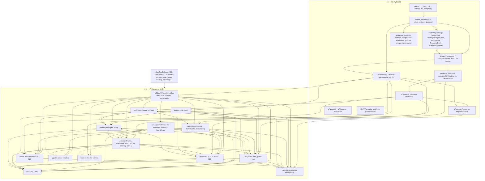

# Victoria II Mod Studio — Arquitectura

Documento de referencia de la arquitectura de **Victoria II Mod Studio**, la
aplicación de escritorio (Windows + Linux) para crear y editar mods de
Victoria II (motor Clausewitz de Paradox, con *A House Divided* y *Heart of
Darkness*) de forma visual.

Estado: **iteración 3 integrada y revisada**. Sus piezas son el índice de
símbolos, la validación con línea base, arreglos y explicador, la localización
editable sincronizada y Ctrl+K (§2.3, §2.6, §2.7 y §8.1.1). Se apoya en la iteración 2,
los cimientos: VFS, proyecto transaccional con diario, deshacer por
instantáneas, descriptor `.mod` y armazón de 7 salas. Las iteraciones 1 y 2
están cerradas (§6.1). Los criterios que necesitaban el corpus del usuario se
cumplen con sus archivos reales. Este documento describe el código que hay hoy
en el repositorio. El diseño de las iteraciones 2 a 10 está en
[`docs/diseno/wizard.md`](docs/diseno/wizard.md) («wizard» en adelante). Lo de
la iteración 2 sigue sobre todo wizard §3–§6, §13, §14.1 y §22; lo de la 3,
wizard §7–§9, §11, §13 y §22. Lo marcado *(planificado)* no existe todavía en
el código, y donde el código se aparta de wizard se dice.

Índice:

1. [Stack tecnológico](#1-stack-tecnológico)
2. [Arquitectura por capas](#2-arquitectura-por-capas)
3. [Herencia Vanilla + Mod (VFS)](#3-herencia-vanilla--mod-vfs)
4. [Motor de parseo](#4-motor-de-parseo)
5. [Árbol de directorios](#5-árbol-de-directorios)
6. [Hoja de ruta y riesgos](#6-hoja-de-ruta-y-riesgos)
7. [Estrategia de pruebas](#7-estrategia-de-pruebas)
8. [Interfaz de escritorio](#8-interfaz-de-escritorio)

---

## 1. Stack tecnológico

### 1.1 Requisitos que condicionan la elección

- **Mapa interactivo**: `map/provinces.bmp` de vanilla mide 5616 × 2160 px a
  24 bits (≈12,1 Mpx, ≈36 MB de píxeles). Hay que leerlo, convertir colores a
  ID de provincia, recolorear por modo de mapa y responder al clic al instante.
- **Windows y Linux** con un único código fuente.
- **Fidelidad absoluta a los archivos**: el juego lee Windows-1252, los mods
  mezclan CRLF/LF, tabs y comentarios; abrir y guardar sin cambios debe dar los
  mismos bytes.
- **Interfaz a medida** con estética victoriana (bronce, pergamino, terciopelo,
  madera, serifas) que siga siendo rápida y usable.
- **i18n en tiempo real** (Español/Inglés) sin reiniciar.
- **Entorno real de desarrollo**: sin red garantizada para instalar
  dependencias; hay que poder ejecutar y probar todo con lo que ya está
  instalado.

### 1.2 Comparativa

| Criterio | Python + PySide6 (Qt 6) | Tauri 2 + Rust + React | Electron + React/TS |
|---|---|---|---|
| Rendimiento del mapa | numpy vectoriza todo el pipeline (ver 1.4); `QGraphicsView` para zoom/paneo; `QOpenGLWidget` con shader si hiciera falta. Medido: decenas de ms por modo de mapa. | Procesado en Rust muy rápido, pero la imagen se dibuja en el WebView: pasar 12 Mpx de Rust a JS por IPC es costoso y WebGL en webkit2gtk es irregular en Linux. | Decodificar BMP en JS/WASM y pintar en Canvas/WebGL es viable, con más memoria y trabajo en *workers*. |
| Tamaño del ejecutable (estimado) | ≈120–200 MB en carpeta (Qt + numpy + intérprete); ≈50–80 MB comprimido. | ≈5–15 MB: usa el WebView del sistema. | ≈150–250 MB en carpeta (Chromium + Node). |
| Empaquetado Windows/Linux | PyInstaller *one-folder* en cada sistema (no compila en cruzado); AppImage opcional. | Bundler propio (MSI/NSIS, deb/rpm/AppImage); en Linux exige webkit2gtk-4.1 en el sistema. | electron-builder (NSIS, AppImage, deb): muy maduro. |
| Curva de aprendizaje | Un solo lenguaje; Qt Widgets es extenso pero estable y bien documentado. | Dos lenguajes (Rust + TS) y un puente IPC entre ellos; Rust (ownership) tiene la curva más alta. | TS/React muy conocidos; acceso a disco vía Node/IPC. |
| Ecosistema útil aquí | `QTableView` con modelo para CSV de 15 000 filas, `QGraphicsView`, `QSettings`, `QPainter` para texturas; numpy y Pillow leen BMP/TGA directamente. | crates `image`, `serde`; librerías de UI de React. | npm enorme; `sharp`/`jimp` para imágenes. |
| Entorno al decidir (iteración 1) | **Instalado**: Python 3.14, PySide6 6.11.2, numpy 2.4.6, Pillow 12.3.0. Se podía ejecutar y probar ya (también *offscreen*). | **No disponible**: no había `rustc`/`cargo` ni webkit2gtk-4.1. | Node.js estaba, pero Electron no, y sin red no se podía hacer `npm install`. |

### 1.3 Decisión: Python + PySide6 + numpy + Pillow

En la primera propuesta se recomendó **Tauri + Rust/React** por el tamaño del
ejecutable y el rendimiento nativo de Rust. Se cambió al comprobar el entorno:
en aquella máquina **no había toolchain de Rust ni webkit2gtk-4.1**, y sin red
garantizada no se podían instalar. En cambio **PySide6 6.11 y numpy ya estaban
instalados**, así que cada pieza (parser, CSV, ventana principal, capturas
*offscreen*) se pudo ejecutar y probar desde el principio contra el corpus real.

Lo que se acepta a cambio:

- Un ejecutable más grande (≈120–200 MB frente a ≈10 MB de Tauri). Para una
  herramienta de escritorio que se descarga una vez es asumible; se reduce
  excluyendo módulos de Qt no usados.
- Arranque algo más lento del intérprete (decenas a cientos de ms), sin impacto
  en el uso.
- El código Python va dentro del ejecutable de forma legible: no es un
  problema para una herramienta de modding.

Versiones: `pyproject.toml` (y `requirements.txt`) exigen Python ≥ 3.10,
PySide6 ≥ 6.5 (< 6.12 en Python 3.10 y 3.11), numpy ≥ 1.24 y Pillow ≥ 10. El
tope se debe a un fallo de PySide6 6.12.0: suelta referencias de más a `None`,
`True` y `False` (una por cada tarea de `QThreadPool`), y antes de Python 3.12,
donde esos objetos aún no son inmortales, el proceso acaba abortando («Fatal
Python error: none_dealloc»). Para quien ya tenga instalada esa combinación,
`vic2studio/compat.py` la detecta leyendo `PySide6.__version_info__`, sin cargar
QtCore: `app.main` avisa con un `QMessageBox` antes de abrir la ventana y sale
con 1 (§8.1), y `tests/_qt.py` lanza `RuntimeError` al importarse (§7.1).
`VIC2STUDIO_ALLOW_BROKEN_PYSIDE=1` (cualquier valor que no sea vacío ni `0`)
desactiva la comprobación, para probar una PySide6 posterior que quizá lo
corrija. Con PySide6 6.5 o 6.6 hace falta además numpy < 2 (lo dicen
`requirements.txt` y el README): sus ruedas de shiboken6 se compilaron con
NumPy 1.x y, con numpy 2, cada importación de PySide6 escribe una traza falsa en
la salida de error. La batería completa pasa con Python 3.13.17 y PySide6
6.12.0, con Python 3.10.20 y PySide6 6.11.3 y con PySide6 6.5.0, el mínimo
declarado (§7.1). Las cifras de §7 se midieron con
Python 3.13.17, PySide6 6.12.0, numpy 2.5.3 y Pillow 12.3.0. El código evita lo
que no existe en los mínimos: por ejemplo, `ui/tasks.wait_for_tasks` pasa el
plazo como entero a `QThreadPool.waitForDone`, porque la sobrecarga con
`QDeadlineTimer` no existe antes de Qt 6.8.

### 1.4 Por qué el rendimiento del mapa no es un problema en Python

El trabajo pesado nunca se hace píxel a píxel en Python: cada paso es una
operación vectorizada de numpy sobre el array completo.

1. **Lectura**: `provinces.bmp` (24 bits) da un array `(H, W, 3) uint8`. Las
   medidas de abajo usan Pillow y `np.asarray`; el diseño usa un códec BMP
   propio con numpy para garantizar la ida y vuelta byte a byte (wizard D11).
   La fila del array es la `y` del motor: el mapa sale con el norte abajo y solo
   la vista se voltea (wizard H1).
2. **Empaquetado**: `rgb = (r << 16) | (g << 8) | b` en `uint32`.
3. **Color → ID**: se lee `map/definition.csv` (una fila por provincia con su
   ID y su color en rojo, verde y azul, separados por `;`, cp1252) y se obtiene
   un **ráster `uint16` de ID de
   provincia** (24 MB), con `np.searchsorted` sobre los colores ordenados o con
   una tabla directa de 2²⁴ entradas `uint16` (32 MB). Los colores que no están
   en `definition.csv` reciben el ID 0 y generan un diagnóstico (`np.unique` del
   array empaquetado lista los colores presentes).
4. **Modo de mapa**: cada modo es una **LUT `(N+1, 3) uint8`** (fila 0 = sin
   provincia) calculada a partir del modelo (dueño → color del país, RGO →
   color del bien, `life_rating` → degradado, etc.). La imagen es `lut[raster]`.
   Para pintar, la LUT se empaqueta además como `uint32` ARGB y
   `np.take(lut32, raster)` produce directamente un buffer que `QImage`
   (`Format_RGB32`) usa sin copiar.
5. **Fronteras**: comparación del ráster con sus versiones desplazadas una fila
   y una columna (`raster[:, 1:] != raster[:, :-1]`, ídem vertical) → máscara
   booleana que se dibuja como capa superpuesta.
6. **Picking del clic**: `raster[y, x]` tras convertir la posición de la vista
   a coordenadas de imagen: O(1).
7. **Visualización**: `QGraphicsView` + `QGraphicsPixmapItem` con zoom (rueda,
   `setTransform`) y paneo (arrastre); transformación rápida (sin suavizado) a
   zoom alto para ver píxeles nítidos. Si cambiar de modo tuviera que ser
   instantáneo, se pasa a un `QOpenGLWidget` con un *fragment shader*: el ráster
   se sube una vez como textura entera (`R16UI`) y la LUT como textura de
   (N+1) × 1; cambiar de modo es subir unos 13 KB en lugar de 48 MB.

Mediciones de la iteración 1 con un script sintético del mismo tamaño que
vanilla (5616 × 2160, 3248 provincias; Ryzen 9 7950X3D, numpy 2.4.6, mejor de
hasta 5 ejecuciones), cuando el corpus aún no tenía la carpeta `map/`:

| Paso | Operación | Tiempo |
|---|---|---|
| Lectura | Pillow → `np.asarray` | 26 ms |
| Empaquetado | `(r<<16)\|(g<<8)\|b` | 30 ms |
| Color → ID (una vez al cargar) | `np.searchsorted` → `uint16` | 164 ms |
| Colores presentes | `np.unique` | 85 ms |
| Modo de mapa, LUT `(N+1,3) uint8` | `lut[raster]` | 104 ms |
| Modo de mapa, LUT `uint32` ARGB | `np.take(lut32, raster)` + `QImage` sin copia | 34 ms |
| Fronteras | comparación de rásteres desplazados | 13 ms |
| Picking | `raster[y, x]` | < 1 µs |

Con el `provinces.bmp` real, wizard §16.5 midió 0,9 s para leer el BMP y
traducir colores con la tabla directa de 2²⁴ entradas, frente a 1,5 s con
`np.searchsorted`; el diseño elige la tabla directa y fija los criterios del
editor de mapa (primera carga ≤ 4 s, cambio de modo ≤ 150 ms).

Editar el dueño de una provincia solo cambia una fila de la LUT; el repintado
puede limitarse a la caja envolvente de esa provincia (precalculada al cargar).

Otros archivos del mapa:

- **`map/default.map`** (sintaxis Clausewitz, se lee con el mismo parser; por
  eso `.map` está en `CLAUSEWITZ_SUFFIXES`): `max_provinces` (los ID válidos van
  de 1 a `max_provinces - 1`; fija el tamaño de las LUT), `sea_starts = { ... }`
  (lista de ID de provincias de mar), y los nombres del resto de archivos:
  `definitions`, `provinces`, `positions`, `terrain`, `rivers`,
  `terrain_definition`, `tree_definition`, `continent`, `adjacencies`, `region`,
  `region_sea`, etc. Nunca se asumen los nombres: se leen de aquí.
- **`map/terrain.bmp`**: imagen **indexada de 8 bits** (paleta). Pillow la abre
  en modo `P` y `np.asarray` devuelve directamente los índices; `terrain.txt`
  traduce índices de paleta a tipos de terreno. El modo Terreno usa el índice
  mayoritario de cada provincia (`np.bincount` sobre `id * 256 + índice`), y
  respeta las anulaciones `terrain = ...` de `history/provinces`.
- `rivers.bmp` también es indexado de 8 bits (capa opcional).

---

## 2. Arquitectura por capas



Dentro de core el diagrama tiene todas las dependencias entre subpaquetes, las
mismas que enumeran las reglas que siguen; las flechas de trazos dentro de core
son importaciones dentro de funciones (las de `modfile` evitan un ciclo al
importar: `project`, `vfs` y `modcheck` importan `modfile`). En la interfaz
muestra solo las principales: por ejemplo, las salas
importan también `encoding`, `modcheck` y `modfile`, la ventana, `core/vfs` y
`core/project`, y los diálogos, `core/project` y `modfile`.

Reglas de dependencia:

- **core** no importa PySide6 nunca. Se puede usar desde la línea de comandos,
  desde pruebas sin pantalla y desde otros programas. Lo comprueba
  `tests/test_arch_writes.py` (`test_core_imports_without_pyside6`): un
  subproceso importa todos los módulos de `vic2studio.core` (al menos 35) y falla
  si quedó cargado PySide6 o shiboken6. Sus diagnósticos y casi
  todos sus errores traen sus propias tablas de mensajes `es`/`en`
  (`Diagnostic.message(lang)`, `EditError.message(lang)`,
  `CsvDiagnostic.message(lang)`, `InvalidFieldError.message(lang)`,
  `Issue.message(lang)`, `FileChangedError.message(lang)`,
  `DescriptorFieldError.message(lang)`, `WriteOutsideModError.message(lang)`,
  `InvalidPathError.message(lang)` y `SaveProblem.message(lang)`), así que no
  dependen del traductor de Qt: la UI les pasa el idioma activo
  (`ui/viewers/common.core_language`). Los textos nuevos del núcleo ya no van en
  tablas `MESSAGES` sino en JSON: `core/**/texts/*.<idioma>.json`, que lee
  `core/texts.py` sin Qt (`load_texts(lang)`, que lanza `ValueError` ante una
  clave repetida o un archivo mal formado, y `text(key, lang, **fmt)`, que cae al
  inglés y, si tampoco está, a la propia clave). Hoy hay tres pares de archivos:
  - `core/project/texts/project.{es,en}.json`, 22 claves: los códigos de
    `SaveProblem`, las notas del diálogo de recuperación y las etiquetas
    `undo.*` de los pasos que crea el núcleo;
  - `core/validate/texts/issues.{es,en}.json`, 303 claves: el mensaje de cada
    código de validación (`issue.<código>`, 90), los títulos, pasos y frases
    del explicador (`explain.*`, 192), los arreglos (`fix.*`) con sus errores
    (`fix_error.*`) y las etiquetas `undo.fix_*` de sus transacciones;
  - `core/map/texts/map.{es,en}.json`, 3 claves: los problemas de
    `definition.csv` (`issue.definition_*`, de la tarea G4).

  Las tablas `MESSAGES` de los módulos de la
  iteración 1 siguen como estaban. Solo tienen texto en español
  `encoding.UnencodableTextError`, los `ValueError` de `csvloc.from_json`, el
  `LookupError` de `normalize_encoding` y, del proyecto, `WrongThreadError`;
  `ReadOnlyDocumentError` solo lleva la ruta y el código del motivo. Quien los
  muestra usa sus campos (`encoding` y `problems` en el primero, como hace la
  CLI de localización; `rel` y `reason` en `ReadOnlyDocumentError`).
  `DescriptorProblemsError` y `DescriptorWriteError`
  llevan en `str()` el primer problema en español, y cada uno de sus problemas
  tiene `message(lang)`.
- Dentro de **core**: `encoding`, `cancel`, `appdirs` y `texts` no dependen de
  ningún otro módulo de `vic2studio` (`encoding` nombra `fileio.FileStamp` solo en las
  anotaciones de tipos); `fileio` usa `encoding`; `clausewitz` y `csvloc` usan
  `encoding`, `fileio` y `cancel`; `modfile` usa `encoding`, `fileio` y
  `clausewitz` y, dentro de las funciones que escriben o revisan
  (`create_mod_skeleton`, `write_descriptor`, `descriptor_problems`), `appdirs`,
  `modcheck`, `project.journal`, `project.model` y `vfs`; `modcheck` usa
  `cancel`, `clausewitz`, `csvloc` y `modfile` (los diagnósticos de
  codificación le llegan de `parse_file` y de `read_csv_file`); `vfs` usa
  `cancel`, `fileio` (solo `BACKUP_SUFFIX`), `modcheck` (`GAME_EXECUTABLES`) y
  `modfile`; y `project` usa `vfs`, `clausewitz`, `csvloc`, `encoding`, `fileio`,
  `modfile`, `appdirs`, `cancel` y, para `SaveProblem.message`, `texts`. Los de
  la iteración 3 quedan encima:
  - `lua_defines` usa solo `encoding`;
  - `rules` usa `clausewitz`, `lua_defines`, `project` (los códecs, para leer
    los bytes efectivos) y `vfs`;
  - `index` usa `appdirs`, `cancel`, `clausewitz`, `csvloc`, `encoding`,
    `fileio` (solo su caché, fuera del mod), `project` y `vfs`;
  - `locsync` usa `cancel`, `csvloc`, `encoding`, `index`, `project` y `vfs`;
  - `validate` usa todo lo anterior salvo `locsync`, además de `modcheck`,
    `modfile` y `texts`.

  Ninguno importa `locsync` ni `validate` desde abajo: el índice no sabe nada
  de las reglas y las reglas no editan. Todos los recorridos largos aceptan
  `cancelled=` de `cancel` (§2.5). El contrato de cada subpaquete es lo que
  exporta su `__init__.py`.
- **Quién escribe en disco** (wizard §4; `tests/test_arch_writes.py`, con un
  recorrido AST de `src/`):
  - las primitivas de escritura cruda (`open` para escribir, `Path.write_*`,
    `unlink`, `rename`, `replace`, `mkdir` y `touch`, `os.replace`, `remove`,
    `rename`, `mkdir`… y `os.open` con banderas de escritura, `shutil.copy*`,
    `move` y `rmtree` y `tempfile.*`) solo aparecen en `core/fileio.py`;
  - la API de escritura de `fileio` (`atomic_write_bytes`, `write_text`,
    `stage_bytes`, `commit_staged`, `discard_staged`, `copy_file`, `move_file`,
    `remove_file`, `make_dirs`, `remove_empty_dirs` y `create_exclusive`; no
    cuenta `fsync_dir`, que no modifica nada) y sus envoltorios
    `serializer.write_file` y `csvloc.write_csv_file` solo se llaman desde
    `core/project/journal.py`, el único que escribe dentro del mod, desde
    `core/project/lock.py`, que escribe el bloqueo fuera del mod
    (`appdirs.locks_dir()`), desde las dos cachés de la iteración 3, también
    fuera del mod (`core/index/cache.py`, en `appdirs.cache_dir()/index`, y
    `core/validate/baseline.py`, en `…/baseline`; la del índice se niega a
    escribir si esa carpeta cayera dentro de una capa), y desde los propios
    envoltorios;
  - en `journal.py`, cada llamada a `fileio` está en una función `_guarded_*`
    que pasa la ruta por `WriteGuard.check` (§3.5), y la prueba lo verifica;
  - las excepciones están declaradas y justificadas en la propia prueba:
    `ui/theme.py` (glifos PNG en una carpeta de `tempfile.mkdtemp`) y
    `core/csvloc/cli.py` (`tojson -o` y `fromjson` escriben donde dice el
    usuario). No hay excepciones temporales, y una excepción que ya no hace falta
    también hace fallar la prueba. Quedan fuera del recorrido, a propósito,
    `tools/`, lo que escribe Qt (`QSettings` y el `QImage.save` de los glifos) y
    la salida estándar de las CLI.

  Así, todo lo que se escribe en el mod o en su `.mod` pasa por el diario
  (`journal.SaveTransaction`, §2.1) y por el `WriteGuard`: el guardado del
  `Workspace`, la papelera, `originals/`, el autoguardado de `recovery/`, la
  recuperación de un guardado cortado, «Nuevo mod»
  (`modfile.create_mod_skeleton`) y `modfile.write_descriptor`, que lleva su
  diario a la carpeta de datos de la aplicación.
- **ui** no escribe nada por su cuenta en el juego ni en el mod: sus escrituras
  propias son las preferencias (`QSettings`, §8.5) y los PNG de los glifos del
  tema, en una carpeta temporal
  (`tempfile.mkdtemp(prefix="vic2studio-theme-")`). En el mod escribe solo a
  través de `Session`: `save`, el autoguardado (`write_recovery`),
  `close_project` (la recuperación final o, con «Descartar», su borrado),
  `restore_session` y `discard_recovery` llegan a `Project` y a su `Workspace`, y
  de ahí al diario. La única escritura que no pasa por `Project` es «Nuevo mod»:
  `Session.create_mod` llama a `core.modfile.create_mod_skeleton`, que crea el mod
  con su propio diario y su propio `WriteGuard`. Las secciones que editan
  (Descriptor .mod y Cambios pendientes) usan el `Workspace` de
  `session.project` (`open`, `touch`, `replace_text`, `revert`), siempre dentro
  de `Session.edit`: eso solo cambia la memoria, y el disco se toca al guardar.
  Las secciones de la iteración 3 también pasan por `Session`, y por eso ven la
  vista efectiva con lo que no se ha guardado (I7):
  - Textos › Todos los textos edita y lee con `LocSync`, que lee en segundo
    plano los CSV del disco que no están abiertos;
  - Proyecto › Validación y el panel Problemas validan con `Session.validate`
    sobre una instantánea con los documentos sin guardar;
  - un arreglo es una transacción de `Session.apply_fix`;
  - Ctrl+K consulta el índice con `Session.search`.

  Para **leer**, en cambio, varias piezas siguen yendo al disco sin pasar por el
  `Workspace`: «Archivos» y «Archivos CSV» (la `ProjectPage` y la
  `LocalisationPage` de la iteración 1) leen con rutas absolutas a través de core
  (`parse_file`, `read_csv_file`, `find_descriptor`, `check_mod`) y, directamente,
  las imágenes con Pillow (`image_viewer.load_image`) y los primeros 2 MiB de un
  archivo sin visor propio para su ficha (`project_page.gather_facts`, que los
  decodifica con `decode_bytes`, con `partial=True` si el archivo es más largo);
  Inicio lee los `.mod` de `<juego>/mod` con `read_descriptor`; Descriptor .mod
  recorre la carpeta del juego para proponer `replace_path` y contar sus
  archivos; y el diálogo «Nuevo mod» y las insignias de capa (`LayerResolver`)
  miran el disco. wizard §4 dice que ningún widget abre archivos; hoy eso se
  cumple para las escrituras, no para las lecturas (§6.3).
- Ningún trabajo largo corre en el hilo de la interfaz: los visores y la
  validación usan `ui/tasks.py` (§2.5), el análisis del archivo anterior se
  suelta por trozos en un hilo propio, y `Session` abre los proyectos
  (`Project.open`: descriptor, VFS, escaneo, bloqueo y recuperación) y crea los
  mods nuevos en segundo plano. El `Workspace` es de un solo hilo (I12):
  `Project.open` lo construye en el hilo de la tarea, `Session` lo cede al hilo
  de la interfaz con `bind_to_current_thread` y, desde entonces, usarlo desde
  otro hilo lanza `WrongThreadError`. Excepciones conocidas (§6.3):
  `gather_facts`, la maquetación y destrucción del documento de la pestaña
  Código con un archivo enorme y el guardado, que renderiza en el hilo de la
  interfaz.
- **i18n** pertenece a la capa de UI: `Translator(QObject)` emite
  `languageChanged(str)` y cada página, sección, panel y diálogo implementa
  `retranslate()`. `load_catalog(code)` reúne `i18n/<code>.json`, los fragmentos
  `i18n/<code>/*.json` (hoy `project.json`, `shell.json`, `validation.json`,
  `localisation.json` y `palette.json`) y los textos del
  núcleo (`core.texts`), y lanza `ValueError` si una clave se repite entre dos
  archivos cualesquiera (§8.4).
- No hay capa `services/`: el estado de la aplicación vive en `core/project/`
  y el único puente con Qt es `ui/session.py` (wizard D2 y §4): solo `Session`
  convierte los eventos del `Workspace` en señales de Qt.

### 2.1 Flujo de datos

Hay dos caminos. El del **proyecto** (`Session` → `Project` → `Workspace`) es
el que edita y guarda; el de los **visores** de «Archivos» y «Archivos CSV» es
el de la iteración 1, de solo lectura y sobre el disco.

```text
 <juego>/ (capa GAME)       dependencias (capa DEPENDENCY)       <juego>/mod/<Carpeta>/ (capa MOD)
 sin <juego>/mod/           mods que nombra «dependencies»       + <Carpeta>.mod  =  "@descriptor.mod"
          \                              |                                  /
           +---- VirtualFS.scan: os.scandir de cada capa, sin leer contenidos (I4) -----------+
                                         |
          resolve(rel): ganador (mod > dependencias > juego; replace_path oculta los del juego)
          stack(rel) · list(carpeta, patrón) · mod_target(rel) · Fingerprint(size, mtime_ns, sha256)
                                         |
          Workspace.open(rel): bytes del ganador → códec.load → DocHandle (uno por rel.key)
          ClausewitzCodec (ParseResult) · LocalisationCodec (LocalisationFile) · JsonCodec · BinaryCodec
          origin = capa leída, base = huella; read_only_reason: locked, binary, parse_errors, unreadable_encoding
                                         |
          Session.edit(etiqueta) → Project.edit → Workspace.transaction
          touch(handle) antes de mutar: instantánea zlib (una por documento y transacción), versión nueva
          al cerrar: UndoStep(etiqueta, formato, before/after) → UndoStack (§2.4)
          eventos DocChanged / DocReplaced / DirtyChanged… → Session → documentsChanged, dirtyChanged, undoChanged
                                         |
          Guardar: Workspace.save → por documento sucio, códec.render
          (render_checked: relectura y comparación del árbol; render_csv_checked; encode_text)
          UnencodableTextError (línea y columna) o SourceMismatchError → SaveProblem: no se toca el disco (I9)
          acción: MODIFY (archivo del mod; expected = base) · COPY_FROM_GAME (mod_target, misma ruta y
          mayúsculas; el destino no debe existir) · CREATE · TRASH (lápida); igual que el disco: no se escribe
                                         |
          journal.SaveTransaction.prepare(): WriteGuard, nombres de Windows, longitud de ruta, mayúsculas,
          huella esperada de cada destino (conflicto externo) y espacio libre; bloqueantes primero
                                         |
          commit(): staging → temporales .<nombre>.<txid>.tmp + fsync → prepared → <destino>.bak y,
          la primera vez, originals/<rel> → backed_up → committing → os.replace en orden (hasta 3 reintentos
          ante PermissionError) y TRASH a trash/<txid>/<rel> → committed → se borra el diario
          un fallo antes de committed: se revierte en el propio proceso (o queda el diario para recover)
                                         |
          al terminar: VirtualFS.refresh, saved_version = version, base = huella nueva;
          sin nada sucio, se borra el autoguardado de la sesión
                                         |
          si el proceso murió a medias: Project.open → recover_all(journal/) → recover():
          cleaned (staging o prepared) · rolled_forward · rolled_back; idempotente → RecoveryDialog
          · nothing (+ nota) si no se puede llevar entero a un lado, si nombra rutas de otro mod o si es
          ilegible: no se toca nada y el diario se queda; mientras quede uno, Workspace.save no guarda
          (save_journal_pending), porque otro guardado encima cambiaría las .bak que ese diario usa

 autoguardado: Workspace.write_recovery → journal.write_recovery → <mod>/.vic2studio/recovery/<sesión>/
 (NNNN.dat + index.json, a través del WriteGuard); cada 60 s, cada 20 transacciones y al cerrar sin «Descartar»
```

La carpeta de proyecto (`.vic2studio/`, §3.6) solo aparece cuando hay algo que
guardar en ella: abrir el proyecto y guardar sin cambios no la crea (criterio 4
de wizard §22, `test_noop_save`), y el diario la borra al cerrar cada guardado si
queda vacía (con `originals/` dentro, ya no lo está). El autoguardado sí la crea
antes del primer guardado si hay cambios sin guardar.

Los visores siguen el camino de la iteración 1, sin `Workspace`: muestran el
disco, no los cambios sin guardar (§6.3).

```text
 ruta absoluta (explorador de «Archivos», «Validar mod», «Archivos CSV»)
          +----------+-----------+
          v                      v
   clausewitz.parse_file    csvloc.read_csv_file
   read_bytes               fileio.read_text: read_bytes ──> encoding.decode_bytes
   ──> decode_bytes         ──> DecodedText: texto, codificación y huella (FileStamp.of)
   ──> match_bom,           ──> parse_csv: split_bom, split_extra_boms
       split_bom,                |
       split_extra_boms          |
   huella: FileStamp.of          |
          |                      |
          v                      v
   ParseResult: CST sin     LocalisationFile: filas
   pérdidas, diagnósticos   crudas, diagnósticos de
   (con el de la            lint, stamp
   codificación), stamp
          |                      |
          v                      v
   visores en una tarea de fondo (TaskRunner): estructura, código, diagnósticos, JSON, tabla CSV
```

`write_file(verify=True)` y `write_csv_file` (§4.1, §4.3) siguen existiendo
para la API y las CLI, pero la aplicación ya no los usa para guardar: el
`Workspace` usa `render_checked` y `render_csv_checked`, que se extrajeron de
ellos y dan los mismos bytes (`test_project_codecs`), y escribe con el diario.

### 2.2 Modelo de dominio *(planificado)*

Lo diseña wizard. El principio (wizard §0, punto 2) es que el CST sin pérdidas
es la única fuente de verdad: formularios, mapa, árbol de condiciones y lienzo
de interfaz son vistas sobre `Block`/`Entry` y `LocRow`, y la interfaz guarda
referencias (`RecordRef`), nunca nodos. Las entidades se declaran con el motor
de esquemas (`core/schema` + `core/schemas`, wizard §10): `Record` es una vista
sobre el `Block` real que lee y escribe con la API de §4.1 (wizard §10.5), y la
historia fechada (`1861.1.1 = { … }`) la resuelve `HistoryView` para una fecha
de trabajo (wizard §10.6).

Lo que ya existe es la capa de debajo: cada documento abierto es un `DocHandle`
del `Workspace` cuyo `model` es el objeto vivo de su códec (`ParseResult`,
`LocalisationFile` o `bytes`, §2.4), y la única sección que edita un CST, la del
descriptor, lo hace directamente sobre él (`modfile.apply_descriptor`). Los
atributos `rules`, `index`, `loc`, `entities` y `validator` de `Project` existen
y siguen valiendo `None`. En la iteración 3 el índice, la `LocSync` y el motor de
validación los tiene `Session` (§2.6 y §2.7), que los construye en segundo plano
y los mantiene al día con los eventos del `Workspace`; el `Project` sigue siendo
Python puro sin saber de ellos. Se aparta de wizard §6.4, que los colgaba del
`Project`, para no meter en el núcleo el ciclo de vida de las tareas de fondo.

### 2.3 Índice de símbolos (`core/index`)

Sigue wizard §7. Dice qué existe en la vista efectiva (juego, dependencias, mod
y cambios sin guardar) y dónde se usa. Python puro, sin Qt.

- **Hechos por archivo** (`model.py`). Un extractor recibe los bytes de un
  archivo, nunca el CST vivo del `Workspace` (I12), y devuelve sus
  definiciones (`Symbol`: tipo, nombre, ruta, línea, `attrs`) y sus referencias
  (`SymbolRef`: tipo, nombre, ruta, línea, columna y rol, como `owner`,
  `add_core` o `sea_starts`). Juntos son un `FileFacts`, con la capa, la raíz
  de la dependencia, la huella y el nombre y la versión del extractor.
- **Extractores** (`extractors/`, 9 familias: países, cultura, economía,
  interfaz, localización, mapa, política, guion y guerra). Se registran con
  `@extractor("patrón", version=N)` y se descubren con `pkgutil`, sin listas
  centrales (wizard §20). `parsing.document` analiza cada archivo una sola vez
  aunque lo procesen varios extractores (`parse_count` lo cuenta en las
  pruebas).
- **Construcción** (`builder.build_index`). Recorre la instantánea de la VFS y
  reutiliza los hechos de la caché cuando coinciden la huella `(tamaño,
  mtime_ns)` y la versión del extractor; si no, lee el archivo y lo extrae.
  `overrides` son los documentos sin guardar (bytes del `snapshot` de su
  códec, o `None` si están borrados): sustituyen al archivo del mod sin tocar
  la caché. Lanza `Cancelled`.
- **Caché** (`cache.FactsCache`). JSON-lines comprimido con gzip, nunca
  `pickle`. Hay un archivo por capa en
  `<cache_dir>/index/<game|mod|dependency>-<sha1(ruta real)>/facts.v<N>.jsonl.gz`:
  la del juego se comparte entre mods. Una caché ilegible o de otro formato se
  ignora y se reconstruye. No escribe dentro de ninguna capa de la vista, ni
  aunque una variable de entorno apunte ahí.
- **Combinación** (`index.SymbolIndex`). Aplica las reglas de carga (§3.3): de
  cada ruta cuenta la capa ganadora, y `replace_path` oculta los archivos del
  juego. En la localización gana la primera clave por orden de archivo, como
  `LocalisationDB`. Entre dependencias gana la última declarada, como en la
  VFS. Los hechos de las capas que pierden se conservan para el explicador
  (`lookup` los da detrás del efectivo). Las provincias que `default.map` nombra
  en `sea_starts` pasan a `sea_province`.
- **Actualización incremental.** `apply(facts, removed)` sustituye los hechos
  de unas rutas o capas e invalida solo las cachés de los tipos que tocan. La
  llama un solo hilo, el de la interfaz.
- **Consultas.** Ninguna lee disco: `names`, `count`, `get`, `lookup`,
  `effective`, `exists`, `attrs`, `symbols`, `defs_in`, `refs_to`,
  `refs_from`, `refs`, `rels` y `facts_of`. `search(texto, loc=…, lang=…)` busca
  por id y por el nombre localizado sin mayúsculas ni acentos (`fold`), y
  `display` da «Prusia (PRU)». `short_name` es el id que ve el usuario: el de un
  partido es el partido, sin el archivo de país que lo hace único en el índice
  (`archivo:partido`, H12).

Rendimiento con vanilla (criterio 2 de wizard §22, `test_index_corpus`):

| Construcción | Tiempo |
|---|---|
| En frío | unos 2,3 s |
| Desde la caché | unos 0,3 s |

Cambiar un archivo vuelve a analizar solo ese archivo. Subir la versión de un
extractor invalida solo su caché.

En la interfaz, `Session` construye el índice en segundo plano (`POOL_INDEX`) al
abrir. Con cada cambio de un documento, a los 300 ms (`REINDEX_DELAY_MS`),
reextrae sus hechos en una tarea y los aplica en el hilo de la interfaz
(`symbolsChanged`). La congelación del resultado (`gc.freeze`) la hace
`ui/tasks.py` al terminar la tarea, como con cualquier resultado grande (§2.5).
El índice no la llama.

### 2.4 Documentos, transacciones y deshacer (`core/project`)

Sigue wizard §6.1–6.3 y D3. Nada se escribe en el mod al editar: los cambios
viven en memoria hasta guardar (§2.1), salvo el autoguardado de recuperación.

**Documentos.** `Workspace.open(rel, *, kind=None, create=False)` da el
documento efectivo de `rel` (el ganador de la VFS o lo que ya hay en memoria),
una sola instancia por `rel.key`: un `DocHandle` con `rel`, `kind`, `model`,
`origin` (la `FileEntry` leída; `None` si es nuevo), `base` (la `Fingerprint`
al leer o guardar), `version` y `saved_version` («sucio» es
`version != saved_version`), `diagnostics`, `read_only_reason` y `deleted` (una
lápida que el guardado manda a la papelera); `copies_from_game` dice si al
guardarlo se copiará al mod. Los códecs (`core/project/codecs.py`) pasan de
bytes al modelo y al revés sin pérdidas: `ClausewitzCodec` (`parse_bytes`, que
hace lo mismo que `parse_file` sobre bytes ya leídos; `render` es
`render_checked` y `snapshot`, `render_checked(verify=False)`),
`LocalisationCodec` (`parse_csv` y `render_csv_checked`), `JsonCodec` (para
`.vic2studio/project.json`; `render` comprueba que sea JSON válido) y
`BinaryCodec` (`writable=False`). TABLE, LUA, BMP e IMAGE se abren como binario
de solo lectura hasta que su iteración registre su códec (`register_codec`).
`kind_for(rel)` toma el tipo de la regla de carga (§3.3); los archivos nuevos
van en cp1252 con CRLF. `read_only_reason` vale `"locked"` (otra instancia tiene
el proyecto), `"binary"` (sin códec de escritura), `"parse_errors"` (errores de
sintaxis: solo se admite sustituir el texto entero, D17) o
`"unreadable_encoding"` (un script en UTF-16; también solo texto).
`DocumentStore` expulsa (LRU, `lru_bytes` = 300 MiB de bytes leídos) los
documentos limpios que no nombran la pila de deshacer ni la transacción abierta.

**Transacciones.** Toda mutación va dentro de
`Workspace.transaction(label, *, merge_key=None, **fmt)` (`Project.edit`,
`Session.edit`); fuera de una, mutar lanza `RuntimeError`. Antes de tocar un
modelo se llama a `touch(handle)`: la primera vez en la transacción guarda la
instantánea (`codec.snapshot` comprimido con zlib, nivel 1) y da al documento una
versión nueva. `replace_model` y `replace_text` (texto libre; recalculan
`read_only_reason`), `create`, `delete` (un archivo del juego no se puede borrar)
y `revert` (vuelve al disco con la etiqueta `undo.revert_file`) se registran
igual. Al cerrar la transacción exterior se calcula el `after` de cada documento:
si sus bytes no cambiaron, recupera su versión y no se apila nada (tocar sin
cambiar no ensucia); si un documento no se puede codificar, la transacción se
revierte y lanza `UnencodableTextError` al editar, no al guardar (I9). Las
transacciones anidadas se funden en la exterior, y si una lanza, sus documentos
vuelven a la instantánea y no se apila nada.

**Deshacer** (`core/project/undo.py`). Una sola pila global
(`UndoStack(limit=500, max_bytes=256 MiB)` de instantáneas comprimidas): un paso
(`UndoStep(label, fmt, snapshots, patches, merge_key)`) puede tocar varios
archivos y se deshace de una vez. Deshacer y rehacer sustituyen el modelo por
`codec.load(before)` o `codec.load(after)`: es exacto gracias a la ida y vuelta
byte a byte, y no hay que programar la inversa de cada mutación. También
restauran la versión, así que deshacer hasta el punto guardado deja el documento
limpio, y se puede deshacer después de guardar. Dos pasos con el mismo
`merge_key` en menos de `MERGE_SECONDS` (1 s) se funden (el formulario del
descriptor usa `descriptor.<campo>`); un paso nuevo vacía rehacer, y pasados los
límites se descartan los más viejos. Las instantáneas se quedan en memoria:
`SNAPSHOT_TO_DISK` (8 MiB) y `Snapshot.before_path` existen, pero no se usan
todavía, porque escribirlas en el mod al editar rompería I4 (docstring de
`undo.py`; wizard §6.3 las manda a disco). `RasterPatch` está declarado para el
mapa (iteración 5). El historial no se guarda en disco.

**Etiquetas e historial.** La etiqueta de un paso es una clave del catálogo con
su formato. Las de los pasos que crea el propio núcleo (`undo.revert_file`,
`undo.project_settings`, `undo.restore_session`) están en los textos del núcleo
(`core/project/texts`); las demás, en el catálogo de quien abre la transacción
(`descriptor.undo_edit`, `pending.undo_revert`). `test_texts` recorre
`core/project` con `ast` y exige texto, con los mismos huecos, para cada
`transaction(LABEL_...)`. `Workspace.history()` y `redo_history()` dan
`(clave, formato)` de cada paso, el más reciente primero; los usan el panel
«Historial» y la ayuda del botón Deshacer (§8.1).

**Eventos.** `Workspace.subscribe(fn)` entrega `DocChanged(rel, version)`,
`DocReplaced(rel)` (el modelo se sustituyó entero: deshacer, rehacer, recarga,
texto libre), `DocCreated`, `DocDeleted`, `DirtyChanged(count)`, `Saved(rels)` y
`UndoApplied(label, fmt, redo, rels)`. `Session` los acumula mientras dura cada
operación (`edit`, `save`, `undo`…) y emite una vez al terminar
`documentsChanged(set[VPath])`, `dirtyChanged(int)` y `undoChanged()`; los que
llegan fuera de una operación salen en la siguiente vuelta del bucle de eventos.
Hoy las vistas vuelven a pedir su `DocHandle` al recibir `documentsChanged`; el
contrato con `RecordRef` de wizard §6.3 llega con los esquemas (iteración 4).

**Cambios externos.** `check_external_changes()` (la ventana lo llama al volver
a estar activa) compara la huella de cada documento abierto con el disco: los
limpios que cambiaron se recargan solos (`DocReplaced`) y los sucios quedan como
conflicto. `accept_external` («Conservar mis cambios») adopta la huella actual
como base, así que el siguiente guardado sobrescribe el cambio externo, con su
`.bak`; `reload` («Recargar del disco») descarta la memoria y no se deshace; y
`external_diff` («Comparar») da el diff entre el disco y la memoria.

La API del CST sigue teniendo inversas exactas para parte de las ediciones:
`remove_entry` devuelve el índice que necesita `insert_entry`, y devolver a una
entrada su valor, su clave o su operador leídos da el texto original exacto
(§4.1, §7.3). El deshacer de la aplicación no las usa: wizard D3 descarta los
comandos con mementos, que dependen de partes privadas del CST y de la trivia
de los vecinos.

### 2.5 Tareas en segundo plano y cancelación

**Contrato del núcleo** (`core/cancel.py`): `CancelCheck` es
`Optional[Callable[[], bool]]`; las funciones largas reciben `cancelled=`, lo
consultan cada cierto trabajo y lanzan `Cancelled` (con
`raise_if_cancelled(cancelled)`). Lo aceptan `tokenize`, `parse` y `parse_file`;
`parse_csv`, `read_csv_file`, `lint_file`, `LocalisationFile.lint` y
`LocalisationDB.from_dirs`; `collect_files`, `check_file` y `check_mod`; y, desde
la iteración 2, `VirtualFS.scan` y `Project.open`. La
regla de wizard §4 pide a toda función larga `cancelled=` y también
`progress=`; hoy informan de progreso las que recorren carpetas:
`collect_files`, `check_mod` y `VirtualFS.scan` (`progress(hechos, total)`, por
entradas de primer nivel de las capas; `Project.open` se lo pasa). En las demás
`progress=` está pendiente, y `Session` abre los proyectos con `progress=None`.
Las funciones nuevas que puedan tardar deben aceptar los dos.

**Ejecución en la UI** (`ui/tasks.py`):

- `TaskRunner(parent=None, *, pool=POOL_PREVIEW)` mantiene una sola tarea vigente:
  `start(fn)` cancela la anterior y devuelve un número de generación; lo que
  llegue tarde de una generación vieja se descarta. `cancel()` solo avisa: la
  tarea para cuando consulta `TaskContext.cancelled`, y una tarea cancelada que
  aún esperaba en la cola no llega a empezar. Las señales `finished(result)`,
  `failed(TaskFailure)` y `progress(valor)` llegan en el hilo de la interfaz;
  `discarded(result)` entrega el resultado de una tarea ya superada que terminó
  de todos modos, para que quien sepa desmontarlo lo suelte fuera de ese hilo
  (el visor de scripts lo hace; si nadie la escucha, se suelta allí mismo).
  `Session` usa un `TaskRunner` por apertura de proyecto (una apertura nueva o un
  cierre cancelan la anterior con un `threading.Event`, y un proyecto que llega
  tarde se cierra para soltar su bloqueo) y otro para «Nuevo mod», los dos en
  `POOL_PREVIEW`.
- La función de la tarea recibe un `TaskContext`: `cancelled()` se pasa tal cual
  como `cancelled=` al núcleo, y `report(valor, *, force=False)` notifica
  progreso como mucho cada `PROGRESS_INTERVAL` (0,04 s). Nunca toca widgets.
- Los resultados viajan por un único despachador que vive toda la aplicación y
  entrega con una referencia débil al runner: un widget destruido a mitad de
  tarea no deja señales huérfanas. `TaskFailure` guarda la excepción sin traza
  y la traza ya formateada.
- Grupos de hilos por área (`thread_pool(nombre)`): `POOL_PREVIEW` (`"preview"`,
  2 hilos: visor de scripts, JSON y localización), `POOL_IMAGES` (`"images"`, 1),
  `POOL_VALIDATION` (`"validation"`, 1) y `POOL_RELEASE` (`"release"`, 1). Así
  una validación larga no deja en cola la vista previa.
- `release_in_background(value, dismantle)` suelta en `POOL_RELEASE` un
  resultado grande que ya no se usa: tras `RELEASE_DELAY` (0,1 s, para no
  competir con el repintado que sigue al cambio) recorre los pasos de
  `dismantle(value)`, cada uno de los cuales suelta poco, y entre paso y paso el
  hilo cede el GIL. Soltar el árbol de 20 MB de una vez es una cascada en C de
  ~0,9 s que no suelta el GIL (docstring de `ui/tasks.py`). Lo usa el visor de
  scripts con `dismantle_load` (§8.2); lo que se suelte así no puede llevar
  objetos de Qt.
- `cancel_all()` cancela la tarea de todos los runners vivos y
  `wait_for_tasks(timeout_ms=-1)` espera a que los grupos queden vacíos.
  `app.main` llama a las dos al salir; `MainWindow.closeEvent` solo cancela.
- Al crear el primer runner se baja `sys.setswitchinterval` a
  `UI_SWITCH_INTERVAL` (0,5 ms): las tareas son Python puro y compiten por el
  GIL con los `paintEvent` escritos en Python.
- **Recolector de basura.** Mientras corre alguna tarea, el recolector cíclico
  está parado (`gc.disable()`): un archivo grande crea millones de objetos y
  cada pasada de la generación más vieja los recorrería con el GIL tomado. Al
  terminar la última tarea, si quedan al menos `GC_FREEZE_MIN_OBJECTS`
  (100 000) objetos nuevos, `gc.freeze()` los aparta antes de reactivarlo; los
  resultados entregados se vigilan con referencias débiles y, cuando ya no vive
  ninguno, `gc.unfreeze()` devuelve lo congelado a la generación más vieja. Un
  resultado que no admite referencias débiles (una lista) se descongela en el
  acto, y los fallos no se vigilan. Contrato: los resultados de las tareas no
  deben formar ciclos (congelado, un objeto solo muere por recuento de
  referencias), quien recibe un resultado grande lo guarda entero mientras use
  sus partes, y `ui/tasks.py` es el único módulo que congela. El resultado
  viaja en una lista que vacía quien lo recibe (`_Job`), así que el hilo de la
  tarea, aunque aún no haya vuelto, no lo retiene si la interfaz lo suelta.
  Los objetos nuevos se cuentan con `gc.get_count()[0]`, más lo que
  `release_in_background` descontó de ese contador al soltar objetos viejos
  mientras tanto (`_gc_released`, medido trozo a trozo). Nunca se cuentan con
  `gc.get_objects()`: su lista retendría, desde el hilo de la tarea, cada objeto
  joven, también los de la interfaz. Si esta soltaba uno mientras tanto (un
  `QPainter`, un `QBrush`), moría en el hilo de la tarea y dejaba corrupto el
  motor de pintado. Era el fallo de segmentación intermitente al pintar un
  degradado (`test_tasks.test_resuming_the_collector_holds_nothing_the_interface_owns`).

### 2.6 Validación cruzada (`core/validate`, `core/rules`)

Sigue wizard §9, §11 y §11.1. Validar nunca bloquea guardar (I10) ni escribe en
el mod (I4).

- **Contexto** (`context.ValidationContext`). Es inmutable y apto para un hilo
  de fondo (I12). Une:
  - la instantánea de la VFS;
  - los documentos sin guardar (`overrides`, bytes o `None` si están
    borrados);
  - el índice;
  - la localización efectiva;
  - las reglas del juego (`GameRules`);
  - los idiomas del proyecto.

  Las reglas leen archivos solo a través de `read` y `parse`, que dan primero
  el documento sin guardar y guardan en caché lo ya analizado.
  `build_context(..., game_only=True)` es el contexto de la base:
  `base_snapshot` quita la capa del mod y deja el juego y las dependencias.
- **Reglas** (`rules/`, 9 familias: `syntax`, `files`, `descriptor`, `countries`,
  `provinces`, `localisation`, `events`, `decisions` y `military`).
  - Hay 91 códigos: 57 errores, 28 avisos y 6 de información.
  - Cada función se registra con `@rule(código, gravedad, fixes=…, scope=…)`
    y se descubre sin listas centrales. Puede declarar varios códigos apilando
    decoradores y se ejecuta una vez.
  - Las reglas sacan casi todo del índice, sin volver a analizar archivos.
  - `make_problem` crea el `Problem` con su gravedad y sus arreglos. Además
    del código, la ruta, la línea y la columna, lleva `entity` (`("tag",
    "SIL")`), los `args` del mensaje y `inherited`.
- **Validador** (`validator.Validator`). Ejecuta las reglas, o solo las de unos
  códigos con `codes`, y marca como heredados los problemas cuya huella está en
  la línea base. Una regla que lanza no aborta la validación: sale un
  `check_failed`. Lanza `Cancelled`.
- **Línea base** (`baseline.py`, I11). Son las huellas de los problemas de la
  base, es decir, el juego y las dependencias a la fecha de trabajo. La huella
  (`Problem.fingerprint`) es el código, la ruta sin mayúsculas, la entidad, el
  campo y los `args`. De los `args` se quitan los de posición (`line`,
  `column`, `offset` y los que acaban en `_line` o `_column`), y los que son
  rutas cuentan sin mayúsculas. Así un fallo de vanilla sale como
  heredado y oculto, y no se culpa al mod.
  - Se guarda en `<cache_dir>/baseline/` por instalación, dependencias y
    fecha, a través de `core.fileio`.
  - Se recalcula si cambia la firma de los archivos de la base
    (`(capa, ruta, tamaño, mtime_ns)`, sin leerlos), la de las reglas
    (`RULES_VERSION`, los códigos con su gravedad, `INDEX_FORMAT` y la versión
    de cada extractor) o la fecha.
  - `baseline_for` hace el ciclo completo.
  - El `replace_path` del propio mod no se aplica a la base: un problema que
    causa él es del mod.
- **Arreglos** (`fixes.py`). Cada uno es un `FixSpec` con su etiqueta
  (`fix.<clave>`) y si es seguro. Los de esta iteración: `register_tag`,
  `convert_to_cp1252`, `add_closing_brace`, `restore_vanilla_loc_rows` y
  `trash_identical_copies`.
  - El plan y la aplicación salen del mismo cálculo: los bytes efectivos de
    cada archivo pasan a bytes nuevos, y el plan es su diff con las cuentas
    reales (`PlannedChange.lines`, del diff entero aunque se recorte).
  - `plan_fix` no toca el proyecto, ni su pila de deshacer.
  - `apply_fix(…, expected=plan)` se niega con `FixError(plan_changed)` si el
    archivo cambió desde el plan que vio el usuario. Si no, aplica justo eso en
    una transacción `undo.fix_<clave>`: se deshace con un Ctrl+Z y no se
    escribe hasta guardar.
  - Hay 12 motivos de `FixError`, con código y texto ES/EN en
    `fix_error.<código>`. Entre ellos están `read_only`, `syntax_errors`,
    `already_registered`, `no_country_file`, `descriptor_changed` y
    `still_utf8`.
- **Explicador** (`explain.py`, §11.1). `explain(problem, ctx)` reconstruye qué
  capas definen lo mismo y en qué orden las carga el juego: el archivo del mod
  que sustituye al de vanilla, la clave que gana por orden de archivo, el
  `replace_path` que oculta una carpeta, el TAG detrás de `dynamic_tags`…
  - Cada paso lleva su capa (juego, dependencia, mod, `replace_path` o sin
    guardar), la línea real, el extracto y su veredicto (`wins`, `loses`,
    `hidden`, `not_loaded` o `missing`).
  - La explicación termina en una frase sobre lo que verá el jugador y en sus
    arreglos.
  - Cada código del catálogo tiene título y frase (`explain.title.<código>` y
    `explain.outcome.<código>`). Los que no tienen explicador propio usan uno
    genérico con la pila de capas del archivo.
- **Reglas del juego** (`core/rules`).
  - `GameRules` lee de la vista efectiva, con los `overrides`:
    - `common/defines.lua`, con `core/lua_defines.py`, que lo edita sin
      pérdidas;
    - los bookmarks;
    - `map/default.map` y la cabecera del BMP de provincias;
    - `issues.txt` y `governments.txt`.

    Un archivo roto da los valores por defecto, nunca una excepción.
  - `ids` valida TAG, ids de provincia y de evento, y da el TAG de una bandera.
  - `names` limpia los nombres de archivo que crea el Studio.
  - `colors` comprueba los colores.

En la interfaz:

- `Session.validate` construye el contexto en `POOL_VALIDATION` con una copia
  del índice hecha en el propio hilo, porque el vivo sigue cambiando en el de
  la interfaz. Antes, vacía los cambios pendientes; mientras el índice va por
  detrás, espera en el estado `waiting` en vez de validar con datos viejos.
- La línea base se calcula allí la primera vez y se guarda para el resto de la
  sesión.
- Tras un arreglo, la sesión vuelve a validar sola cuando el índice se pone al
  día.
- Proyecto › Validación y el panel Problemas muestran el último informe
  (§8.1.1).

### 2.7 Localización editable (`core/locsync`)

Sigue wizard §8 y D6. `LocSync` edita la localización con la política del
juego: gana la primera clave cargada, por orden alfabético de archivo, y un CSV
del mod sustituye al del juego con el mismo nombre.

- **Dónde se escribe un texto.**
  - Una clave nueva va a `localisation/00_<prefijo>_<área>.csv`.
  - Si el ganador es un archivo del mod, la fila se edita en su sitio (en VSM,
    su copia de `text.csv`, con un diff de 1 línea).
  - Si el ganador es del juego, va a `00_<prefijo>_overrides.csv`, que carga
    antes. La fila copia los 13 idiomas de la del juego, para no borrar sus
    otras traducciones, y el CSV del juego no se copia nunca.
  - Un archivo nuevo imita la cabecera y la convención de la `x` de los del
    mod.
  - Un `;` o un salto de línea en un texto se rechazan antes de escribir.
- **Vista efectiva** (I7). Son los ganadores de `localisation/*.csv` más los
  documentos abiertos, también los nuevos sin guardar; un borrado deja ver lo
  de debajo. Los CSV del disco se leen una vez en segundo plano
  (`read_localisation`) y `adopt` los incorpora, para que la primera tabla no
  lea megas en el hilo de la interfaz.
- **Indicadores** de cada `LocEntry`, que son los filtros de Textos:
  - `created_by_studio`;
  - `overrides_game`;
  - `degraded` (H15), con la misma comparación que el aviso
    `loc_copy_degraded` (`csvloc.degraded.is_degraded`): los dos cuentan 3 427
    claves en el `text.csv` de VSM.
- Todo son ediciones del `Workspace` dentro de la transacción de quien llama,
  así que se deshacen con ella. Leer no escribe nada (I4).

---

### 2.8 Motor de esquemas y editor genérico (`core/schema`, `core/schemas`, `ui/forms`, `ui/entity`)

Iteración 4 (wizard §10, §13.5–13.7). El informe con las decisiones y las desviaciones está en
`docs/handoff/opencode/INFORME_IT4.md` (y el del corte del motor, en `INFORME_MOTOR.md`).

- **Esquemas** (`core/schemas/<kind>.py`, por descubrimiento): `government`, `casus_belli`, `bookmark`,
  `culture` y `culture_group`, `unit` (vistas `land` y `naval`), `event_modifier` y los seis catálogos de solo
  lectura de `readonly.py`. Textos en `core/schemas/texts/<kind>.{es,en}.json`; referencia generada en
  `docs/referencia/{es,en}/` (`tools/gen_reference.py`, `python -m vic2studio.core.schema doc`).
- **Disposiciones** con lógica: `SingleFile`, `OnePerFile`, `RepeatedKey`, `GroupedIn` (nivel 0 y 1) y
  `NestedIn`; cada una sabe qué archivos son suyos (`touches`) y cuáles leer en una instantánea
  (`context_rels`).
- **`Entities`**: la vista efectiva es el índice con **todos** los documentos abiertos del layout encima (lo
  sin guardar, lo borrado y lo recién guardado que el índice aún no ha releído); una lápida de una copia del mod
  deja ver el archivo del juego, y editarlo lo revive. `create`, `duplicate`, `delete` y `restore_vanilla` son
  una transacción cada una, con los compañeros y las claves de texto.
- **Compañeros**: `AppendToList` (`peace_order`), `MappingTable` (la matriz de rebeldes), `ActivateUnit` y
  `UnitNamesSlot`. Sus propias referencias (`own_roles`) no bloquean el borrado.
- **Validación**: `Record.issues` en vivo (el editor) y `schema_problems(ValidationContext)` en la tarea de F7
  (sin el `Workspace`, I12), que `Session` añade al informe sin repetir los de la validación global.
- **Interfaz**: `ui/halls/registry.py` genera una `SectionSpec` por esquema editable con sala y sección (una por
  vista) y sustituye la tarjeta planificada de la misma clave; `EntityEditorPage` (navegador y pestañas),
  `EntityForm`/`FormBuilder` con `EDITORS` (un editor por `ValueType.widget`) y los selectores de `ui/pickers`.
  `Session.entities` da el servicio; cada edición es una transacción con `merge_key` por campo.

## 3. Herencia Vanilla + Mod (VFS)

Implementada en la iteración 2 (`core/vfs`, wizard §5): `paths.py` (rutas
relativas y nombres de Windows), `model.py` (capas, huellas, entradas e
instantánea), `rules.py` (reglas de carga), `guard.py` (protección de escritura
e inspección de carpetas) y `vfs.py` (`VirtualFS`). En caso de duda sobre el
diseño manda wizard; sobre el comportamiento, el código y sus pruebas
(`test_vfs_paths`, `test_vfs_resolution`, `test_vfs_guard`).

### 3.1 Principios

- **El juego base es intocable y la protección es «solo el mod».** El mod vive
  dentro de `<juego>/mod/` (wizard H24), así que no basta con rechazar rutas
  bajo la carpeta del juego: `WriteGuard.check` compara rutas reales
  (`realpath`) y solo admite el subárbol del mod, su `.mod` y, si el mod es de
  solo lectura, la carpeta de proyecto que lo sustituye; un enlace que salga de
  esas raíces también se rechaza (§3.5).
- **Copia al guardar** (wizard D5): editar un archivo del juego solo ensucia el
  documento; la copia al mod se hace al guardar (`COPY_FROM_GAME`), a la misma
  ruta y con la mayúscula de las carpetas que el mod ya tenga
  (`VirtualFS.mod_target`), y solo si los bytes cambiaron (I4).
- **Rutas al estilo Windows**: `VPath` conserva las mayúsculas y compara y
  ordena por `VPath.key` (`upper()`, el mismo criterio que
  `csvloc.db.load_order_key`); `VirtualFS.case_collisions` lista los archivos de
  una misma capa que solo se diferencian en mayúsculas.
- **Leer no escribe** (I4): `scan` solo hace `os.scandir`, y abrir, explorar o
  guardar sin cambios no crea nada en el mod (`test_workspace_readonly`,
  `test_noop_save`). Los ajustes, el diario, la papelera, `originals/` y el
  autoguardado van a `<mod>/.vic2studio/` (wizard D16; aquí, §3.6).

### 3.2 Capas, rutas y resolución

`VirtualFS(game_root, mod_root, *, descriptor=None, replace_paths=(),
replace_recursive=True, dependencies=(), extra_roots=())` reúne tres tipos de
capa (`LayerKind`: `MOD`, `DEPENDENCY` y `GAME`; `Layer(kind, root, label)`), en
orden de prioridad: el mod, las dependencias (la última declarada primero) y el
juego. `game_root=None` deja solo el mod (pruebas, mods sueltos).
`VirtualFS.from_descriptor(game_root, descriptor)` sitúa el mod en
`<juego>/<path>` y resuelve sus `dependencies` por `name` entre los
`<juego>/mod/*.mod` (`resolve_dependencies`, sin distinguir mayúsculas); las que
no encuentra quedan en `missing_dependencies`.

- **Escaneo.** `scan(*, progress=None, cancelled=None)` recorre cada capa con
  `os.scandir`, de forma iterativa y sin seguir dos veces la misma carpeta real,
  y guarda por archivo una `FileEntry(rel, layer, path, fingerprint)` con
  `Fingerprint(size, mtime_ns, sha256=None)`: el sha se calcula solo si hace
  falta, y `Fingerprint.matches` da por igual un archivo con el mismo tamaño y
  `mtime` o, si la huella tiene sha, con el mismo tamaño y el mismo sha aunque
  cambiara el `mtime`. Se saltan `.vic2studio/` y `.git/`
  de primer nivel, los `.bak` y `.tmp` y, en la capa del juego, `<juego>/mod/`
  (ahí viven los mods, este incluido). Si se cancela, la VFS se queda como estaba.
- **Consulta.** `resolve(rel)` da el ganador (lo que cargaría el juego);
  `stack(rel)`, todas las capas que tienen esa ruta, ganador primero (también las
  ocultas por `replace_path`); `entry(rel, kind)`, la de una capa aunque no gane;
  `list(carpeta, patrón="*.txt", *, recursive=None)`, los ganadores ordenados por
  clave (con `recursive=None` decide la regla de carga de esa carpeta);
  `read_bytes`, `same_as_game` (copia idéntica a la del juego, H15),
  `hidden_by_replace_path`, `refresh(rels=None)` (vuelve a mirar el disco y
  devuelve las rutas cuya huella o ganador cambió) y `snapshot()`, una
  `VfsSnapshot` inmutable para los hilos de fondo (I12; la interfaz aún no la
  usa). La resolución es siempre por ruta, sin distinguir mayúsculas: el modo de
  la regla de carga todavía no cambia qué archivo gana (§3.3).
- **Rutas.** `VPath.of(raw)` normaliza (`\` → `/`, sin `//` ni `./`) y lanza
  `InvalidPathError` (código `invalid_path`, `message(lang)`) con `..`, unidad,
  ruta absoluta, NUL, ruta vacía o un primer componente que empiece por `@`;
  ofrece `key`, `name`, `parent`, `suffix` (en minúsculas), `parts`, `join` e
  `is_under`. `windows_name_problems(nombre)` da los motivos por los que Windows
  rechazaría un componente (`windows_device`, también con extensión o espacio:
  `CON.tga`, `CON .x`; `windows_forbidden_character`, `<>:"|?*` y caracteres de
  control; `windows_trailing_dot_or_space`; `windows_empty_name`), y
  `long_path_problem(ruta)` avisa (`path_too_long`) por encima de
  `MAX_PATH_WARNING` (240 caracteres, para dejar sitio a los temporales).
- **El descriptor como archivo del mod.** `DESCRIPTOR_REL` (`"@descriptor.mod"`,
  construida sin `VPath.of`, que rechaza el `@` en las rutas que vienen de fuera)
  nombra el `.mod`, que vive fuera de la carpeta del mod: `resolve`, `stack`,
  `read_bytes` y `mod_target` lo tratan como un archivo de la capa `MOD` cuya
  ruta real es `descriptor_path`, y `list` nunca lo devuelve. Así, editar el
  descriptor es una transacción más del `Workspace` y se guarda con el diario.
  Sin `.mod`, `Project.open` apunta la VFS (y su `WriteGuard`) al sitio donde se
  creará, junto a la carpeta del mod: `<juego>/mod/<Carpeta>.mod` (wizard §14.1).
  Con `.mod`, `Project.open` usa el que encuentra `find_descriptor` (o el que se
  le pasa) y toma de él `replace_path` y `dependencies`.

### 3.3 Reglas de carga (`core/vfs/rules.py`)

`LoadMode` tiene los siete modos de wizard §5.2 (`WHOLE_FILE`, `UNION_BY_PATH`,
`KEYED_UNION`, `REFERENCED`, `LOCALISATION`, `MAP_BUNDLE` y `ASSET`).
`LoadRule(pattern, mode, doc_kind, recursive=False, key_of=None, new_file=None,
verified=True)` usa un glob sin mayúsculas (`**/` es cero o más carpetas) y
`verified=False` marca una regla [verificar en juego]. `LOAD_RULES` va de la más
específica a la menos y `rule_for(rel)` da la primera que encaja (nunca falla):

| Patrón | Modo | Documento |
|---|---|---|
| `@descriptor.mod` | `WHOLE_FILE` | CLAUSEWITZ |
| `common/countries/*.txt` | `REFERENCED` | CLAUSEWITZ |
| `common/defines.lua` | `WHOLE_FILE` | LUA |
| `common/*.txt`, `interface/*.gui` | `WHOLE_FILE` | CLAUSEWITZ |
| `history/countries/*.txt` | `KEYED_UNION` (`tag_key`: los 3 primeros caracteres) | CLAUSEWITZ |
| `history/provinces/**/*.txt` | `KEYED_UNION` recursivo (`leading_int_key`: el entero inicial, H9) | CLAUSEWITZ |
| `history/pops/**/*.txt` | `UNION_BY_PATH` recursivo | CLAUSEWITZ |
| `history/units/**/*.txt` | `REFERENCED` recursivo | CLAUSEWITZ |
| `history/wars/*.txt`, `history/diplomacy/*.txt`, `events/*.txt`, `decisions/*.txt`, `units/*.txt`, `news/*.txt`, `poptypes/*.txt` | `UNION_BY_PATH` | CLAUSEWITZ |
| `technologies/*.txt`, `inventions/*.txt` | `REFERENCED`, [verificar en juego] | CLAUSEWITZ |
| `interface/*.gfx` | `UNION_BY_PATH`, [verificar en juego] | CLAUSEWITZ |
| `localisation/*.csv` | `LOCALISATION` | LOCALISATION |
| `map/default.map`, `map/*.txt`, `map/*.csv`, `map/*.bmp`, `map/**/*.dds`, `map/**/*` | `MAP_BUNDLE` | CLAUSEWITZ, TABLE, BMP, IMAGE o BINARY |
| `gfx/**/*.tga`, `*.dds`, `*.png`, `gfx/**/*` | `ASSET` | IMAGE o BINARY |
| `**/*.txt` (y `.gui`, `.gfx`, `.sfx`, `.asset`, `.map`), `**/*.lua`, `**/*` | comodines, [verificar en juego] | CLAUSEWITZ, LUA o BINARY |

Varias reglas traen además la plantilla de nombre de un archivo nuevo
(`new_file`: `events/{prefix}_studio.txt`, `localisation/00_{prefix}_{area}.csv`…).
`DocKind` (CLAUSEWITZ, LOCALISATION, TABLE, LUA, BMP, IMAGE, JSON y BINARY) vive
en `core/vfs/model.py` porque lo declaran las reglas. Hoy de cada regla se usan
`doc_kind` (`codecs.kind_for`: qué códec abre el documento; los `.json` de
`.vic2studio/` son JSON) y `recursive` (`list`); `mode`, `key_of`, `new_file` y
`verified` están declarados para las iteraciones siguientes (conflictos de
`KEYED_UNION`, archivos nuevos, validación). La localización (`LOCALISATION`)
sigue resolviéndose fuera de la VFS, con las reglas de `csvloc.LocalisationDB`
(§4.3): el juego no sustituye por ruta sino que carga todos los CSV y, ante
claves repetidas, gana la primera cargada (`LocalisationDB.from_entries`, que
wizard §21 prevé para alimentarla desde la VFS, no existe todavía).

### 3.4 `replace_path` y dependencias

Cada `replace_path = "history/provinces"` del descriptor indica al juego que no
cargue los archivos de vanilla de esa carpeta. `VirtualFS(...,
replace_paths=..., replace_recursive=True)` los oculta: `resolve` y `list` no los
dan, pero siguen en `stack()` para comparar y `hidden_by_replace_path` los
señala. Con `replace_recursive=False` las subcarpetas siguen cargándose; cuál de
los dos hace el juego es [verificar en juego], así que la opción es explícita y
las pruebas cubren los dos valores. Solo se ocultan los archivos de la capa del
juego: los del propio mod (wizard §5.3) y los de las dependencias se siguen
cargando. Las carpetas se comparan como claves (`paths.folder_key`: `/`, sin
barras sobrantes, en mayúsculas). `ModDescriptor.replaces(carpeta)` y
`ModDescriptor.normalized_replace_paths` comparan esas rutas en el descriptor
(§4.4), y `modfile.descriptor_problems` avisa con `replace_path_empty` si el mod
deja vacía una carpeta reemplazada.

### 3.5 `WriteGuard` (`core/vfs/guard.py`)

`WriteGuard(mod_root, *, extra_files=(), extra_roots=())` es la única puerta
para escribir (I1). `check(destino)` devuelve la ruta real si está bajo
`realpath(mod_root)` o bajo una de `extra_roots`, o si es uno de `extra_files` o
uno de sus compañeros de guardado en la misma carpeta (su `.bak` y sus
temporales `.<nombre>.<token>.tmp`); si no, lanza `WriteOutsideModError` (un
`PermissionError`, código `write_outside_mod`, `message(lang)`); `allows` dice
lo mismo sin lanzar. Un componente `..` se rechaza siempre (tras un enlace no
lleva a donde aparenta), también escrito con `\`, igual que una ruta vacía o
con NUL. El destino puede no existir todavía: `realpath` resuelve la parte que
existe, así que un enlace simbólico que sale del mod se rechaza aunque su ruta
aparente esté dentro. Las rutas se comparan con
`os.path.normcase(os.path.realpath(...))`: en Windows sin distinguir mayúsculas;
en Linux una carpeta que solo difiere en mayúsculas es otra y se rechaza.

Cada `VirtualFS` crea el suyo con el descriptor como archivo extra y las
`extra_roots` que recibe: `Project.open` le pasa la carpeta de proyecto separada
cuando el mod es de solo lectura (§3.6). El
diario pasa por él cada ruta que toca: destino, temporal, `.bak`, `originals/`,
papelera, diario y autoguardado. Fuera del `Project` hay dos guards más:
`create_mod_skeleton` usa uno sobre la carpeta del mod nuevo y su `.mod`, y
`write_descriptor`, uno que solo admite ese `.mod` y la carpeta de datos donde
deja su diario.

`guard.py` reúne también la inspección de carpetas que antes estaba en
`ui/pages/project_page.py` (la página la importa de aquí): `inspect_folder`
(→ `FolderReport`: carpetas del juego presentes de `EXPECTED_FOLDERS`,
ejecutable, número de entradas y descriptor), `evaluate_game`, `evaluate_mod`
(el mod nunca puede ser el juego, contenerlo ni estar dentro de él salvo en
`<juego>/mod/`, ni ser esa misma `<juego>/mod`; la regla es `mod_root_problem`,
y `VirtualFS` la aplica también: con una raíz así lanza `InvalidModRootError`),
`same_folder`, `is_under` (antes `_is_under`) y `folder_key`
(clave de una carpeta absoluta por su ruta real; no confundir con
`paths.folder_key`, la de una carpeta relativa). Devuelven claves del catálogo
de la interfaz, marcadas con un `N_` local porque el núcleo no importa
`vic2studio.i18n`.

### 3.6 Carpeta de proyecto, datos y caché

`<mod>/.vic2studio/` (`journal.project_dir`) guarda:

```text
.vic2studio/
  project.json          ProjectSettings (prefix, languages, copy_en_to, id_ranges, working_date, mode, backup_bak)
  journal/<txid>.json   diario de un guardado en curso; journal/<txid>/NNNN.bak con backup_bak = false
  originals/<rel>       estado de un archivo del mod antes de la primera escritura del Studio (nunca se sobrescribe)
  trash/<txid>/<rel>    lo «borrado» y lo que la recuperación no sabe ubicar (<rel>.recovered): nada desaparece (I6)
  recovery/<sesión>/    autoguardado de los documentos sucios: NNNN.dat + index.json
```

`project.json` es un documento más del `Workspace` (`SETTINGS_REL`, tipo
JSON): leerlo no lo crea, `Project.set_settings` lo cambia en una transacción
(`undo.project_settings`) que se deshace y se guarda con el resto, un campo
inválido toma su valor por defecto y las claves desconocidas se conservan. Por
defecto, `prefix` es el nombre de la carpeta del mod en mayúsculas, solo letras y
cifras (`VSM`), `languages` es `("en", "es")`, el rango de eventos es el primer
bloque de 10 000 ids desde 200 000 000, la fecha de trabajo es `1836.1.1`, el
modo es `"simple"` y `backup_bak` es `true` (decisiones 1, 3 y 7 de wizard §24).
La interfaz aún no ofrece cambiarlos. Si la carpeta del mod no admite escritura
(`os.access`), la carpeta de proyecto pasa a
`<data_dir>/projects/<sha1(realpath(mod))>/` (`appdirs.detached_project_dir`).

Fuera del mod (`core/appdirs.py`, sin Qt y sin crear nada: crea quien escribe, a
través de `fileio`): `data_dir()` y `cache_dir()` son `VIC2STUDIO_DATA_DIR` y
`VIC2STUDIO_CACHE_DIR` si están definidas; si no, en Linux `$XDG_DATA_HOME` (o
`~/.local/share`) y `$XDG_CACHE_HOME` (o `~/.cache`) con `vic2studio`, y en
Windows `%LOCALAPPDATA%\Vic2Studio\{data,cache}`. En la carpeta de datos van
el bloqueo entre instancias (`locks/<sha1>.lock`, `core/project/lock.py`: JSON
con pid, equipo, hora, versión y mod, creado en exclusiva con
`fileio.create_exclusive`), las carpetas de proyecto de los mods de solo lectura
y el diario de `write_descriptor`. La caché aún no la usa nadie (índice,
iteración 3).

### 3.7 Descriptor `.mod`

Vive en `<juego>/mod/<Nombre>.mod`, junto a la carpeta del mod. Ejemplo real
(`VSM.mod`, el descriptor del mod del usuario, también en
`tests/fixtures/shago_mod_min/`; cp1252 con CRLF):

```text
name = "Shago Mod"
path = "mod/VSM"
user_dir = "VSM"
```

| Campo | Significado |
|---|---|
| `name` | Nombre que muestra el lanzador. |
| `path` | Carpeta del mod relativa a la carpeta del juego (`mod/<carpeta>`). |
| `user_dir` | Carpeta propia en Documentos para partidas y caché, separada de las de vanilla. |
| `replace_path` | Repetible: carpetas de vanilla que el mod sustituye por completo. |
| `dependencies` | Bloque con los nombres de otros mods de los que depende. |
| `archive` | Archivo comprimido con el mod, si lo usa en vez de `path`. |

`core/modfile.py` lee, busca, genera y escribe descriptores conservando el resto
del archivo (§4.4). La capacidad 1 (wizard §14.1) llega con la iteración 2,
salvo la validación `replace_path_hides_referenced`, que espera al índice: el
formulario Proyecto › Descriptor .mod edita el CST del `.mod`
como un documento más del `Workspace` (`DESCRIPTOR_REL`) y «Nuevo mod» crea la
carpeta y el descriptor en una sola transacción del diario (§8.1). La prueba de
oro de wizard §14.1 pasa: `render_descriptor(DescriptorSpec("Shago Mod", "VSM",
"VSM"))` da los bytes de `tests/fixtures/shago_mod_min/VSM.mod`
(`test_modfile_write`).

---

## 4. Motor de parseo

### 4.1 Clausewitz `.txt` (`vic2studio.core.clausewitz`)

Sintaxis que reconoce: `clave = valor`, operadores `= < > <= >= != ==`, bloques
`{ ... }` anidados, valores sueltos (`{ 1 2 3 }`), bloques mixtos, cadenas entre
comillas (sin secuencias de escape), fechas `1861.1.1` (también como clave),
comentarios `#` hasta el final de la línea y tokens pegados (`a={b=c}`). Los
saltos de línea pueden ser CRLF, LF o CR solo: los comentarios terminan en `\r`
o `\n` y las líneas se cuentan con los tres. Son espacio en blanco los
caracteres `\x00`–`\x20`, `\x7f` y U+FEFF. `CLAUSEWITZ_SUFFIXES` (`.txt`, `.mod`,
`.gfx`, `.gui`, `.sfx`, `.asset`, `.map`) son las extensiones que se leen con
este parser.

**CST sin pérdidas.** El árbol (`Document`, `Block`, `Entry`, `Scalar`)
conserva la *trivia*: espacios, tabs, saltos de línea y comentarios.
`to_source(document)` reproduce **exactamente** el texto original si no hubo
ediciones, también en archivos con errores de sintaxis; con ediciones, solo se
reescribe lo editado y el resto queda byte a byte igual. Los tokens leídos
nunca se modifican: al serializar, cada bloque se compara con su orden leído,
así que reinsertar una entrada borrada en su índice o devolverle su valor leído
da el texto original exacto (deshacer).

**Tolerancia a errores.** `parse(text, *, filename=None, cancelled=None)` nunca
lanza excepciones por un archivo mal formado (el analizador es iterativo: la
profundidad de anidamiento no tiene límite). Devuelve un `ParseResult` con
`document`, `diagnostics`, `path`, `stamp` (huella de lo leído; `None` sin
archivo), `encoding` y `newline` (los del documento) y las vistas `ok`, `errors`
y `warnings`. `parse_file(path, *, encoding=None, cancelled=None)` detecta la
codificación con `decode_bytes` (§4.2), ajusta una `encoding` explícita al BOM
real del archivo (`match_bom` y `split_bom`), quita del texto los BOM repetidos
y los cuenta en `Document.extra_boms` (`split_extra_boms`), y añade él mismo
el diagnóstico de la codificación (`non_game_encoding`, `unreadable_encoding`
o `stray_bom`, los de `diagnostics.ENCODING_CODES`): la CLI, «Validar mod» y
el visor lo reciben del mismo sitio. Cada `Diagnostic` tiene `code`, `severity`,
`line`/`column` (desde 1), `offset`, `args`, `related`, `message(lang)` (tablas
`es` y `en` completas; por defecto `en`) y `format(path, lang)`, que da
`archivo:línea:columna: severidad: mensaje`. Los argumentos que se citan en los
mensajes se escapan y se cortan a 60 caracteres.

| Código | Severidad | Cuándo aparece | Ejemplo |
|---|---|---|---|
| `unclosed_block` | error | Un `{` llega al final del archivo sin cerrar. Posición: la `{`; `args`: `key`, `open_line`; `related`: el final del archivo. | `political_decisions = { …` sin `}` final |
| `unexpected_close_brace` | error | `}` sin bloque abierto. | `a = 1 }` |
| `missing_value` | error | Clave y operador sin valor antes de `}`, del final del archivo o, si el operador acaba la línea, de otra asignación en la línea siguiente. Se informa en la línea de la clave. | `p = { owner = }` |
| `missing_key` | error | Operador sin clave delante. | `= GER` |
| `unterminated_string` | error | Comillas sin cerrar. | `name = "Prusia` |
| `invalid_key` | error | Un bloque usado como clave. | `{ a } = b` |
| `unexpected_operator` | error | Dos operadores seguidos. | `owner = = GER` |
| `invalid_character` | error | Carácter que no puede formar parte de ningún token. | `!` suelto |
| `multiline_string` | aviso | Una cadena abarca varias líneas: probablemente falta una comilla. | `name = "a` ⏎ `b"` |
| `control_character` | aviso | Caracteres de control invisibles en el archivo. | byte `0x01` |
| `invisible_character` | aviso | Un carácter invisible o de espacio raro dentro de una palabra (espacio de no separación, de ancho cero…). | `GER` seguido de U+00A0 |
| `non_game_encoding` | aviso | Solo `parse_file`: el archivo está en UTF-8. Con BOM se informa en 1:1; si no, en el primer carácter no ASCII (un archivo solo ASCII no avisa). | — |
| `unreadable_encoding` | error | Solo `parse_file`: el archivo está en UTF-16 (cualquiera de las cuatro de `GAME_UNREADABLE`), que el juego no puede leer. En 1:1; `args`: `encoding`. | — |
| `stray_bom` | aviso | Solo `parse_file`: BOM UTF-8 delante de un texto en Windows-1252; el juego pega esos bytes a la primera clave. En 1:1. | — |
| `suspicious_close_brace` | info | Una `}` cierra un bloque con menos sangría que la línea que lo abrió: pista de dónde falta una llave. | ver el caso real |

Caso real: `check` sobre la carpeta del mod del usuario (`VSM`, 3927 archivos;
medido en una sesión con el corpus) da 3 errores, 1 aviso y 1 pista:

- `decisions/somaliland_shago.txt` y `decisions/zulu_expancionshago.txt` no
  cierran el bloque `political_decisions` abierto en la línea 1
  (`unclosed_block`). En el segundo, `suspicious_close_brace` apunta además a
  la línea 155, cuya `}` cierra `imperio_zulu` (abierto en la línea 85) con
  menos sangría de la esperada: la llave que falta está probablemente antes.
- `history/units/v2dd2.txt` no es un script sino el texto de un diario de
  desarrollo copiado por error (también está en la plantilla y en vanilla):
  `missing_key` en la línea 4.
- `history/units/1861/HAI_oob.txt` está en UTF-8 (`non_game_encoding`).

Son errores que pasan fácilmente desapercibidos, y por eso `check` indica
siempre la línea donde se abrió el bloque. La muestra del repositorio reproduce
el primer punto:

```text
$ PYTHONPATH=src python3 -m vic2studio.core.clausewitz check tests/fixtures/shago_mod_min
tests/fixtures/shago_mod_min/VSM/decisions/somaliland_shago.txt:1:23: error: El bloque 'political_decisions' abierto en la línea 1 no se cierra (falta '}')
tests/fixtures/shago_mod_min/VSM/decisions/zulu_expancionshago.txt:1:23: error: El bloque 'political_decisions' abierto en la línea 1 no se cierra (falta '}')
tests/fixtures/shago_mod_min/VSM/decisions/zulu_expancionshago.txt:155:1: info: Esta '}' cierra 'imperio_zulu' (línea 85) pero tiene menos sangría que esa línea: puede que falte una '}' antes
17 archivo(s), 2 error(es), 0 aviso(s)
```

**API de consulta** (en `Block`, y por tanto en `Document`; las de búsqueda por
clave, `find`, `find_all`, `get`, `get_all`, `get_text`, `has`,
`index_by_key`, `find_path` y `get_path`, aceptan `ignore_case=False`):

| Método | Efecto |
|---|---|
| `find(key, value=…)`, `find_all(key, value=…)` | Primera entrada (o todas) con esa clave y, si se da, ese valor; números y fechas se comparan por valor (`5` encuentra `5.000`). |
| `get(key, default=None)`, `get_all(key)`, `get_text(key, default=None)`, `has(key)` | Valores por clave; `get_text` da el texto del primer valor escalar. |
| `keys()`, `values()`, `index_by_key()` | Claves sin repetir en orden, valores sueltos e índice `clave -> [entradas]` (una foto). |
| `find_path(path)`, `get_path(path, default=None)`, `path_of(entry)` | Rutas de claves desde el bloque; `"[i]"` es la entrada en la posición `i`; `path_of` da la ruta exacta que `find_path` devuelve. |
| `line`, `column`, `is_closed` | Posición de la `{` y si al bloque leído le falta la `}`. `Document.unclosed_blocks()` los lista. |
| `Block.close_position`, `Entry.value_end` | Posiciones finales, como `(línea, columna)` desde 1: la `}` leída que cierra el bloque, y el último carácter del valor leído de la entrada (su token o, en un bloque, su `}`; una cadena puede acabar en otra línea). Dan `None` si el bloque es nuevo o no se cerraba al leerlo, o si el valor o la entrada los creó o cambió el código. Para un token, `value_end` usa `end_position(token)`, una función del módulo interno `lexer` que `__init__.py` no exporta. El índice de estructura del visor solo usa esta API. |

**API de edición** (conserva el formato existente):

| Método | Efecto |
|---|---|
| `set(key, value, *, op=None, ignore_case=False)` | Sustituye el valor de la primera entrada con esa clave (con un `str`, conserva las comillas del valor anterior; con `op`, cambia el operador); si no existe, la añade al final. |
| `append(key, value, op="=")`, `append_value(value)` | Añaden al final una entrada con clave o un valor suelto. |
| `insert(index, key, value, op="=")`, `insert_before(entry, …)`, `insert_after(entry, …)` | Insertan una entrada nueva en una posición o junto a otra. |
| `insert_entry(index, entry)`, `remove_entry(entry)` | Reinsertan una entrada existente; `remove_entry` devuelve su índice, así que deshacer es `insert_entry(índice, entrada)`. |
| `remove(key, value=…, *, ignore_case=False)` | Elimina las entradas con esa clave (y valor); devuelve cuántas. `remove("add_core", "RUS")` quita solo esa. |
| `move(entry, index=None, *, to=None)` | Mueve una entrada dentro del bloque o a otro bloque del mismo documento; se lleva sus comentarios y se sangra según su nuevo sitio. |
| `close()` | Añade la `}` que le falta a un bloque leído (y a los que contiene), al final del archivo con la sangría de su línea de apertura. |
| `clone(*, comments=True)` | Copia profunda sin el formato de origen, para llevar nodos a otro archivo. |
| `Block.from_pairs(pairs)` | Bloque nuevo desde pares `(clave, valor)` o `(clave, operador, valor)`; admite claves repetidas. |
| `Entry(key, op="=", value=None)` | `key`, `op` y `value` se pueden asignar; `is_assignment`, `line`, `column` y `clone(*, comments=True)`. |
| `Document.check_text(text, *, key=False)` | Problema que tendría ese texto como valor o clave (incluido `unencodable_character` en la codificación del documento), o `None`: sirve para avisar mientras se teclea. |

`Block.entries` es una lista normal: también se puede reordenar directamente y
el serializador lo respeta.

Valores aceptados: `Scalar`, `Block`, `str` (sin comillas si es una palabra
válida; si no, entre comillas), `int`, `float` (decimal exacto, sin notación
científica; `-0.0` se escribe `0.0` y NaN o infinito dan `not_finite`), `bool`
(→ `yes`/`no`, también los de numpy), números que implementan el protocolo
numérico (numpy), `ClausewitzDate` (calendario sin años bisiestos), `list` o
`tuple` (→ bloque de valores sueltos) y `dict` (→ bloque de asignaciones).
`Scalar` es inmutable y ofrece `text`, `quoted`, `as_int`, `as_float`,
`as_bool`, `as_date`, `is_number` e `is_date`; `ClausewitzDate` es inmutable,
ordenable y tiene `ClausewitzDate.parse(text)`.

**Comentarios.** Pertenecen a la línea en que están y todos se pueden leer y
cambiar:

| Propiedad | Comentarios |
|---|---|
| `Entry.comments` | Líneas propias encima de la entrada (los de la cabecera del archivo son de su primera entrada). |
| `Entry.line_comment` | El del final de la línea de la entrada (en un bloque, también el que sigue a su `}`). |
| `Block.open_comment` | El de la línea de la `{`. |
| `Block.trailing_comments` | Líneas propias entre la última entrada y la `}`; en un `Document`, los del final del archivo. |

**Errores de edición.** La API valida antes de cambiar nada y lanza `EditError`
(un `ValueError`) o `EditTypeError` (un `EditError` y un `TypeError`), con
`code`, `params`, `message(lang)` (por defecto `en`; si `params` trae `where`,
el mensaje empieza por esa ubicación) y `str()` en español. Hay 40 códigos con
mensajes en los dos idiomas; por grupos:

- valores: `not_an_integer`, `not_a_number`, `not_a_bool`, `not_finite`,
  `not_a_date`, `date_part_type`, `date_month_range`, `date_day_range`,
  `unsupported_value`, `dict_none_key`, `pair_shape`;
- texto: `text_type`, `quote_in_string`, `needs_quotes`, `line_break`,
  `control_character`, `invisible_character`, `empty_key`,
  `unencodable_character`, `invalid_key_type`;
- estructura: `invalid_operator`, `entry_without_value`,
  `loose_value_operator`, `not_an_entry`, `entry_not_in_block`, `cycle` (un
  bloque dentro de sí mismo), `not_a_node`, `not_a_document`,
  `invalid_path_item`, `source_mismatch`;
- JSON (`from_json`, con `params["where"]` = ruta JSON como
  `$.entries[0].value`): `json_expected_block`, `json_expected_list`,
  `json_expected_object`, `json_expected_scalar`, `json_missing_type`,
  `json_unknown_type`, `json_scalar_fields`, `json_key_op`,
  `json_expected_strings`, `json_expected_string`.

**Serialización.** `to_source(node, *, newline=None)` aplica estas reglas a lo
editado (docstring de `serializer.py`): una entrada nueva al final de un bloque
va justo antes de la línea de su `}`, tras los comentarios finales; entre dos
entradas, antes de los comentarios que preceden a la siguiente; al quitar una
entrada se quita su línea entera con su comentario de final de línea y se
quedan los de encima (salvo si se movió: entonces se van con ella); lo movido se
sangra según su nuevo sitio con la unidad de sangría del archivo; nunca quedan
dos palabras pegadas; un bloque de una línea que pasa de `INLINE_WIDTH` (80) o
que recibe comentarios pasa a varias líneas; y una cadena sin cerrar recibe su
comilla de cierre si algo la sigue tras editar.

**Guardado.** `write_file(path, document_or_result, *, encoding=None,
backup=True, verify=True, expected=None) -> Path | None`:

- con `verify`, antes de tocar el disco vuelve a leer el texto generado y
  comprueba que da el mismo árbol (con los mismos bloques sin cerrar) y ningún
  error de sintaxis que no estuviera en lo leído; si no, lanza
  `SourceMismatchError` (código `source_mismatch`, con la ruta y la línea de la
  primera entrada distinta) y no escribe nada;
- codifica en `encoding` o en la del documento (cp1252 para documentos nuevos):
  un carácter que no cabe da `UnencodableTextError` (§4.2); los BOM repetidos
  (`Document.extra_boms`) se escriben delante solo si se guarda en la misma
  codificación y esta lleva BOM: un UTF-8 con dos BOM se guarda en cp1252 sin
  ellos y, sin cambios en su codificación, da los mismos bytes;
- con `expected` (normalmente `ParseResult.stamp`) lanza `FileChangedError` si
  el archivo cambió fuera de la aplicación; tras guardar un `ParseResult` en su
  propio archivo, su `stamp` pasa a ser el de lo escrito;
- con `backup`, la copia `<nombre>.bak` se hace solo en el primer guardado de
  la sesión (del proceso) de cada ruta: los siguientes no la pisan y sigue
  guardando el original.

**JSON.** `to_json(node, *, include_comments=False)` produce este esquema exacto.
Para el texto `owner = XYZ` seguido de `lista = { 10 20 }`:

```json
{"type": "block", "entries": [
  {"key": {"type": "scalar", "text": "owner", "quoted": false}, "op": "=",
   "value": {"type": "scalar", "text": "XYZ", "quoted": false}},
  {"key": {"type": "scalar", "text": "lista", "quoted": false}, "op": "=",
   "value": {"type": "block", "entries": [
     {"key": null, "op": null, "value": {"type": "scalar", "text": "10", "quoted": false}},
     {"key": null, "op": null, "value": {"type": "scalar", "text": "20", "quoted": false}}
   ]}}
]}
```

Con `include_comments=True` se añaden, solo cuando existen, las claves de los
comentarios: en una entrada, `"comments"` (lista) y `"line_comment"` (texto); en
un bloque, `"open_comment"` (texto) y `"trailing_comments"` (lista); el bloque
raíz puede llevar `"trailing_comments"` con los del final del archivo. Para el
texto

```text
# cabecera
modo = rapido # al final de la línea
bloque = { # en la línea de la {
	clave = 1
	# encima de la }
}
# final del archivo
```

el resultado es:

```json
{"type": "block", "entries": [
  {"key": {"type": "scalar", "text": "modo", "quoted": false}, "op": "=",
   "value": {"type": "scalar", "text": "rapido", "quoted": false},
   "comments": ["# cabecera"], "line_comment": "# al final de la línea"},
  {"key": {"type": "scalar", "text": "bloque", "quoted": false}, "op": "=",
   "value": {"type": "block", "open_comment": "# en la línea de la {", "entries": [
     {"key": {"type": "scalar", "text": "clave", "quoted": false}, "op": "=",
      "value": {"type": "scalar", "text": "1", "quoted": false}}
   ], "trailing_comments": ["# encima de la }"]}}
], "trailing_comments": ["# final del archivo"]}
```

`from_json(obj)` devuelve un `Document` (lanza `EditError` con la ruta JSON del
fallo). Invariante, con `c` igual a `False` o `True` y
`j = to_json(doc, include_comments=c)` para cualquier documento `doc`:

```text
to_json(parse(format_canonical(from_json(j), comments=c)).document, include_comments=c) == j
```

Con un `j` generado con comentarios y `c=False` no se cumple, porque se pierden
los comentarios. La prueba de corpus lo comprueba sin comentarios en todos los
archivos del corpus, también en los que tienen errores (§7.2), y
`test_clausewitz_json` con comentarios.
`iter_json(value, *, indent=2)` produce el texto JSON a trozos, idéntico al de
`json.dumps(value, ensure_ascii=False, indent=indent)`, sin recursión (sirve
para árboles muy profundos y para mostrar JSON grandes en segundo plano); un
ciclo da `EditError("cycle")`.

**Otras vistas.**

- `format_canonical(node, *, indent="\t", newline="\n", comments=False)`:
  impresión normalizada (`clave = valor`, bloques sangrados, listas cortas en
  línea `{ 1 2 3 }`); con `comments`, incluye todos los comentarios.
- `simplify(node)`: vista con pérdidas para leer rápido (bloque de valores
  sueltos → `list`; con asignaciones → `dict`, claves repetidas → `list`; mixto
  → `list`; números → `int`/`float`; `yes`/`no` → `bool`). No sirve para
  escribir de vuelta.
- `walk(node)`: recorre en profundidad dando `(ruta, entrada)`, con `"[i]"` en
  la ruta para los valores sueltos.

**CLI.**

```text
python -m vic2studio.core.clausewitz check RUTA... [--lang es|en]
python -m vic2studio.core.clausewitz tojson ARCHIVO [--comments] [--lang es|en]
```

`check` recorre archivos y carpetas (en las carpetas, los de
`CLAUSEWITZ_SUFFIXES`), imprime en la salida estándar un diagnóstico por línea
con `Diagnostic.format`, deja el resumen `N archivo(s), E error(es), W aviso(s)`
en la salida de error y sale con código 1 si hay errores; un archivo que no se
puede leer cuenta como error. `tojson` imprime el árbol con `iter_json` (con
`--comments`, con los comentarios), deja los diagnósticos en la salida de error
y sale con 0 si el archivo no tiene errores y con 1 si los tiene o no se puede
leer. El idioma por defecto de la CLI es `es`. Un archivo en UTF-16 da el
error `unreadable_encoding` (y el código de salida 1) y un BOM UTF-8 delante de
Windows-1252, el aviso `stray_bom`: los da `parse_file`, como a «Validar mod»
y al visor. `check` recorre `CLAUSEWITZ_SUFFIXES`, que tiene una sola
definición (`parser.py`); `modcheck`, el visor y `tests/_corpus.py` la importan.

### 4.2 Lectura y escritura (`core.encoding`, `core.fileio`)

**Detección** (`decode_bytes(data, encoding=None, *, partial=False)`, nunca falla
al detectar):

| Bytes | Codificación | Notas |
|---|---|---|
| BOM `FF FE` | `utf-16` | UTF-16 LE; se vuelve a escribir LE con BOM, sea cual sea la máquina. |
| BOM `FE FF` | `utf-16-be-bom` | UTF-16 BE; codec que registra `core.encoding`. |
| BOM `EF BB BF` y el resto es UTF-8 | `utf-8-sig` | |
| BOM `EF BB BF` y el resto no es UTF-8 | `cp1252` | Un UTF-8 reconvertido a ANSI sin quitar el BOM: el juego ve `STRAY_BOM` pegado a la primera clave (`has_stray_bom`). |
| Sin BOM, UTF-8 válido y con algún carácter no ASCII | `utf-8` | |
| Con NUL alternos, sin BOM | `utf-16-le` / `utf-16-be` | Por la proporción de NUL en los bytes altos y bajos de una muestra de 4096 bytes. |
| Cualquier otro caso | `cp1252` | Los cinco bytes que cp1252 deja sin definir (0x81, 0x8D, 0x8F, 0x90, 0x9D) se conservan con un manejador propio. |

`GAME_UNREADABLE` reúne las cuatro variantes de UTF-16: el juego no puede
leerlas. En las codificaciones con BOM (`BOM_ENCODINGS`: `utf-8-sig`, `utf-16`
y `utf-16-be-bom`) el BOM no queda en el texto y se vuelve a escribir delante.
Con una codificación explícita, `decode_bytes` usa ese codec tal cual;
`split_bom(text, encoding)` pasa un U+FEFF inicial a la codificación (`utf-8` →
`utf-8-sig`…), `match_bom(data, encoding)` ajusta la codificación al BOM que
tienen de verdad los bytes (`utf-8-sig` sin BOM pasa a `utf-8`; `utf-16` con
BOM `FE FF`, a `utf-16-be-bom`…) y `split_extra_boms(text, encoding)` separa los
BOM repetidos que siguen al primero y devuelve cuántos había. `parse_file` usa
las tres (§4.1). `normalize_encoding` rechaza los codecs que no
son de texto. `display_name(encoding)` da el nombre para mostrar
(`DISPLAY_NAMES`: `utf-16-be-bom` → «UTF-16 BE BOM», `cp1252` →
«Windows-1252»; acepta alias), el que llevan en `args` los diagnósticos de
codificación del parser y del lint y el que enseña el visor. `partial=True` es para vistas previas: una secuencia multibyte
cortada al final no cambia la detección. Decodificar y volver a codificar un
archivo sin cambios da los mismos bytes: lo comprueba la prueba de corpus con
los 12 007 archivos de texto (`.txt`, `.csv`, `.mod`, `.lua`, `.bak`) del corpus
completo (§7.2).

**Codificación al guardar.** Por defecto la detectada al leer (cp1252 para
archivos nuevos). El juego no entiende UTF-8 ni UTF-16: `parse_file` avisa de
UTF-8 con `non_game_encoding` y da el error `unreadable_encoding` con UTF-16
(§4.1), y el lint del CSV usa `non_game_encoding`, como error si es UTF-16
(§4.3). El validador global
ofrecerá convertirlos *(planificado, wizard §11 y §15)*. Si el texto tiene
caracteres que la codificación no puede representar, `encode_text` lanza
`UnencodableTextError` con `encoding` y `problems` (índice, línea, columna y
carácter de cada uno, de `find_unencodable`) **antes** de tocar el disco.

**Saltos de línea.** `detect_newline(text, *, lone_cr=True)` da el
predominante: `"\r\n"`, `"\n"` o `"\r"` (solo CR es el salto de algunos
archivos vanilla); con `lone_cr=False` un CR suelto no cuenta (el CSV del juego
solo parte filas en LF). El CST conserva los del archivo y usa el del documento
para el texto generado; los CSV nuevos usan CRLF, como todos los del corpus;
`format_canonical` usa LF salvo que se le pase `newline="\r\n"`.

**Escritura atómica** (`fileio`):

- `read_text(path, encoding=None)` devuelve un `DecodedText(text, encoding,
  stamp)`; `stamp` es un `FileStamp(size, digest)` con un resumen BLAKE2b de
  16 bytes de lo leído (`FileStamp.of(data)`; `file_stamp(path)` da el del
  archivo en disco o `None` si no existe).
- `atomic_write_bytes(path, data, *, backup=False, expected=None) -> Path | None`:
  con `expected`, si el archivo ya no tiene esa huella (o no existe) lanza
  `FileChangedError` (un `OSError` con `code = "file_changed"` y
  `message(lang)`) antes de tocar nada; crea las carpetas intermedias; con
  `backup` copia el original a `<nombre>.bak` (`copy_file`); escribe en un
  temporal `.<nombre>.<hex>.tmp` de la misma carpeta (creado en exclusiva, con
  `0o666` menos la umask; si el destino existe, toma sus permisos), hace
  `fsync` y `os.replace`. Si algo falla, borra el temporal: un fallo a mitad de
  guardado nunca deja un archivo a medias. Devuelve la ruta de la copia, si se
  hizo. Desde la iteración 2 va encima de `stage_bytes` y `commit_staged`, con
  la misma firma.
- `write_text(path, text, encoding, *, backup=False, expected=None)` codifica
  con `encode_text` y llama a la anterior.
- **Primitivas del guardado con diario** (wizard §6.5; son las únicas
  escrituras crudas del proyecto, §2): `stage_bytes(destino, datos, *,
  token=None)` escribe el temporal con `fsync` sin tocar el destino (con `token`,
  el txid del diario, el nombre es predecible y, si ya existe, lanza
  `FileExistsError`); `commit_staged(temporal, destino)` hace `os.replace`
  conservando los permisos del destino y, ante un `PermissionError` (un antivirus
  o un editor con el archivo abierto en Windows), lo reintenta hasta
  `REPLACE_RETRIES` (3) veces cada `REPLACE_RETRY_DELAY` (0,1 s);
  `discard_staged`; `fsync_dir` (no hace nada en Windows ni donde no se puede);
  `copy_file` (`copy2` a un temporal, `fsync` y renombrado: un corte deja la copia
  anterior o la nueva); `move_file` (`os.replace` o, entre unidades, copia y
  borrado); `remove_file`, `make_dirs`, `remove_empty_dirs(carpeta, *, stop_at)`
  y `create_exclusive(ruta, datos)` (`O_EXCL`, para el bloqueo entre
  instancias).
- Las copias `.bak` (por ejemplo `text.csv.bak`) no terminan en `.txt` ni en
  `.csv`, así que el juego no las carga. Cuándo se hacen depende de quién
  guarda: el guardado de la aplicación (el diario) copia el destino a su `.bak`
  en cada guardado y, la primera vez, a `.vic2studio/originals/` (wizard D4,
  §2.1); `write_file` solo en el primer guardado de la sesión (§4.1) y
  `write_csv_file` en cada guardado (§4.3), pero esos dos ya solo los usan la API
  y la CLI de localización.

### 4.3 Localización CSV (`vic2studio.core.csvloc`)

El juego **no** usa CSV estándar: una entrada por línea, campos separados por
`;`, sin comillas ni escapes, cp1252. Las líneas que empiezan por `#` son
comentarios.

| Columna | 0 | 1 | 2 | 3 | 4 | 5 | 6 | 7 | 8 | 9 | 10 | 11 | 12 | 13 | 14 |
|---|---|---|---|---|---|---|---|---|---|---|---|---|---|---|---|
| Contenido | clave | English | French | German | Polish | Spanish | Italian | Swedish | Czech | Hungarian | Dutch | Portuguese | Russian | Finnish | `x` |

`LANGUAGE_COLUMNS`, `LANGUAGE_CODES` (`"en": 1` … `"es": 5` … `"fi": 13`),
`END_MARKER = "x"` y `END_MARKER_COLUMN` (14) exponen esta tabla. **El juego
solo muestra English, French, German y Spanish** (`DISPLAYED_LANGUAGES`); el
resto de columnas existen en el formato pero el juego no las usa.

Lo que muestra el corpus real (comprobado):

- Vanilla suele terminar con la `x` en la columna 14 seguida de campos vacíos
  extra, que hay que conservar; la forma es
  `CLAVE;texto en;texto fr;texto de;;texto es;;;;;;;;;x;;;;`. De las 21 676
  filas de datos de la carpeta `localisation` de vanilla, 18 976 tienen la `x`
  en la columna 14, 2 658 en otra y 42 no la tienen.
- Muchas filas ponen la `x` antes (por ejemplo en la columna 11 en
  `darkness_3_01.csv`), y los archivos del mod del usuario (`00_VSM_*.csv`)
  tienen la clave y los 13 idiomas sin ninguna `x` y empiezan con una fila de
  cabecera `key;English;French;…`. Por eso el linter informa
  (`missing_end_marker`, `too_few_columns`, `header_row`) sin bloquear la
  edición, y al re-serializar una fila editada la normaliza a
  `clave;13 columnas;x` conservando los extras tras la `x`.
- Hay comillas como texto literal. Como el juego no las interpreta, un `;`
  entre comillas desplaza columnas: aviso `semicolon_in_quotes`.
- Los textos usan códigos de color `§Y … §W`/`§!` y variables `$COUNTRY$`; el
  editor debe mostrarlos sin alterarlos.
- Todos los CSV del corpus usan CRLF.

**Lectura.** `parse_csv(text, *, filename=None, encoding=None, cancelled=None)`
convierte el texto en un `LocalisationFile` sin perder nada: el BOM inicial pasa
a la codificación (`split_bom`) y los BOM repetidos que lo siguen van a
`LocalisationFile.extra_boms` en vez de pegarse a la primera clave; las filas se
separan solo en LF (con o sin CR delante) y un CR suelto es contenido; sin
saltos de línea se asume CRLF. `read_csv_file(path, *, encoding=None,
cancelled=None)` detecta la codificación con `fileio.read_text` y guarda la
huella en `stamp`.

**Modelo.** `LocalisationFile(rows=None, *, encoding="cp1252", newline="\r\n",
trailing_newline=True, path=None, extra_boms=0)` guarda filas `LocRow` de tipo
`RowKind` (datos, comentario o línea vacía) con su texto crudo; sin ediciones,
`to_source()` reproduce el texto original y, codificado, los mismos bytes.
Edición: `get_row`, `get`, `set`, `add_row(key, texts=None, *, index=None,
allow_duplicate=False)`, `add_rows`, `add_comment`, `add_blank`,
`rename_key(old, new, *, all=False, allow_duplicate=False)`, `remove_row`,
`remove_rows`, `remove`, `keys()` (en orden de primera aparición), `lint()` y
`mark_saved()`. Los textos inválidos se rechazan con `InvalidFieldError`
(códigos `separator_in_text`, `newline_in_text`, `empty_key`, `key_whitespace`,
`comment_key`, `duplicate_key`, `unknown_language`, `invalid_column`,
`not_a_language_column`, `not_a_data_row`, `invalid_comment` e `invalid_blank`);
`DuplicateKeyError` es además un `KeyError`.

**Escritura.** `write_csv_file(path, file, *, encoding=None, backup=True,
force=False) -> Path | None` codifica (por defecto en la codificación del
archivo) y escribe de forma atómica. Antes de tocar el disco lanza
`UnencodableTextError` si algún carácter no cabe y `FileChangedError` si se
guarda sobre el archivo leído y este cambió fuera de la aplicación (`force`
sobrescribe de todos modos). Los BOM repetidos solo se conservan al guardar en
la misma codificación, si es de las que llevan BOM. Con `backup`, cada guardado
copia lo que había en `<nombre>.bak`.

**Diagnósticos** (`CsvDiagnostic`, mensajes `es`/`en`; `lint_file(file,
encoding=GAME_ENCODING, *, cancelled=None)`, donde `encoding` es la de destino):

| Código | Severidad | Significado |
|---|---|---|
| `missing_end_marker` | aviso o info | Falta la `x` en la columna 14 o está en otra columna. Es info si el juego ve enteros sus cuatro idiomas (solo faltan columnas que no muestra, o la `x`); aviso si las columnas están desplazadas o falta un idioma visible. |
| `too_few_columns` | aviso | A la fila le falta algún idioma visible. |
| `duplicate_key` | aviso | Clave repetida en el mismo archivo; el juego usa la primera. |
| `empty_key` | aviso | Fila sin clave. |
| `key_whitespace` | aviso | La clave tiene espacios al principio o al final; las referencias no coincidirán. |
| `semicolon_in_quotes` | aviso | Un texto entre comillas contiene `;`. |
| `non_game_encoding` | aviso o error | El archivo no está en Windows-1252 (con BOM UTF-8, variante propia); error si está en UTF-16, que el juego no puede leer. También avisa, en 1:1, de un `STRAY_BOM` en un archivo cp1252. |
| `unencodable_character` | error | Caracteres que no se pueden guardar en la codificación de destino. |
| `header_row` | info | Fila de cabecera `key;English;…`: el juego la carga como la clave `key`; inofensiva. |

**Precedencia.** `LocalisationDB.from_dirs(dirs, *, encoding=None,
cancelled=None)` recibe las carpetas por prioridad (mod antes que vanilla) y
reproduce lo que hace el juego:

- de cada carpeta toma los `*.csv` sin distinguir mayúsculas; si dos carpetas
  tienen un archivo con el mismo nombre, se usa el de la primera y el otro se
  ignora entero (`replaced_files`);
- carga los archivos en orden alfabético de nombre sin distinguir mayúsculas
  (`load_order_key(name)` compara los nombres en mayúsculas, como NTFS), sin
  importar de qué carpeta venga cada uno;
- ante claves repetidas gana la primera cargada; por eso los mods nombran sus
  archivos con prefijos como `00_` para cargarse antes que `text.csv`. Las
  claves distinguen mayúsculas.

Un archivo que no se puede leer no detiene la carga y queda en `errors`.
`keys()` da las claves en orden de carga de la definición que gana; `entry`,
`file_of`, `origin`, `lookup(key, lang="en", *, fallback=None)`, `source_of`,
`definitions` y `overrides()` (→ `KeyOverride(key, winner, shadowed)`) dicen qué
texto gana y dónde está definido, y `would_win(file_name, key)` si definir la
clave en un archivo con ese nombre haría que el juego la usara. `add_file`
respeta la prioridad de las carpetas y `define(key, texts, file)` mantiene la
base al día sin reconstruirla.

**JSON y CLI.** `to_json`/`from_json` producen `{"encoding", "newline",
"trailing_newline", "rows": [...]}` (más `"extra_boms"` si hay BOM repetidos)
con filas `data` (clave + campos crudos), `comment` y `blank`; una fila lleva
`"newline"` solo si su salto difiere del del archivo. `from_json` lanza
`ValueError` si la estructura no es válida.
`to_source(from_json(to_json(f))) == to_source(f)` para archivos sin ediciones.

```text
python -m vic2studio.core.csvloc check RUTA... [--lang en|es] [--summary] [--strict]
python -m vic2studio.core.csvloc tojson ARCHIVO [-o SALIDA] [--indent N] [--lang en|es]
python -m vic2studio.core.csvloc fromjson JSON -o SALIDA [--no-backup] [--lang en|es]
```

`check` analiza en las carpetas solo los CSV de localización
(`is_localisation_csv`: un `.csv` directamente en una carpeta `localisation`) y
los que están directamente en la carpeta indicada, y cuenta en el resumen los
que se saltó; `--summary` cuenta los diagnósticos por código. Sale con 0 sin
errores, 1 con errores (o con avisos si se pasa `--strict`) y 2 si alguna ruta
no se pudo leer. `tojson` (sangría 1 por defecto) sale con 0, o con 2 si no se
pudo leer el CSV o escribir la salida. `fromjson` sale con 0, con 1 si hay
caracteres que no caben en la codificación y con 2 si no se pudo leer o
escribir un archivo o el JSON no es válido; no comprueba la huella del destino,
porque el archivo que crea `from_json` no tiene ruta ni huella. El idioma por
defecto de esta CLI es `en`. Ejemplo:

```text
$ PYTHONPATH=src python3 -m vic2studio.core.csvloc check tests/fixtures/shago_mod_min/VSM/localisation --lang es --summary
```

da 125 `missing_end_marker`, 6 `semicolon_in_quotes` y 3 `header_row`, con el
resumen `3 archivo(s): 0 error(es), 6 aviso(s), 128 info` y código de salida 0.

### 4.4 Descriptor y validación del mod (`core.modfile`, `core.modcheck`)

**Descriptor** (`core/modfile.py`):

- `ModDescriptor` (inmutable) tiene `file`, `name`, `path`, `user_dir`,
  `replace_paths`, `dependencies`, `diagnostics` (de sintaxis), `location`
  (`SIBLING`, junto a la carpeta del mod, o `INSIDE`, dentro de ella),
  `archive` y `encoding`, más `errors`, `game_readable` (falso con UTF-16),
  `folder_name`, `normalized_replace_paths` y `replaces(folder)`.
- `read_descriptor(file, *, location=SIBLING)` lee siempre del disco y devuelve
  `None` si no se puede leer; `descriptor_from_result(file, result)` reutiliza
  un análisis hecho.
- `find_descriptor(folder)` busca primero en la carpeta superior un `.mod` cuyo
  `path` lleve a esta misma carpeta; si no, uno cuyo `path` termine en su nombre
  o, si ninguno, uno con su mismo nombre, pero nunca uno cuyo `path` lleve a otra
  carpeta que existe (es el de otro mod); si no hay, el primero de dentro de la
  carpeta. Compara sin distinguir mayúsculas, salta los que no se pueden leer y
  solo elige uno que el juego no puede leer si no hay otro.
- `write_descriptor(file, descriptor, *, backup=True)` edita un descriptor
  existente cambiando solo los campos que difieren (conserva comentarios, claves
  desconocidas, formato y codificación, salvo UTF-16, que pasa a cp1252) o crea
  uno canónico en cp1252 con CRLF. Un valor con comillas o saltos de línea lanza
  `DescriptorFieldError` (`descriptor_quote` o `descriptor_newline`) sin tocar
  nada. Sin cambios no escribe. Desde la iteración 2 escribe con el diario: un
  `WriteGuard` que solo admite ese archivo y un diario (con su `originals/`) en
  `appdirs.detached_project_dir`, nunca junto al juego. La aplicación ya no lo
  usa: el descriptor se edita en el `Workspace`.

**Generador** (wizard §14.1, iteración 2):

- `DescriptorSpec(name, folder, user_dir="", replace_paths=(), dependencies=())`
  es lo que edita el formulario; `path` es siempre `mod/<folder>`.
  `DescriptorSpec.from_descriptor` y `spec.fields(file)` pasan de un
  `ModDescriptor` a un `DescriptorSpec` y al revés.
- `render_descriptor(spec, existing=None) -> bytes`: sin `existing`, el
  descriptor canónico en cp1252 con CRLF (prueba de oro: el `VSM.mod` de la
  muestra); con un `ParseResult` existente, solo cambian los campos que difieren
  y `existing` no se modifica. `apply_descriptor(document, spec)` hace lo mismo
  sobre el CST vivo que edita el formulario y dice si cambió algo.
- `descriptor_problems(spec, game_root, *, creating=False, descriptor_file=None,
  mod_root=None, template=None)` devuelve `modcheck.Issue`: los de
  `check_descriptor`, los valores que no se pueden escribir y los códigos nuevos
  `descriptor_name_duplicate` (aviso: otro `.mod` de `<juego>/mod` con el mismo
  `name`), `descriptor_user_dir_empty` (info), `windows_reserved_name` (error,
  con la misma regla que el guardado, `windows_name_problems`),
  `descriptor_folder_taken` (error, al crear) y `replace_path_empty` (error). Sus
  textos están en `modcheck.MESSAGES`. `replace_path_hides_referenced` tiene
  código y texto, pero necesita el índice (iteración 3) y aún no se emite.
- `sanitize_folder(nombre, *, taken=frozenset())` propone carpetas en ASCII
  («Dark Age Mod» → `DAM`, `Dark_Age_Mod`), sin nombres que Windows rechace ni
  los ocupados (`taken_folders(game_root)`), con un número si hace falta
  (`DAM2`).
- `create_mod_skeleton(game_root, spec, *, template=None)` («Nuevo mod») crea
  `<juego>/mod/<folder>/` con `common/`, `history/` y `localisation/`
  (`SKELETON_FOLDERS`, vacías: la herencia hace innecesario copiar vanilla) y
  `<juego>/mod/<folder>.mod`, más, si se da, el contenido de una plantilla
  (`template_files`: todo salvo `.vic2studio`, `.git`, `.bak`, temporales y los
  `.mod` de su raíz), en una sola transacción del diario. Lanza
  `DescriptorProblemsError` (un `ValueError`) si `descriptor_problems(...,
  creating=True)` tiene errores y `DescriptorWriteError` (un `OSError`) si el
  diario encuentra un problema bloqueante; en los dos casos sin escribir nada.
  Sobre lo que deja si el guardado falla a medias, ver §6.3.
- Diferencias con la API de wizard §14.1: `create_mod_skeleton` no recibe un
  proyecto ni un guard (crea los suyos), `descriptor_problems` devuelve `Issue`
  en vez de `Problem` (la iteración 3 los convierte) y los códigos
  `descriptor_path_mismatch` y `descriptor_folder_missing` de wizard son los
  `descriptor_bad_path`/`descriptor_other_folder` y `descriptor_missing_folder`
  de `check_descriptor`.

**Validación** (`core/modcheck.py`, sin Qt): `check_mod(root, *, extra_files=(),
progress=None, cancelled=None)` recorre las carpetas que lee el juego
(`GAME_FOLDERS`) y los `.mod` de la raíz, más archivos extra, como el `.mod` de
la carpeta superior (se salta las carpetas ocultas y las que contienen una
instalación del juego); analiza cada script con `parse_file` y cada CSV de
localización con `read_csv_file`, y devuelve un `ModCheckReport(root, files,
clausewitz_files, csv_files, issues, elapsed, cancelled)` con los `Issue`
ordenados por gravedad, ruta, línea y columna. `progress(hechos, total, ruta)`
se llama al explorar (con total 0 y la carpeta que se recorre), antes de cada
archivo (con los ya analizados y el que empieza) y al final, si no se canceló,
con `(total, total, "")`. Los diagnósticos de cada archivo llegan tal cual,
también los de codificación de los scripts (`unreadable_encoding` y
`stray_bom`, que da `parse_file`, §4.1), con línea y columna y sus argumentos
en `issue.diagnostic.args`. Además, añade estos códigos:

| Código | Severidad | Significado |
|---|---|---|
| `read_error` | error | No se pudo leer un archivo. |
| `check_failed` | error | El análisis de un archivo falló de forma inesperada. |
| `folder_error` | error | No se pudo recorrer una carpeta. |
| `no_game_folders` | aviso | La carpeta no parece la raíz de un mod: no tiene ninguna de las carpetas que lee el juego ni un descriptor. |
| `descriptor_no_name` | aviso | El descriptor no tiene `name`. |
| `descriptor_no_path` | error | El descriptor no tiene `path`. |
| `descriptor_bad_path` | error | `path` no tiene la forma `mod/<carpeta>`. |
| `descriptor_other_folder` | error | `path` apunta a otra carpeta que la del mod. |
| `descriptor_missing_folder` | error | `path` apunta a una carpeta que no existe en la carpeta del juego. Solo lo da `check_descriptor` con `game_dir`; `check_mod` no lo emite. |
| `descriptor_bad_user_dir` | error | `user_dir` no es un nombre de carpeta válido en Windows. |
| `descriptor_bad_replace_path` | error | Un `replace_path` no es una carpeta relativa a la del juego (sin `..` ni unidad). |

`check_file(path, root=None, *, cancelled=None)` valida un archivo suelto,
`check_descriptor(descriptor, *, mod_dir=None, game_dir=None, root=None)` los
campos de un descriptor, `collect_files` la lista de archivos e
`is_mod_root(root)` si una carpeta parece un mod. Con la muestra del repositorio
(la carpeta `VSM` y `VSM.mod` como archivo extra), `check_mod` revisa 20
archivos (17 scripts y 3 CSV) y da 2 errores (los `unclosed_block` de §4.1), 6
avisos (`semicolon_in_quotes`, §4.3) y 129 info.

---

## 5. Árbol de directorios

Todo lo versionado (`git ls-files`), una línea por archivo o carpeta. No hay
piezas planificadas en el árbol: lo que llega en las iteraciones siguientes
está en wizard §4.1. Los módulos internos de `clausewitz/` y `csvloc/` son
detalle de implementación: el contrato es lo que exportan sus `__init__.py`.

```text
VictoriaII_ModWizard/
├── .gitignore
├── ARCHITECTURE.md                      este documento
├── CONTINUAR_EN_CLAUDE_CODE.md          traspaso para una sesión nueva: estado, decisiones, entorno, corpus y próximas tareas
├── README.md                            qué es, cómo ejecutar, probar y usar las CLI
├── THIRD_PARTY_NOTICES.md               avisos de terceros
├── pyproject.toml                       metadatos y empaquetado (setuptools, layout src, gui-script vic2studio, package-data con fragmentos y textos del núcleo)
├── requirements.txt                     dependencias de ejecución (las mismas que pyproject.toml; numpy < 2 con PySide6 6.5/6.6)
├── docs/
│   ├── capturas/                        26 PNG ES/EN de la interfaz sobre la muestra: T5 (01–10), iteración 2 (11–20) e iteración 3 (21–26: Validación con el explicador, Todos los textos y Ctrl+K)
│   ├── diseno/
│   │   ├── wizard.md                    diseño de las iteraciones 2 a 10
│   │   └── prototipos/mapforge/         README y 61 scripts de estudio del taller de mapas (wizard §18); no se instalan ni se prueban
│   ├── handoff/
│   │   ├── PARA_GEMINI.md               tareas para otros asistentes (G1–G7) y su estado
│   │   ├── iteracion3_agente_A.md       encargo del agente A de la iteración 3 (índice, reglas, validación)
│   │   ├── iteracion3_agente_B.md       encargo del agente B de la iteración 3 (LocSync, Session e interfaz)
│   │   ├── workflow_iteracion1.js       flujo de trabajo de la iteración 1 (fases, componentes y verificadores)
│   │   ├── workflow_t4_segunda_revision_interfaz.js   segunda revisión adversarial de la última ronda de la interfaz
│   │   ├── workflow_iteracion2_implementacion.js      iteración 2: agentes A (núcleo) y B (descriptor e interfaz) contra el contrato
│   │   └── workflow_iteracion2_revision.js            revisión adversarial de la iteración 2: un revisor y un verificador por componente
│   └── requisitos/
│       └── prompt_maestro_creador_de_mods_victoria_ii.md   requisitos originales del proyecto
├── packaging/
│   ├── vic2studio.spec                  PyInstaller one-folder "Victoria II Mod Studio"
│   ├── build_linux.sh                   construye, comprime y (opcional) instala en ~/.local
│   ├── build_windows.bat                construye y comprime la versión Windows
│   └── linux/
│       └── vic2studio.desktop           lanzador de escritorio (freedesktop)
├── tools/
│   └── screenshot.py                    capturas PNG offscreen por idioma, sala, sección, diálogo y estado (§8.6)
├── src/vic2studio/
│   ├── __init__.py                      __version__, APP_NAME, ORG_NAME
│   ├── __main__.py                      python -m vic2studio → app.main()
│   ├── app.py                           create_application(argv), main(argv): tema, aviso de PySide6 incompatible, MainWindow, cierre de tareas
│   ├── compat.py                        combinaciones de Python y PySide6 que abortan, sin cargar QtCore; VIC2STUDIO_ALLOW_BROKEN_PYSIDE
│   ├── settings.py                      preferencias QSettings (INI); VIC2STUDIO_SETTINGS_DIR las desvía
│   ├── core/                            Python puro, sin Qt
│   │   ├── __init__.py
│   │   ├── appdirs.py                   data_dir(), cache_dir(), locks_dir(), detached_project_dir(), mod_key(); VIC2STUDIO_DATA_DIR / VIC2STUDIO_CACHE_DIR
│   │   ├── cancel.py                    CancelCheck, Cancelled, raise_if_cancelled
│   │   ├── encoding.py                  detección sin pérdidas (cp1252, UTF-8, UTF-16), BOM, saltos de línea
│   │   ├── fileio.py                    lectura con huella, escritura atómica, primitivas del diario, .bak, FileChangedError; única escritura cruda
│   │   ├── modfile.py                   descriptor .mod: leer, buscar, DescriptorSpec, render_descriptor, descriptor_problems, sanitize_folder, create_mod_skeleton, write_descriptor
│   │   ├── modcheck.py                  validación sintáctica de un mod completo (y textos de los códigos de descriptor_problems)
│   │   ├── texts.py                     textos del núcleo: load_texts(lang), text(key, lang, **fmt)
│   │   ├── locsync.py                   LocSync: editar la localización con la política del juego, vista efectiva e indicadores (§2.7)
│   │   ├── lua_defines.py               defines.lua sin pérdidas: leer y cambiar CLAVE = valor (H20)
│   │   ├── tablecsv.py                  tablas «;» sin pérdidas (definition.csv y compañía; G4)
│   │   ├── index/                       índice de símbolos (§2.3)
│   │   │   ├── __init__.py              API pública (SymbolIndex, build_index, FactsCache, Symbol, SymbolRef, FileFacts, extractor, fold, short_name)
│   │   │   ├── model.py                 Symbol, SymbolRef, FileFacts, @extractor, tipos (KIND_*), fold, short_name
│   │   │   ├── parsing.py               document(data): un análisis por archivo para todos sus extractores
│   │   │   ├── builder.py               build_index, extract_bytes, extract_entry: hechos con caché por huella
│   │   │   ├── cache.py                 FactsCache: JSON-lines con gzip por capa, fuera del mod
│   │   │   ├── index.py                 SymbolIndex: combinación por reglas de carga, apply incremental, consultas, search, display
│   │   │   └── extractors/              9 familias registradas con @extractor
│   │   │       ├── __init__.py
│   │   │       ├── _support.py          atajos comunes (crear símbolos y referencias, normalizar rutas)
│   │   │       ├── countries.py         registro de TAG, archivos de país con sus partidos, historias de país
│   │   │       ├── culture.py           culturas, religiones, tipos de POP y bloques de POPs
│   │   │       ├── economy.py           bienes, edificios, tecnologías, invenciones, unidades y modificadores
│   │   │       ├── interface.py         sprites de .gfx, ventanas de .gui y archivos de gfx/
│   │   │       ├── localisation.py      claves de localisation/*.csv (sin la fila de cabecera)
│   │   │       ├── map.py               provincias, regiones, continentes, climas, terrenos e historias de provincia
│   │   │       ├── politics.py          gobiernos, ideologías, asuntos y reformas, valores nacionales, rebeldes
│   │   │       ├── script.py            eventos, decisiones, marcas y referencias a eventos y textos
│   │   │       └── war.py               casus belli, bookmarks, guerras y diplomacia de inicio
│   │   ├── validate/                    validación cruzada con línea base (§2.6)
│   │   │   ├── __init__.py              API pública (Validator, build_context, baseline_for, explain, FIXES, plan_fix, apply_fix, @rule…)
│   │   │   ├── model.py                 Problem (y su huella), ValidationReport, FixSpec, ChangePlan, PlannedChange, Explanation, ExplainStep
│   │   │   ├── registry.py              @rule, make_problem, discover_rules
│   │   │   ├── context.py               ValidationContext, build_context, base_snapshot, apply_unsaved_deletions
│   │   │   ├── validator.py             Validator: reglas, heredados, check_failed
│   │   │   ├── baseline.py              línea base del juego y las dependencias: compute_baseline, BaselineCache, baseline_for
│   │   │   ├── fixes.py                 los 5 arreglos, plan = aplicación, FixError
│   │   │   ├── explain.py               explicador de conflicto por código
│   │   │   ├── rules/                   9 familias de reglas
│   │   │   │   ├── __init__.py
│   │   │   │   ├── syntax.py            lo de modcheck.check_file sobre los bytes efectivos
│   │   │   │   ├── files.py             copias idénticas al juego, mayúsculas, nombres y rutas de Windows
│   │   │   │   ├── descriptor.py        campos del .mod y replace_path
│   │   │   │   ├── countries.py         registro de TAG, archivos de país, partidos, gobiernos, historias y referencias rotas
│   │   │   │   ├── provinces.py         historias de provincia, ids, colores del BMP y regiones
│   │   │   │   ├── localisation.py      claves que faltan, sin traducir, huérfanas y copias degradadas
│   │   │   │   ├── events.py            ids de evento repetidos, fuera de rango o que no existen
│   │   │   │   ├── decisions.py         decisiones repetidas y sin imagen
│   │   │   │   └── military.py          peace_order de cb_types.txt
│   │   │   └── texts/
│   │   │       ├── issues.es.json       mensajes, arreglos, sus errores y el explicador de cada código
│   │   │       └── issues.en.json       los mismos, en inglés
│   │   ├── rules/                       reglas del juego (wizard §9)
│   │   │   ├── __init__.py
│   │   │   ├── game.py                  GameRules: defines.lua, bookmarks, default.map, BMP, issues.txt y governments.txt
│   │   │   ├── ids.py                   TAG, ids de provincia y de evento, flag_tag
│   │   │   ├── names.py                 nombres de archivo que crea el Studio
│   │   │   └── colors.py                colores fuera de rango
│   │   ├── map/                         piezas del mapa para la iteración 5 (G4, G5)
│   │   │   ├── __init__.py
│   │   │   ├── bmp.py                   códec BMP propio con numpy
│   │   │   ├── definition.py            definition.csv sin pérdidas
│   │   │   └── texts/
│   │   │       ├── map.es.json          problemas de definition.csv
│   │   │       └── map.en.json          los mismos, en inglés
│   │   ├── gfx/                         imágenes para las iteraciones 6 y 8 (G6, G7)
│   │   │   ├── __init__.py
│   │   │   ├── dds.py                   DDS sin comprimir de 24 y 32 bits
│   │   │   └── flags.py                 banderas TGA de 32 bits, 93 × 64
│   │   ├── clausewitz/                  parser .txt
│   │   │   ├── __init__.py              API pública (parse, to_source, to_json, render_checked, write_file, …)
│   │   │   ├── __main__.py              CLI check / tojson
│   │   │   ├── lexer.py                 tokens con posición y trivia
│   │   │   ├── parser.py                parser iterativo tolerante a errores → ParseResult
│   │   │   ├── nodes.py                 CST (Document, Block, Entry, Scalar, ClausewitzDate) y API de edición
│   │   │   ├── serializer.py            to_source, format_canonical, render_checked, write_file
│   │   │   ├── json_bridge.py           to_json, from_json, iter_json, simplify, walk
│   │   │   └── diagnostics.py           Diagnostic, Severity, EditError y mensajes es/en
│   │   ├── csvloc/                      localización CSV
│   │   │   ├── __init__.py              API pública (parse_csv, read_csv_file, render_csv_checked, LocalisationDB, …)
│   │   │   ├── __main__.py              python -m vic2studio.core.csvloc
│   │   │   ├── cli.py                   CLI check / tojson / fromjson
│   │   │   ├── model.py                 LocRow, LocalisationFile, columnas de idioma
│   │   │   ├── serialization.py         lectura, render_csv_checked, escritura y JSON
│   │   │   ├── lint.py                  validación de un archivo
│   │   │   ├── degraded.py              is_degraded: la fila degradada de H15, para la regla y para Textos
│   │   │   ├── db.py                    LocalisationDB: precedencia mod/vanilla
│   │   │   └── diagnostics.py           CsvDiagnostic, Severity y mensajes es/en
│   │   ├── vfs/                         herencia juego + dependencias + mod (§3)
│   │   │   ├── __init__.py              API pública (VirtualFS, VPath, WriteGuard, LOAD_RULES, DESCRIPTOR_REL, …)
│   │   │   ├── paths.py                 VPath, InvalidPathError, DESCRIPTOR_REL, windows_name_problems, long_path_problem
│   │   │   ├── model.py                 DocKind, LayerKind, Layer, Fingerprint, FileEntry, VfsSnapshot
│   │   │   ├── rules.py                 LoadMode, LoadRule, LOAD_RULES, rule_for, tag_key, leading_int_key
│   │   │   ├── guard.py                 WriteGuard, WriteOutsideModError; inspect_folder, evaluate_game, evaluate_mod, same_folder, is_under
│   │   │   └── vfs.py                   VirtualFS (scan, resolve, stack, list, mod_target, refresh, snapshot), resolve_dependencies
│   │   └── project/                     proyecto transaccional (§2.1, §2.4)
│   │       ├── __init__.py              API pública (Project, Workspace, Txn, eventos, ChangeSet, SaveReport, …)
│   │       ├── model.py                 DocHandle, PlannedWrite, ChangeSet, SaveProblem/SaveReport/SaveResult, Snapshot, UndoStep, eventos, JournalState, RecoveryResult, ProjectSettings
│   │       ├── codecs.py                ClausewitzCodec, LocalisationCodec, JsonCodec, BinaryCodec; parse_bytes, kind_for, register_codec
│   │       ├── documents.py             DocumentStore: documentos abiertos con expulsión LRU
│   │       ├── undo.py                  UndoStack: instantáneas zlib, fusión por merge_key, límites
│   │       ├── workspace.py             Workspace: open, transaction, touch, deshacer, changeset, save, cambios externos, autoguardado
│   │       ├── journal.py               SaveTransaction (prepare, commit), papelera, originals/, autoguardado; único que escribe en el mod
│   │       ├── recovery.py              pending_journals, recover, recover_all, orphan_sessions, load_session
│   │       ├── lock.py                  ProjectLock: bloqueo entre instancias en appdirs.locks_dir()
│   │       ├── settings.py              project.json ⇄ ProjectSettings (default_settings, settings_from_json, render_settings)
│   │       ├── diffing.py               unified_diff, counted_diff (las cuentas del diff entero), split_truncation y changed_lines
│   │       ├── project.py               Project: open, edit, save, set_settings, restore_session, discard_session, close
│   │       └── texts/
│   │           ├── project.es.json      22 textos del núcleo: códigos de SaveProblem, notas de recuperación, etiquetas undo.*
│   │           └── project.en.json      los mismos, en inglés
│   ├── i18n/
│   │   ├── __init__.py                  Translator, load_catalog (rechaza claves repetidas), tr(), N_(), set_language(), …
│   │   ├── es.json                      textos en español (332 claves planas "nav.project", …)
│   │   ├── en.json                      textos en inglés (las mismas claves)
│   │   ├── es/                          fragmentos por área: project.json (154 claves), shell.json (193), validation.json (80), localisation.json (74) y palette.json (64)
│   │   └── en/                          los mismos fragmentos, en inglés
│   └── ui/
│       ├── __init__.py
│       ├── main_window.py               MainWindow: estandarte, 7 salas, acciones globales (Guardar, Deshacer, Historial, F7), estado, closeEvent
│       ├── session.py                   Session: único puente con Qt (abrir en segundo plano, editar, guardar, deshacer, recuperación, «Nuevo mod»)
│       ├── tasks.py                     TaskRunner, TaskContext, grupos de hilos, recolector, liberación en segundo plano (§2.5)
│       ├── theme.py                     paleta, apply_theme(), texturas procedurales, fuentes
│       ├── style.qss                    hoja de estilo Qt
│       ├── shell/
│       │   ├── __init__.py              HallPage, SectionRail, RailButton, PendingChangesPanel, HistoryDock
│       │   ├── hall.py                  HallPage: índice de secciones y sección a la vista
│       │   ├── section_rail.py          SectionRail: columna de madera o franja en ventanas estrechas, contadores e iteración
│       │   ├── pending_changes.py       PendingChangesPanel: lista de escrituras de un ChangeSet y su diff coloreado (con las cuentas reales)
│       │   ├── history_dock.py          HistoryDock: panel acoplable «Historial»
│       │   ├── problems_dock.py         ProblemsDock, ProblemsModel y FixFlow: el panel «Problemas» y lo que comparte con Validación
│       │   └── command_palette.py       CommandPalette: el buscador Ctrl+K superpuesto a la ventana
│       ├── halls/
│       │   ├── __init__.py
│       │   ├── registry.py              HallSpec, SectionSpec, discover_halls (pkgutil), HALL_KEYS
│       │   ├── project/
│       │   │   ├── __init__.py          sala Proyecto (Ctrl+1): Inicio, Descriptor .mod, Archivos, Validación, Cambios pendientes
│       │   │   ├── home.py              Inicio: juego base, mods de <juego>/mod, «¿Qué quieres hacer?», hoja de ruta
│       │   │   ├── descriptor.py        Descriptor .mod: formulario sobre DescriptorSpec, problemas y texto resultante
│       │   │   ├── files.py             Archivos: la ProjectPage con insignias de capa
│       │   │   ├── validation.py        Validación: informe con heredados, [Arreglar ▾], [¿Por qué?] y el ExplainerPanel
│       │   │   └── pending.py           Cambios pendientes: ChangeSet con diff, Guardar y Descartar un archivo
│       │   ├── map/__init__.py          sala Mapa (Ctrl+2), planificada (iteraciones 5 y 9)
│       │   ├── nations/__init__.py      sala Naciones (Ctrl+3), planificada (iteraciones 4 y 6)
│       │   ├── war/__init__.py          sala Guerra (Ctrl+4), planificada (iteraciones 4 y 6)
│       │   ├── events/__init__.py       sala Eventos (Ctrl+5), planificada (iteración 7)
│       │   ├── interface/__init__.py    sala Interfaz (Ctrl+6), planificada (iteración 8)
│       │   └── localisation/
│       │       ├── __init__.py          sala Textos (Ctrl+7): Todos los textos, Pendientes de traducir y Archivos CSV
│       │       └── texts.py             Todos los textos y Pendientes de traducir: la tabla editable de LocSync
│       ├── dialogs/
│       │   ├── __init__.py              API de los diálogos (KEEP, RELOAD, RESTORE, DISCARD, needs_review…)
│       │   ├── save_review.py           SaveReviewDialog: revisión antes de guardar (D13)
│       │   ├── conflict.py              ConflictDialog: Conservar mis cambios, Recargar del disco, Comparar
│       │   ├── recovery.py              RecoveryDialog: guardados recuperados y autoguardados huérfanos
│       │   ├── new_mod.py               NewModDialog: «Nuevo mod»
│       │   ├── fix_plan.py              FixPlanDialog: el plan de un arreglo, con confirmación explícita si borra o sustituye
│       │   └── add_key.py               AddKeyDialog: «Añadir clave» de Textos
│       ├── pages/
│       │   ├── __init__.py              PAGE_CLASSES y PAGE_KEYS: compatibilidad con la navegación de la iteración 1
│       │   ├── base.py                  BasePage: key, título, subtítulo, icono, retranslate(), shutdown()
│       │   ├── planned.py               PlannedSectionPage (tarjeta «en desarrollo») y RoadmapCard (hoja de ruta de Inicio)
│       │   ├── project_page.py          ProjectPage, la sección Archivos: rutas, explorador, vista previa, validación
│       │   └── localisation_page.py     LocalisationPage, la sección Archivos CSV (solo lectura)
│       ├── viewers/
│       │   ├── __init__.py              API de los visores
│       │   ├── clausewitz_viewer.py     estructura, código fuente, diagnósticos y JSON de un script
│       │   ├── code_view.py             vista de texto con números de línea, resaltado y marcas
│       │   ├── common.py                gravedades, errores del sistema, formato de cifras, cabecera
│       │   ├── diagnostics.py           tabla de diagnósticos (modelo con filtro)
│       │   ├── image_viewer.py          vista previa de imágenes con Pillow
│       │   ├── localisation_editor.py   tabla de localización de solo lectura con filtro y lint
│       │   └── validation_panel.py      «Validar mod»: progreso y tabla de problemas
│       └── widgets/
│           ├── __init__.py
│           ├── banner.py                cabecera-estandarte con emblema y título
│           ├── busy.py                  busy(widget): cursor de espera y barra de estado para lo síncrono largo
│           ├── delegates.py             PathElideDelegate: rutas recortadas por la izquierda en las tablas
│           ├── cards.py                 insignias, estados vacíos, cintas, hoja de ruta (RoadmapStrip, en filas si no cabe)
│           ├── flow.py                  disposición en filas que salta de línea
│           ├── icons.py                 iconos vectoriales dibujados con QPainter
│           ├── icons_extra/             iconos nuevos de la iteración 2, un archivo por dueño (wizard §20)
│           │   ├── __init__.py          load(): los registra junto a los de icons.py
│           │   ├── checks.py            iteración 3: añadir (Textos), arreglar y «¿por qué?»
│           │   ├── halls.py             salas y secciones (espadas, ventana, corona, barco, casco, calendario…)
│           │   └── shell.py             armazón: Inicio, guardar, deshacer, rehacer, historial y capas
│           ├── layer_badge.py           insignias de capa J / M / M⊃J del explorador (LayerResolver, LayerBadgeDelegate)
│           ├── navigation.py            placas de navegación con icono, nombre y atajo
│           ├── ornaments.py             marcos de bronce, remaches, medallones, emblema, filetes
│           └── surfaces.py              paneles de madera/terciopelo, marco ornamentado, tarjetas
└── tests/
    ├── _corpus.py                       localiza el corpus (VIC2_CORPUS, vanilla_root() con VIC2_GAME) y crea la plantilla sintética
    ├── _qt.py                           entorno Qt: PySide6 incompatible, offscreen, preferencias, datos y caché aislados, XDG_RUNTIME_DIR, avisos, dispose
    ├── _layers.py                       capas de juego, dependencias y mod desde diccionarios de bytes; isolate_appdirs
    ├── _minigame.py                     minijuego sintético (versión de la iteración 2): CB, países, localización, historias, eventos y decisiones
    ├── _fake_project.py                 Project falso para las pruebas de interfaz: la API del real, rápido y con fallos a la carta
    ├── _fake_index.py                   índice, validación, línea base y arreglos falsos para las pruebas de interfaz (y --demo-index)
    ├── _diskfull.py                     disco lleno simulado (ENOSPC) en las primitivas de fileio, para las pruebas del diario
    ├── fixtures/shago_mod_min/          muestra mínima del mod del usuario: VSM.mod y 19 archivos de VSM/ (los 6 de países, sintéticos)
    ├── test_appdirs.py                  carpetas de datos y caché fuera de cualquier mod
    ├── test_arch_writes.py              reglas de arquitectura: quién escribe (AST), core sin PySide6, sintaxis 3.10 (criterio 9)
    ├── test_clausewitz_cli.py           CLI check / tojson
    ├── test_clausewitz_corpus.py        ida y vuelta, invariante JSON y errores conocidos del corpus
    ├── test_clausewitz_edit.py          API de edición, valores, errores, guardado, mover, deshacer y formato
    ├── test_clausewitz_fuzz.py          fuzzing del parser y de las ediciones
    ├── test_clausewitz_json.py          JSON (con comentarios e iter_json), from_json, simplify, walk, formato canónico
    ├── test_clausewitz_lexer.py         tokens, trivia y saltos de línea
    ├── test_clausewitz_parser.py        árbol, diagnósticos, escalares, fechas, consultas, saltos de línea, cancelación
    ├── test_compat.py                   aviso con PySide6 6.12 en Python 3.10/3.11: combinaciones, app.main y tests/_qt.py
    ├── test_contract_it3.py             contrato de la iteración 3: tipos, registros y firmas
    ├── test_cr_line_counts.py           líneas con saltos solo CR, contra el parser y una referencia (G2)
    ├── test_csvloc_cli.py               CLI check / tojson / fromjson
    ├── test_csvloc_corpus.py            ida y vuelta, edición y rendimiento con los CSV del corpus y del mod del usuario
    ├── test_csvloc_db.py                LocalisationDB: orden de carga y precedencia
    ├── test_csvloc_edit.py              edición de filas y escritura
    ├── test_csvloc_lint.py              diagnósticos del CSV
    ├── test_csvloc_parse.py             lectura, BOM, saltos de línea, cancelación y JSON
    ├── test_e2e_it3.py                  la ventana, la Session y el núcleo reales de punta a punta (minijuego y copia de VSM: criterios 3, 5 y 6)
    ├── test_encoding.py                 detección, escritura atómica y huellas, ida y vuelta del corpus
    ├── test_external_change.py          cambios externos: conflicto, Conservar, Recargar y Comparar
    ├── test_fileio_journal.py           primitivas del diario en fileio
    ├── test_gfx_dds.py                  DDS sin comprimir de vanilla (G6)
    ├── test_gfx_flags.py                banderas TGA (G7)
    ├── test_i18n.py                     catálogos es/en y cambio de idioma
    ├── test_index_cache.py              FactsCache: formato, versiones de extractor, nunca dentro de una capa
    ├── test_index_combine.py            combinación por reglas de carga, replace_path, dependencias y apply incremental
    ├── test_index_corpus.py             criterios 1, 2 y 7 con vanilla real
    ├── test_index_extractors.py         cada extractor sobre el minijuego
    ├── test_index_review_it3.py         regresiones de la revisión de la iteración 3 en el índice
    ├── test_journal_commit.py           guardado con diario: pasos, copias, papelera, comprobaciones previas y «Nuevo mod»
    ├── test_journal_crash.py            fallo inyectado y corte simulado en cada paso de un guardado de 3 archivos (criterio 6)
    ├── test_journal_kill.py             os._exit en un subproceso en cada paso (criterio 6)
    ├── test_lexer_cr.py                 saltos de línea solo CR con comentario (criterio 2)
    ├── test_loc_effective.py            vista efectiva de la localización con documentos sin guardar
    ├── test_lock.py                     bloqueo entre instancias: segunda instancia en solo lectura, pid muerto caducado
    ├── test_locsync.py                  LocSync: dónde se escribe, formato de archivos nuevos, degradadas, criterio 6 con el corpus
    ├── test_lua_defines.py              defines.lua: ida y vuelta byte a byte y set
    ├── test_map_bmp.py                  códec BMP (G5)
    ├── test_map_definition.py           definition.csv (G4)
    ├── test_modcheck.py                 descriptor .mod y validación del mod
    ├── test_modfile_write.py            generador del descriptor: oro, edición sin pérdidas, problemas, carpetas, «Nuevo mod» (criterio 8)
    ├── test_no_paradox_data.py          ningún dato de Paradox en el repositorio (G1)
    ├── test_noop_save.py                abrir y guardar sin cambios no escribe ni crea .vic2studio/ (criterio 4)
    ├── test_pickle_errors.py            los errores del núcleo pasan por pickle (G3)
    ├── test_project_codecs.py           códecs: ida y vuelta, render comprobado igual que write_file y write_csv_file
    ├── test_project_diffing.py          diffs de «Cambios pendientes» y almacén LRU
    ├── test_project_open.py             Project.open: descriptor, VFS, escaneo, bloqueo, recuperación y ajustes
    ├── test_project_settings.py         project.json ⇄ ProjectSettings
    ├── test_project_workspace.py        Workspace: transacciones, deshacer exacto, guardado con diario (criterios 3 y 7)
    ├── test_recovery_autosave.py        autoguardado de recuperación, sesiones huérfanas y su restauración
    ├── test_review_*.py                 regresiones de la revisión adversarial de la iteración 2 (§6.1): vfs, journal,
    │                                    workspace(_open), descriptor_session, interface y otras siete, una por hallazgo
    ├── test_rules_game.py               GameRules desde la vista efectiva
    ├── test_rules_ids.py                TAG, ids, banderas y nombres de archivo
    ├── test_tablecsv.py                 tablas «;» sin pérdidas (G4)
    ├── test_tasks.py                    entrega, cancelación, espera, recolector, latidos y cierre
    ├── test_texts.py                    textos del núcleo: paridad, códigos de SaveProblem y etiquetas undo.*
    ├── test_ui_counts.py                recuentos con 1 en singular
    ├── test_ui_descriptor.py            sección Descriptor .mod contra el Project falso
    ├── test_ui_integration.py           vista previa, validación, localización y capturas en la ventana
    ├── test_ui_loc_edit.py              Textos: editar, filtros, añadir clave, deshacer
    ├── test_ui_localisation.py          página y editor de localización
    ├── test_ui_new_mod.py               diálogo «Nuevo mod» con un creador falso
    ├── test_ui_pages.py                 página Proyecto: explorador, descriptor, carpeta del mod, imágenes, validación
    ├── test_ui_palette.py               Ctrl+K: búsqueda, teclado, abrir en su línea (criterio 7 con el corpus)
    ├── test_ui_real_project.py          la ventana contra el Project real: test_ui_shell y test_ui_descriptor otra vez, y el ciclo de vida
    ├── test_ui_review_it3.py            regresiones de la revisión de la iteración 3 en la interfaz
    ├── test_ui_roadmap.py               hoja de ruta: iteraciones de wizard §22 en ES y EN y reparto en filas
    ├── test_ui_session.py               Session contra el Project falso: abrir, editar, guardar, deshacer, recuperación, «Nuevo mod»
    ├── test_ui_shell.py                 armazón: registro de salas, fragmentos, insignias, cambios pendientes y la ventana con un proyecto
    ├── test_ui_smoke.py                 ventana principal: 7 salas y secciones, navegación, idioma, preferencias, tema y arranque
    ├── test_ui_validation.py            Validación y Problemas: tabla, heredados, arreglos, explicador, barra de estado
    ├── test_ui_viewer.py                visor Clausewitz: índice, código, diagnósticos, archivos grandes y latidos
    ├── test_undo_property.py            propiedad: secuencias aleatorias de edición, deshacer y rehacer todo
    ├── test_undo_stack.py               UndoStack: instantáneas, fusión por merge_key y límites
    ├── test_validate_baseline.py        línea base: cálculo, caché, firmas y dependencias
    ├── test_validate_corpus.py          criterios 3, 4 y 5 con vanilla y VSM reales
    ├── test_validate_explain.py         explicador: capas, veredictos, frases de cada código
    ├── test_validate_fixes.py           los 5 arreglos: plan sin efectos, un paso de deshacer, revalidar, negativas
    ├── test_validate_review_it3.py      regresiones de la revisión de la iteración 3 en la validación
    ├── test_validate_rules.py           un caso por código del catálogo, con su explicación
    ├── test_vfs_guard.py                WriteGuard: enlaces, .., \, mayúsculas, mod dentro del juego, descriptor (criterio 5)
    ├── test_vfs_paths.py                VPath, nombres de Windows y reglas de carga
    ├── test_vfs_resolution.py           resolución: WHOLE_FILE, UNION, KEYED, replace_path, mayúsculas, dependencias
    ├── test_workspace_readonly.py       abrir y consultar el proyecto no escribe (I4)
    └── test_workspace_thread.py         el Workspace solo se usa desde su hilo (I12)
```

`theme.py` carga además fuentes `.ttf`/`.otf` libres de
`src/vic2studio/assets/fonts` si la carpeta existe; no está versionada y
`pyproject.toml` ya la incluye en `package-data` (`assets/**/*`). Nunca
contendrá recursos del juego.

---

## 6. Hoja de ruta y riesgos

### 6.1 Iteraciones

**Iteración 1.** Cerrada el 27-10-2026. Hecho: `core.encoding`/`fileio`, el
parser Clausewitz y el CSV con JSON y CLI, `core.modfile` y `core.modcheck`, la
cancelación cooperativa (`core/cancel.py`), las tareas en segundo plano, la
ventana principal con estética Vic2, selector ES/EN en tiempo real y navegación
entre 5 módulos (en la iteración 2 pasó a ser la de 7 salas), la página Proyecto
(explorador, visores, «Validar mod»), la página Localización (solo lectura), las
capturas offscreen y el empaquetado preparado. El arreglo de los saltos de línea
solo CR que wizard §22 pone en la iteración 2 se hizo aquí (pruebas
`test_clausewitz_parser.LineBreakTests.test_cr_only_files` y
`test_encoding.EncodingTests.test_cr_only_newlines`, que se pueden ejecutar
por nombre con `python3 -m unittest` desde `tests/`), y la iteración 2 solo
añadió la prueba de regresión del criterio 2 (`test_lexer_cr`). La última ronda
de T4 añadió:

- la API pública de las posiciones finales del CST (`Block.close_position` y
  `Entry.value_end`, que se apoya en `lexer.end_position`, interna del
  paquete), la única que usa el visor (§4.1);
- los diagnósticos de codificación en `parse_file` (`unreadable_encoding` con
  UTF-16 y `stray_bom`), y por tanto en `python -m vic2studio.core.clausewitz
  check`;
- los BOM repetidos en `parse_file` (`Document.extra_boms`): un UTF-8 con dos
  BOM ya se puede guardar en cp1252 con `write_file`;
- el análisis de un archivo grande soltado por trozos fuera del hilo de la
  interfaz (`release_in_background`, §2.5);
- los nombres de las cuatro codificaciones UTF-16 en el visor y en la ficha, y
  la insignia roja «Ilegible para el juego».

Después llegaron el aviso al arrancar con PySide6 6.12 en Python 3.10 y 3.11
(§1.3), la hoja de ruta con la numeración de wizard §22 (§8.1), la muestra con
los archivos de país sintéticos (§7.2), la segunda revisión adversarial de la
última ronda de la interfaz (`9040839`, y su grupo de compatibilidad en
`563a709`) y T5, las capturas de `docs/capturas/` (`3230442`).

**Iteración 2 (cimientos).** Integrada: commit de contrato (`4f5b46d`), núcleo
del agente A (`97f0386`), descriptor, `Session` y armazón de 7 salas del agente B
(`f3ff809`), retirada de los puentes temporales (`d3ed5de`), compatibilidad con
PySide6 6.5.0 (`563a709`) y la interfaz contra el `Project` real de punta a punta
(`59e8847`), que destapó cinco fallos de integración, ya corregidos con su
prueba de regresión. Entrega: la VFS (§3), el proyecto transaccional con
documentos, códecs, deshacer, guardado con diario, recuperación, bloqueo,
cambios externos, autoguardado y `project.json` (§2.1, §2.4), la regla de
escrituras (§2), `core/appdirs.py` y `core/texts.py`, el generador del `.mod`
(capacidad 1, §3.7 y §4.4), `ui/session.py`, `ui/shell`, `ui/halls`,
`ui/dialogs` y las insignias de capa, la ventana de 7 salas (§8.1), la i18n por
fragmentos y `tools/screenshot.py` con `--hall`, `--section` y `--no-game-art`.
Estado de los criterios de aceptación de wizard §22:

| Criterio | Estado | Pruebas |
|---|---|---|
| 1. La batería pasa sin corpus, con la muestra y con `VIC2_CORPUS` completo | **Sí.** 1089 pruebas: con el corpus real del usuario (vanilla, su plantilla y el Shago Mod, de la release `recursos-v1`) pasan todas sin omitir ninguna, con ida y vuelta byte a byte de los 12 054 archivos Clausewitz (27,4 MB); sin corpus, 1089 con 5 omitidas (§7.1) | toda la batería |
| 2. `a = 1 # c\rb = 2\r` da 2 entradas y `detect_newline` da `"\r"` | Sí | `test_lexer_cr` |
| 3. Cambiar `months` de un CB copia `cb_types.txt` con 1 línea de diff; sobre la copia de VSM, la modifica; el juego no cambia | **Sí**, con el minijuego (mod vacío y mod con su copia) y sobre vanilla real + la copia de `cb_types.txt` de VSM (1 línea de diff, `common/` de vanilla intacto) | `test_project_workspace.test_acceptance_criterion_3_*` |
| 4. Abrir y guardar sin cambios no escribe ni crea `.vic2studio/` | Sí | `test_noop_save` |
| 5. `WriteGuard` rechaza el juego, `..` y enlaces que salen; admite el mod y su `.mod` | Sí | `test_vfs_guard` |
| 6. Un fallo en cada paso de un guardado de 3 archivos (y `os._exit`) deja todo antes o todo después; recuperar dos veces da lo mismo | Sí | `test_journal_crash`, `test_journal_kill` |
| 7. Deshacer y rehacer 3 archivos es exacto; deshacer hasta el punto guardado deja limpio | Sí | `test_project_workspace.test_acceptance_criterion_7_*`, `test_undo_property` |
| 8. Oro de `render_descriptor` y «Dark Age Mod» en cp1252 con CRLF | Sí | `test_modfile_write` |
| 9. `test_arch_writes` pasa | Sí, sin excepciones temporales | `test_arch_writes` |
| 10. Capturas ES/EN a 1100×700 y 1920×1080 | **Sí.** Se generaron las 20 tras las correcciones y se revisaron sin defectos; en `docs/capturas/` están la 11 a la 20 (las 5 vistas en español a 1100×700 y en inglés a 1920×1080) | revisión visual |
| 11. Verificación adversarial; el mod de «Nuevo mod» aparece en el lanzador | **Sí, en dos rondas**: 53 hallazgos confirmados (4 altos, 18 medios, 31 bajos) y, en la segunda, 2 más sobre los arreglos; todos corregidos con prueba de regresión y mutación (ver abajo). La comprobación en el juego se hace una sola vez, en la iteración 10 (decisión 6 de wizard §24) | `test_review_*` |

**Revisión adversarial de la iteración 2.** Con
`docs/handoff/workflow_iteracion2_revision.js` sobre `59e8847`: un revisor por
componente que reproduce cada fallo y un verificador que intenta refutarlo y
propone el arreglo. Los 53 hallazgos se confirmaron, todos con reproducción. Los
cuatro altos:

- **`<juego>/mod` como carpeta del mod** (VFS-I1-MODS): se escribía en los demás
  mods, en sus `.mod` y en `<juego>/mod.mod`. Ahora `mod_root_problem` la rechaza
  en la página y en `VirtualFS` (`InvalidModRootError`).
- **Un diario pendiente se aplicaba a medias al reabrir** y pisaba lo guardado
  después (R1 del diario). Ahora la recuperación no toca nada si no puede llevar el
  guardado entero a un lado, y `Workspace.save` no guarda mientras quede un diario
  sin resolver (`save_journal_pending`).
- **Ctrl+S o cerrar con un campo del descriptor a medio teclear perdía lo
  escrito** (UI-IT2-01). Ahora `MainWindow.commit_edits` lo confirma antes de
  guardar, de preguntar al cerrar y de cambiar de mod. Sin nada tecleado no hace
  nada: un descriptor «raro» no se normaliza.
- **Restaurar un autoguardado huérfano y sufrir otro corte perdía lo restaurado**
  (NM-02). Ahora `restore_session` escribe el autoguardado de la sesión nueva antes
  de borrar el huérfano.

Entre los medios y bajos:

- **Diario**:
  - `.bak` apartadas y devueltas si el guardado se deshace;
  - carpetas de la papelera creadas antes de confirmar;
  - autoguardado en archivos nuevos con su sha;
  - diarios con rutas de otro mod que no se tocan;
  - «Nuevo mod» cortado que se resuelve al volver a crearlo y que, si se confirmó,
    no es un fallo.
- **`Workspace`**:
  - lápidas y `open(create=True)` que se deshacen a «no existía»;
  - `seal()` tras guardar y recargar;
  - nombres de 230 a 255 caracteres rechazados en `prepare`;
  - `set_settings` sin cambios que no hace nada;
  - `close` desde otro hilo que lanza sin soltar el bloqueo.
- **Descriptor**:
  - `find_descriptor` que no elige el `.mod` de otro mod;
  - un `.mod` UTF-16 que se pasa a cp1252;
  - campos repetidos y comentarios que se conservan;
  - nombres fuera de cp1252 y `user_dir` reservados como problema del formulario;
  - «Nuevo mod» siempre dentro de `<juego>/mod`.
- **`Session`**:
  - aperturas canceladas que se cierran y sueltan su bloqueo aunque lleguen tarde;
  - reabrir el mismo mod espera a que la apertura anterior suelte el bloqueo.
- **Interfaz**:
  - archivos borrados fuera que no se anuncian como modificados;
  - avisos del guardado en la barra de estado;
  - notas de la recuperación como alarma;
  - lista de problemas con desplazamiento;
  - «Cancelar» bloqueado mientras se crea un mod;
  - plurales;
  - la flecha de orden de Qt 6.5 en Cambios pendientes.

Las pruebas están en los doce `tests/test_review_*.py` (86 pruebas; 88 con la segunda ronda). Hubo 24
mutaciones, una por arreglo importante: cada una deshace su arreglo, y alguna de
esas pruebas falla. Las 24 fallaron (la de la flecha, solo con PySide6 6.5.0).

**Segunda ronda.** Fue una lectura de esos arreglos. Dejó dos cambios:

- **F4 (media).** Un mod copiado o renombrado tras un guardado cortado no se
  podía volver a guardar nunca. Su diario nombra la carpeta original, así que la
  recuperación no lo toca (VFS-I1-MOVED), y `save_journal_pending` (R1)
  bloqueaba todo guardado. Ahora un diario ajeno (`NOTE_FOREIGN`) no bloquea:
  ningún guardado de este mod toca sus rutas. Un diario ilegible sí sigue
  bloqueando, porque podría ser de este mod.
- **F2 (baja).** `create_mod_skeleton` se tragaba un `KeyboardInterrupt` llegado
  tras confirmar.

Otros dos quedan sin código, con su motivo:

- Un valor del descriptor que no se puede escribir (con comillas) se pierde al
  cerrar sin preguntar. El formulario ya mostraba el error al teclearlo, y
  guardarlo no era posible.
- Un guardado fallido que no se pudo recuperar en el momento puede recuperarse
  hacia delante al guardar otra vez. Entonces sale como conflicto con lo propio,
  y «Conservar mis cambios» lo resuelve.

Durante la batería con carga apareció además un fallo de segmentación
intermitente al pintar. No era de la revisión: venía de la iteración 1
(`9040839`). Lo causaba `gc.get_objects` en un hilo de tarea (§2.5).

**Iteración 3 (índice, validación, textos y Ctrl+K).** Integrada y revisada.

- **Contrato** (`914e5ed`).
- **Implementación.** Agente A, núcleo: índice, reglas, validación, arreglos y
  explicador (`7f8e814`). Agente B: `LocSync`, `Session`, Textos, Validación,
  Problemas y Ctrl+K (`c577135`).
- **Integración contra el núcleo real** (`61589b1`, `9e38e45`, `e7cc27f`), con la
  prueba de punta a punta de la ventana (`tests/test_e2e_it3.py`). Destapó cinco
  fallos de integración:
  - los documentos borrados sin guardar no llegaban al índice ni al validador;
  - un borrado hacía que el archivo del juego pareciera ausente;
  - F7 justo después de Ctrl+Z validaba con el índice viejo;
  - la barra de estado seguía en «Validando…»;
  - los partidos salían en Ctrl+K con la ruta del archivo.
- **Revisión adversarial y sus correcciones.** La revisión fue en tres partes:
  escritura, núcleo e interfaz (ver abajo). Las correcciones son `4eb166d`,
  `f148061`, `4c1df81`, `c3b1410` y `6d568c7`.

Estado de los criterios de wizard §22:

| Criterio | Estado | Pruebas |
|---|---|---|
| 1. Recuentos del índice con el corpus | **Sí**, todos: 271 TAG (50 dinámicos), 2 703 provincias de tierra (3246 incluida) y 545 de mar, 549 regiones, 6 continentes, 34 grupos y 226 culturas, 8 gobiernos, 31 CB, 21 tipos de unidad (11 + 10), 150 tecnologías, 387 invenciones, 1 064 eventos, 151 decisiones y 2 bookmarks | `test_index_corpus.test_criterion_1_counts` |
| 2. Índice de vanilla en frío < 6 s y desde la caché < 1 s; cambiar un archivo reprocesa solo ese; subir un extractor invalida solo su caché | **Sí**: unos 2,3 s en frío y 0,3 s desde la caché, en segundo plano | `test_index_corpus.test_criterion_2_*`, `test_index_cache` |
| 3. Validar VSM: errores propios exactos; los avisos nombrados | **Sí**, exactamente los 7 errores. Los avisos nombrados salen todos, `loc_copy_degraded` con 3 427 claves y 3 438 filas (wizard §22 explica por qué no son 3 429). El único aviso propio que el criterio no nombra son 6 `semicolon_in_quotes`, errores reales del usuario. CSR, que solo tiene banderas, sale como información | `test_validate_corpus`, `test_e2e_it3.VsmEndToEndTests` |
| 4. Los problemas de vanilla, heredados y ocultos | **Sí**: 13 partidos, 50 `civilized`, 27 colores, 1396/1397, `HAI_oob.txt`, el evento 11108 y `annex` | `test_validate_corpus.test_criterion_4_*` |
| 5. «Registrar SIL» (1 línea antes de `dynamic_tags`), revalidar, Ctrl+Z; explicadores de `tag_not_registered` y `loc_copy_degraded` | **Sí**, desde la ventana sobre una copia de VSM y con el núcleo | `test_validate_corpus.RegisterSilTests`, `test_criterion_5_explainers`, `test_e2e_it3` |
| 6. Clave del juego en un mod vacío → `00_<P>_overrides.csv`; en VSM, la fila de su `text.csv` con 1 línea de diff | **Sí**, en el minijuego y en vanilla y VSM reales | `test_locsync`, `test_e2e_it3.test_criterion_6_*` |
| 7. Ctrl+K encuentra «549», «Berlín», «PRU» y «north_german» y abre su línea | **Sí**: la ficha enseña esa línea, marcada | `test_index_corpus.test_criterion_7_search_targets`, `test_ui_palette.CorpusCriterion7Tests` |
| 8. Capturas ES/EN de Textos, Validación y la paleta; verificación adversarial | **Sí**: capturas 21 a 26 de `docs/capturas/` y la revisión de abajo | revisión visual, `test_*_review_it3` |

**Revisión adversarial de la iteración 3.** Cada revisor reprodujo sus hallazgos
con un guion sobre una copia de VSM. Cada corrección tiene su prueba de
regresión, comprobada con mutantes. Antes de mutar se pasa un control sin
mutar.

- **Escritura** (`4eb166d`, `f148061`). 1 bloqueante, 3 altos, 2 medios y 7
  bajos.
  - El bloqueante: tras guardar la papelera y deshacer, ningún guardado volvía
    a funcionar, porque las imágenes volvían como documentos sin códec de
    escritura.
  - Una lápida contaba dos veces en la pila de deshacer.
  - La papelera se llevaba copias que tapan una dependencia o que un
    `replace_path` nuevo hace imprescindibles.
  - «Registrar TAG» escribía detrás de un bloque sin cerrar.
  - Rendimiento con VSM: guardar la papelera bajó de 35 s a 4,7 s y aplicarla,
    de 5,3 s a 3,1 s. El diff de «Recuperar las filas» ya cuenta las 3 438
    líneas reales.
  - 28 mutantes, detectados.
- **Núcleo** (`6f3c606`, fusionado en `4c1df81`). 16 hallazgos.
  - El índice ya admite varias dependencias.
  - La línea base cubre el juego y las dependencias a la fecha de trabajo.
  - `loc_copy_degraded` es lineal: la regla bajó de 1,89 s a 0,25 s y validar
    VSM, de 5,15 s a 3,14 s.
  - El explicador es rápido: `loc_copy_degraded`, de 1,84 s a 15 ms.
  - Las culturas cuentan como uso de un TAG.
  - 36 mutantes, detectados.
- **Interfaz** (`a6818f8`…`6ba1599`, fusionados en `6d568c7`). 21 hallazgos
  (del 3 al 23; el 1 y el 2 estaban en el núcleo y van con la escritura).
  - Explicador legible y en segundo plano.
  - Cancelar de verdad, e informe desfasado con su aviso.
  - Cuentas de líneas reales.
  - Documentos que solo están en memoria.
  - Ctrl+K en su línea, con Mayús+Intro y Esc.
  - Textos sin pasadas de más y «Añadir clave» con Windows-1252.
  - Los fallos de las tres tareas de fondo se gestionan, y los resultados
    vivos se sueltan al cerrar.
  - 55 de 56 mutantes detectados; el que sobrevive es equivalente.
- **Al integrar** (`4c1df81`, `c3b1410`, `6d568c7`):
  - Las banderas solas de un TAG son `flag_tag_not_registered` (información).
    Antes sumaban un octavo error en VSM y rompían el criterio 3.
  - «Registrar el TAG» se niega sin archivo de país (`no_country_file`), en
    vez de escribir uno que no existe.
  - Una sola comparación de filas degradadas para el aviso y para Textos.
  - La etiqueta de «Recuperar las filas» dice las filas que cambia.
  - `Session` usa la línea base nueva, por fecha, y los idiomas del proyecto.
  - 48 códigos que explicaban con una frase genérica ya dicen lo que verá el
    jugador.
  - 19 mutantes, detectados.

Queda sin código, con su motivo:

- Deshacer, tras guardar, una copia hecha desde el juego deja en el mod una
  copia idéntica. Es inofensivo, y la validación la señala
  (`mod_shadow_identical`).
- Abrir para editar el `text.csv` de VSM lo analiza en el hilo de la interfaz:
  unos 0,1 s, por debajo del límite de 0,5 s de §7.4.
- `LocSync.entries()` recalcula 0,15–0,3 s por edición en VSM.
- Planear, aplicar y guardar siguen siendo síncronos, porque tocan el
  `Workspace` (I12). Muestran el cursor de espera y dicen lo que hacen.

Lo pendiente y su orden están en `CONTINUAR_EN_CLAUDE_CODE.md` §5.

**Iteraciones 2 a 10.** Resumen de wizard §22, que tiene el objetivo, las
entregas y los criterios de aceptación de cada una. Cada iteración sigue el
ritmo de wizard §20: contrato, trabajo en paralelo, integración, verificación
adversarial, correcciones, capturas e informe.

| Iter. | Contenido | Capacidades (wizard §14) |
|---|---|---|
| 2 | Cimientos: VFS, proyecto transaccional, generador `.mod`, arreglo CR y armazón de 7 salas | 1 |
| 3 | Índice de símbolos, validación con línea base, localización editable sincronizada y Ctrl+K | (requisito del editor CSV) |
| 4 | Motor de esquemas y editor genérico: gobiernos, CB, bookmarks, culturas, unidades terrestres y navales | 4, 9, 10, 11, 12, 13 |
| 5 | Editor de mapa: provincias, POPs, modos, regiones, continentes, climas y estrechos | 3, 14 |
| 6 | Naciones y guerra: asistente de países, ficha nacional, banderas, OOB, diplomacia y guerras de inicio | 2, 8 |
| 7 | Event Studio y decisiones: catálogo, constructor AND/OR/NOT, MTTH, opciones | 5, 7 |
| 8 | Suite de interfaces (.gui/.gfx) e imágenes | 6 |
| 9a | Taller de mapas: mapa procedural, importación de bitmaps y «Solo mapa» jugable | 15 (mapa) |
| 9b | Taller de mapas: mundo, importación de FMG JSON, banderas y «Sobre vanilla» | 15 (mundo y mapa existente) |
| 10 | Pulido, rendimiento, exportación y empaquetado | — |

La 9b depende de la receta `new_country` de la iteración 6.

**Iteración 4.** Completa en `opencode/it4-claude` (28-10-2026), pendiente de revisión: el resto del núcleo
del motor de esquemas, docgen y la CLI, los formularios generados, los selectores, el editor de entidades y sus
7 secciones, la integración con `Session` y la prueba de punta a punta (`tests/test_e2e_it4.py`). Los 7 criterios
de wizard §22, con su prueba, están en la tabla de `docs/handoff/opencode/INFORME_IT4.md`.

### 6.2 Riesgos del diseño

Los riesgos de las iteraciones 2 a 10 y sus mitigaciones están en wizard §23
(semántica del motor por verificar en el juego, escribir en el juego base,
guardados interrumpidos, deshacer inexacto, rendimiento y memoria, copyright de
Paradox, nombres inválidos en Windows, cambios externos, taller de mapas…).

### 6.3 Riesgos del código actual

| Riesgo | Situación y mitigación |
|---|---|
| Escribir fuera del mod | Resuelto en la iteración 2 (§2, §3.5): todo lo que la aplicación escribe en el mod pasa por el diario y el `WriteGuard`, y `test_arch_writes` impide escribir por otro camino. Quedan sin guard, a propósito, `atomic_write_bytes`, `write_file` y `write_csv_file`, que escriben en la ruta que reciben: solo los llaman el diario (tras `WriteGuard.check`), el bloqueo (en `appdirs.locks_dir()`), los propios envoltorios y la CLI de localización, que escribe donde dice `-o`. Lo que escribe Qt (`QSettings` y los glifos) queda fuera de la regla. |
| «Nuevo mod» que falla a medias deja rastro | `create_mod_skeleton` crea su `SaveTransaction` sin `trash_creates=False`. Si el guardado falla después de confirmar algún archivo, la reversión manda el `.mod` (y los archivos de la plantilla) a `<juego>/mod/<carpeta>/.vic2studio/trash/<txid>/`, así que la carpeta del mod queda en `<juego>/mod/` y un segundo intento con la misma carpeta da `descriptor_folder_taken`. Comprobado inyectando un fallo con `journal.FAULT_HOOK` en el primer `replace`. `test_journal_commit.NewModTests` prueba el diario con `trash_creates=False` y por eso no lo ve. |
| «Archivos» y «Archivos CSV» muestran el disco | Siguen siendo las páginas de la iteración 1 y no pasan por el `Workspace` (§2.1): no enseñan los cambios sin guardar (I7), y las insignias de capa (`LayerResolver`) solo miran si la misma ruta existe en la otra carpeta, sin `replace_path` ni dependencias. Desde la iteración 3, «Validar mod» (F7 y el botón de Archivos) usa el validador del núcleo sobre la vista efectiva, y la localización se edita en Textos › Todos los textos con `LocSync` (§2.7). Lo que queda: la pestaña «Validación» del panel izquierdo de Archivos conserva el análisis de la iteración 1 (`check_mod`, sobre el disco), y abrir un problema o un símbolo de un documento nuevo sin guardar no tiene dónde mostrarlo (se dice en la barra de estado). La pestaña «Código» sobre el `DocHandle` sigue pendiente (wizard §21). |
| Guardar en el hilo de la interfaz | `MainWindow.save_project` llama a `Session.changeset()` (renderiza y verifica por relectura todos los documentos sucios, con su diff) y después a `Session.save()`, que los vuelve a renderizar: todo en el hilo de la interfaz. La sección «Cambios pendientes» también renderiza todos los sucios cada vez que se refresca, aunque solo mientras está a la vista. Con pocos documentos pequeños (el descriptor, `cb_types.txt`) no se nota; las pruebas de latido (§7.4) no cubren el guardado. |
| Deshacer en memoria | Las instantáneas van comprimidas con zlib, pero siempre en memoria: `SNAPSHOT_TO_DISK` (8 MiB) y `Snapshot.before_path` no se usan (§2.4; wizard §6.3 las manda a disco). La pila se limita a 500 pasos y 256 MiB comprimidos y descarta los más viejos, y la LRU solo expulsa documentos limpios. |
| Autoguardado antes del primer guardado | Con cambios sin guardar, `recovery/<sesión>/` se escribe cada 60 s, cada 20 transacciones y al cerrar sin «Descartar», y crea `<mod>/.vic2studio/` aunque aún no se haya guardado nada. Es lo que pide I8, pero wizard §5.4 dice que la carpeta se crea en el primer guardado; el criterio 4 (abrir y guardar sin cambios) no se ve afectado. |
| Texto del diálogo de cambios sin guardar | `shell.unsaved_info` dice que, si no se guardan, queda una copia de recuperación para la próxima vez. En ese diálogo no guardar es «Descartar», que desde `59e8847` borra esa copia (`close_project(discard=True)`): la copia solo queda tras un cierre inesperado o un cierre sin pregunta. Hay que corregir el texto (ES y EN). |
| Bloqueo que no caduca | Un bloqueo de otro equipo nunca se da por caducado, y uno de este equipo solo si su pid ya no existe (un pid reutilizado lo mantiene). El proyecto se abre entonces en solo lectura con el mensaje de que otra ventana del Studio lo tiene abierto, y la interfaz no ofrece romperlo: hay que borrar `<data_dir>/locks/<sha1>.lock`. |
| Huellas distintas según quién guarda | Conviven tres: `fileio.FileStamp` (tamaño y BLAKE2b del contenido: `ParseResult.stamp`, `LocalisationFile.stamp`, `expected` de `write_file`), `vfs.Fingerprint` (tamaño, `mtime_ns` y sha256 perezoso: el `Workspace` y el diario) y `ui/viewers/common.file_stamp` (`(mtime_ns, size)`, para recargar la vista previa). Con `Fingerprint.matches`, un cambio externo que conserve tamaño y `mtime` no se detecta. Fuera de la aplicación, `write_csv_file` comprueba la huella siempre que guarda sobre el archivo leído (salvo `force=True`) y `write_file` solo si se le pasa `expected`. |
| Copias `.bak` distintas según quién guarda | El guardado de la aplicación copia el destino a su `.bak` en cada guardado y, la primera vez, a `originals/` (D4, unificado en el diario). `write_file` hace la copia solo en el primer guardado de la sesión y `write_csv_file` en cada guardado, pero ya solo los usan la API y la CLI. |
| Líneas en archivos solo CR | **Resuelto** (tarea G2, hecha por Gemini e integrada tras revisión): `encoding.find_unencodable` y la ficha de archivo cuentan como salto `\r\n`, `\n` y un `\r` suelto, igual que el lexer (`encoding.line_breaks` y `count_lines`). `find_unencodable` deja la codificación a C con un manejador de errores propio y es unas 12 veces más rápida que antes (0,08 s frente a 0,96 s con 22 MB). `tests/test_cr_line_counts.py` la compara con el parser y con una referencia sobre textos aleatorios. |
| Árbol grande soltado en segundo plano | Al cambiar de archivo, el visor suelta el `QTextDocument` del código en el hilo de la interfaz y el resto del análisis en `POOL_RELEASE`, por trozos de `RELEASE_CHUNK` (4 096) elementos (`dismantle_load`, §2.5). Quedan dos cascadas sin trocear, fuera del hilo de la interfaz pero con el GIL tomado: si la tarea del JSON sigue en marcha al cambiar de archivo, retiene la raíz, y el árbol se suelta de una vez cuando esa tarea acaba (NF-JSON-HELD-ROOT: una pausa de unos cientos de ms), y `core.modcheck.check_file` suelta el árbol de cada archivo al terminar con él (NF-VALIDATE-TREE-RELEASE: huecos de 206–260 ms con 7,9 MB, por debajo del límite de 0,5 s de §7.4). |
| Ficha de archivo en el hilo de la interfaz | `project_page.gather_facts` lee hasta 2 MiB (`MAX_SCAN_BYTES`) y los decodifica en el hilo de la interfaz. Si el archivo es más largo usa `decode_bytes(partial=True)`, así que un carácter multibyte cortado al final del bloque ya no cambia la codificación detectada (NF-FACTS-PARTIAL). |
| Contrato del recolector | Un resultado de tarea que forme un ciclo no se libera nunca mientras está congelado; con varios resultados grandes seguidos, la basura congelada con el primero espera a que no viva ninguno (§2.5). Las pruebas de `test_tasks` lo vigilan. |
| Sin CI y huecos en las pruebas de arquitectura | `test_arch_writes` ya comprueba las escrituras, que core no carga PySide6 y la sintaxis de Python 3.10, pero esta última solo en `src/`: la de `tests/` y `tools/` la cubre de hecho pasar la batería con 3.10, a mano. La regla «sin datos de Paradox» de wizard §19.5 ya tiene prueba (`tests/test_no_paradox_data.py`, tarea G1). No hay CI: wizard solo lo prevé para `tools/bench_mapforge.py` con las versiones mínimas (wizard §18.12), y un CI con Windows y Linux para toda la batería no está planificado todavía. |
| Pestaña Código con archivos enormes | Al mostrar la pestaña Código, `QPlainTextEdit.setDocument` maqueta todos los bloques del documento en el hilo de la interfaz, y al cambiar de archivo el documento anterior se destruye también en ese hilo. Con 1,3 M líneas, `code_view.py` da ~0,6 s al colgarlo y 0,16–0,35 s al destruirlo (NF-DOC-DELETE: vaciarlo por trozos cuesta 1,4–1,9 s con el GIL tomado, y destruirlo en otro hilo no es seguro). Crear los `QTextLayout` en la tarea bajaría lo primero a unos 0,25 s, pero alargaría la carga unos 6 s y ocuparía unos 350 MB más aunque el código no llegue a mostrarse (con 20 MB); se dejó como límite conocido. |
| Ediciones junto a texto descartado | En un archivo con errores de sintaxis, una edición puede releerse de otra forma: lo que se pone detrás de un bloque sin cerrar queda dentro de él (con `a = { b = 1` sin `}`, añadir `z = 9` al documento lo relee dentro de `a`), y un valor suelto seguido de un operador descartado forma con él una asignación. Lo nuevo ya no se pega al texto descartado (con `a =`, añadir `z = 9` da `z = 9 a =`). `write_file(verify=True)` detecta esos casos y no escribe (`SourceMismatchError` con `near_errors`), y el fuzz de edición solo compara árboles si el original no tenía errores (§7.3). En el `Workspace`, un documento con errores de sintaxis se abre con `read_only_reason="parse_errors"` y solo admite sustituir el texto entero (D17); si aun así algo se relee distinto, `render_checked` lo convierte en el problema `save_source_mismatch` sin tocar el disco. |
| Codificación explícita que no describe el archivo | `parse_file` ya ajusta una codificación forzada a los bytes (`match_bom` y `split_bom`, §4.2): `encoding="utf-16-be"` sobre un UTF-16 BE con BOM da `utf-16-be-bom`, y `"utf-8-sig"` sobre datos sin BOM, `utf-8`. `decode_bytes` y `fileio.read_text` no: `decode_bytes(datos, "utf-16")` de un UTF-16 BE con BOM vuelve a codificar en LE, y `"utf-8-sig"` sobre datos sin BOM añade un BOM al guardar, también con `read_csv_file` y `write_csv_file`. Ninguna llamada de `src/` fuerza una codificación al leer un script o un CSV: la interfaz, las CLI, `modfile`, `modcheck` y los códecs de `core/project` usan la detección. |
| Errores que no pasan por `pickle` | **Resuelto** (tarea G3, hecha por Gemini e integrada tras revisión, más los dos de `core/vfs`): `SourceMismatchError`, `UnencodableTextError`, `DescriptorFieldError`, `DescriptorProblemsError`, `DescriptorWriteError`, `SaveProblem` (conserva su `mappingproxy`), `ReadOnlyDocumentError`, `DuplicateKeyError`, `FileChangedError` (cuya copia duplicaba el mensaje), `InvalidPathError` y `WriteOutsideModError` se recuperan iguales; `tests/test_pickle_errors.py` compara tipo, `str()`, mensajes, `repr()` y atributos. Listo para el proceso trabajador del taller de mapas (wizard §18.4). |

---

## 7. Estrategia de pruebas

### 7.1 Cómo se ejecutan

- **Framework**: `unittest` de la biblioteca estándar; sin dependencias extra.
  Cada archivo de prueba añade `<raíz>/src` a `sys.path`, así que no hace falta
  instalar el paquete.
- **Carpetas aisladas.** `tests/_qt.py` fuerza `QT_QPA_PLATFORM=offscreen` si no
  está definida y desvía a carpetas temporales, que se borran al salir, las
  preferencias (`VIC2STUDIO_SETTINGS_DIR`) y los datos y la caché de la
  aplicación (`VIC2STUDIO_DATA_DIR` y `VIC2STUDIO_CACHE_DIR`: abrir un mod desde
  la ventana usa el `Project` real, que escribe su bloqueo en la carpeta de
  datos). En Linux, si falta `XDG_RUNTIME_DIR`, crea uno temporal (0700): Qt
  6.5.0 avisa al crear la aplicación sin él, y el aviso haría fallar las pruebas
  (§7.4). Las pruebas del núcleo aíslan las carpetas de la aplicación con
  `_layers.isolate_appdirs(test)`, y `test_ui_shell.HarnessTests` comprueba que
  las de interfaz nunca usan las reales y que el `XDG_RUNTIME_DIR` existe.
- **PySide6 incompatible**: con Python 3.10 o 3.11 y PySide6 6.12 o posterior,
  `tests/_qt.py` lanza al importarse un `RuntimeError` que dice por qué y cómo
  arreglarlo (`compat.broken_binding_message`, §1.3). Todas las pruebas que usan
  Qt lo importan, así que fallan al cargarse en vez de abortar el proceso a
  mitad de la batería; `VIC2STUDIO_ALLOW_BROKEN_PYSIDE=1` desactiva la
  comprobación.
- **Cifras actuales** (28-10-2026, con el editor de texto y el corte del motor de esquemas): 1588 pruebas en 105
  archivos. Con el corpus completo (la instalación de vanilla, la plantilla del usuario y su mod, de la release
  `recursos-v1`, en copias) pasan todas con Python 3.13.17 y PySide6 6.12.0, y solo se omite la clase base de
  `tests/schema_harness.py`. Sin corpus pasan con 40 omitidas (39 de corpus, §7.2, y esa clase base) con Python
  3.10.20 y PySide6 6.11.3. Las 1494 de la iteración 3 pasaron además con PySide6 6.5.0, el
  mínimo declarado (Python 3.10, numpy 1.24.0 y Pillow 10.0.0, sin
  `XDG_RUNTIME_DIR`; la receta está en `CONTINUAR_EN_CLAUDE_CODE.md` §4). Los recuentos son exactos; los tiempos son
  orientativos y varían entre ejecuciones: con 561 pruebas, en la máquina de una
  sesión anterior, entre 135 y 160 s sin corpus y entre 210 y 225 s con él.

```bash
# Desde la raíz del repositorio; sin VIC2_CORPUS usa la muestra del repositorio.
python3 -m unittest discover -s tests
# Con el corpus completo (rutas separadas por os.pathsep). VIC2_GAME, si se define, señala el juego base;
# si no, es la primera raíz de VIC2_CORPUS con map/default.map (_corpus.vanilla_root).
VIC2_CORPUS="/ruta/vanilla:/ruta/Plantilla Mod:/ruta/ShagoMod" python3 -m unittest discover -s tests
```

| Archivo | Pruebas | Archivo | Pruebas |
|---|---|---|---|
| `test_appdirs.py` | 5 | `test_project_workspace.py` | 38 |
| `test_arch_writes.py` | 10 | `test_recovery_autosave.py` | 9 |
| `test_clausewitz_cli.py` | 8 | `test_review_descriptor_path_kept.py` | 3 |
| `test_clausewitz_corpus.py` | 7 | `test_review_descriptor_session.py` | 11 |
| `test_clausewitz_edit.py` | 88 | `test_review_external_window.py` | 2 |
| `test_clausewitz_fuzz.py` | 6 | `test_review_interface.py` | 15 |
| `test_clausewitz_json.py` | 26 | `test_review_journal.py` | 18 |
| `test_clausewitz_lexer.py` | 20 | `test_review_new_mod_paths.py` | 4 |
| `test_clausewitz_parser.py` | 61 | `test_review_undo_all_autosave.py` | 1 |
| `test_compat.py` | 9 | `test_review_unencodable_form.py` | 1 |
| `test_contract_it3.py` | 5 | `test_review_utf16_form.py` | 2 |
| `test_cr_line_counts.py` | 5 | `test_review_vfs.py` | 13 |
| `test_csvloc_cli.py` | 9 | `test_review_workspace.py` | 15 |
| `test_csvloc_corpus.py` | 10 | `test_review_workspace_open.py` | 3 |
| `test_csvloc_db.py` | 17 | `test_rules_game.py` | 5 |
| `test_csvloc_edit.py` | 30 | `test_rules_ids.py` | 7 |
| `test_csvloc_lint.py` | 26 | `test_tablecsv.py` | 12 |
| `test_csvloc_parse.py` | 31 | `test_tasks.py` | 30 |
| `test_e2e_it3.py` | 9 | `test_texts.py` | 6 |
| `test_encoding.py` | 21 | `test_ui_counts.py` | 4 |
| `test_external_change.py` | 8 | `test_ui_descriptor.py` | 15 |
| `test_fileio_journal.py` | 13 | `test_ui_integration.py` | 16 |
| `test_gfx_dds.py` | 10 | `test_ui_loc_edit.py` | 17 |
| `test_gfx_flags.py` | 12 | `test_ui_localisation.py` | 22 |
| `test_i18n.py` | 17 | `test_ui_new_mod.py` | 8 |
| `test_index_cache.py` | 13 | `test_ui_pages.py` | 48 |
| `test_index_combine.py` | 17 | `test_ui_palette.py` | 12 |
| `test_index_corpus.py` | 4 | `test_ui_real_project.py` | 42 |
| `test_index_extractors.py` | 22 | `test_ui_review_it3.py` | 35 |
| `test_index_review_it3.py` | 8 | `test_ui_roadmap.py` | 9 |
| `test_journal_commit.py` | 18 | `test_ui_session.py` | 36 |
| `test_journal_crash.py` | 5 | `test_ui_shell.py` | 40 |
| `test_journal_kill.py` | 2 | `test_ui_smoke.py` | 29 |
| `test_lexer_cr.py` | 2 | `test_ui_validation.py` | 24 |
| `test_loc_effective.py` | 9 | `test_ui_viewer.py` | 60 |
| `test_lock.py` | 6 | `test_undo_property.py` | 2 |
| `test_locsync.py` | 34 | `test_undo_stack.py` | 7 |
| `test_lua_defines.py` | 6 | `test_validate_baseline.py` | 12 |
| `test_map_bmp.py` | 14 | `test_validate_corpus.py` | 6 |
| `test_map_definition.py` | 7 | `test_validate_explain.py` | 10 |
| `test_modcheck.py` | 29 | `test_validate_fixes.py` | 21 |
| `test_modfile_write.py` | 30 | `test_validate_review_it3.py` | 24 |
| `test_no_paradox_data.py` | 2 | `test_validate_rules.py` | 20 |
| `test_noop_save.py` | 3 | `test_vfs_guard.py` | 11 |
| `test_pickle_errors.py` | 15 | `test_vfs_paths.py` | 11 |
| `test_project_codecs.py` | 8 | `test_vfs_resolution.py` | 17 |
| `test_project_diffing.py` | 6 | `test_workspace_readonly.py` | 2 |
| `test_project_open.py` | 10 | `test_workspace_thread.py` | 3 |
| `test_project_settings.py` | 3 |  | |

### 7.2 Corpus y fixtures

Las pruebas del proyecto, de la VFS y del diario no necesitan corpus: usan
fixtures sintéticos, todo inventado (wizard §19.1). `tests/_layers.py`
(`build_layers`) monta en una carpeta temporal capas de juego, dependencias y
mod a partir de diccionarios de bytes, por defecto con el mod dentro del juego
(`<juego>/mod/<nombre>/` y su `.mod`, H24). `tests/_minigame.py`
(`build_minigame`, la versión mínima de la iteración 2) genera encima un juego y
un mod coherentes: `common/cb_types.txt` con `peace_order` y tres CB con
`months`, `common/countries.txt` con `dynamic_tags` y sus archivos de país,
localización, historias de país y de provincia (una solo con CR, otra con
nombre irregular y un id repetido en dos carpetas), eventos y decisiones; el mod
puede ir vacío, con archivos propios o con copias de archivos del juego
(`mod_copies`, como VSM). Las iteraciones siguientes lo amplían.

El corpus es opcional y no está en el repositorio (`tests/_corpus.py`):

- `VIC2_CORPUS` lista carpetas separadas por `os.pathsep`. Sin ella se usan
  `../Plantilla Mod` (respecto a la raíz del proyecto), si existe, y siempre la
  muestra mínima del mod del usuario `tests/fixtures/shago_mod_min` (`VSM.mod`,
  6 archivos de países, 6 historias de país, 4 de decisiones, entre ellas las
  dos rotas, y 3 CSV de localización). Así las pruebas del mod del usuario
  corren también sin el corpus completo.
- Los 6 archivos de países de la muestra son sintéticos desde el 26-10-2026,
  por decisión del usuario: repetían bloques de partidos y listas `unit_names`
  de vanilla. Las políticas, las fechas de los partidos y los `unit_names` son
  inventados; se conservan los nombres de partido (con el TAG de cada país),
  las ideologías, los colores, `graphical_culture`, la clave `social_policy` en
  5 de los 6 (un error real del usuario), los partidos `MAJ_*` de Warsangali y
  las rarezas de formato (CRLF en cinco archivos y LF en uno, tabulaciones,
  llaves mal sangradas…). El resto de la muestra son archivos creados por el
  usuario.
- Las pruebas que necesitan archivos que la muestra no trae (`text.csv`, una
  historia de provincia) usan, si el corpus no los tiene, una plantilla
  sintética con la misma forma (`synthetic_template()`: `text.csv` de unas
  15 300 filas y unos 3,6 MB en cp1252 con CRLF, `newtext.csv` y una historia
  de provincia), y lo indican en su salida.
- `vanilla_root()` da el juego base real: `VIC2_GAME` si está definida (y tiene
  `common/`) o, si no, la primera raíz de `VIC2_CORPUS` con `map/default.map`;
  sin corpus, `None` (la plantilla y la muestra no son el juego).
- Sin corpus se omiten 5 pruebas, cada una con su motivo: la copia `.csv.bak`
  del corpus, la precedencia mod sobre vanilla (necesita una carpeta vanilla),
  los valores pegados al token siguiente, la de líneas de vanilla en el
  repositorio (`test_no_paradox_data`) y el criterio 3 de la iteración 2 sobre
  vanilla + VSM (`test_project_workspace.test_acceptance_criterion_3_with_the_corpus`:
  copia el `cb_types.txt` de VSM a un mod temporal, cambia los `months` de un CB
  y comprueba un diff de 1 línea y que los hashes de `<juego>/common` no
  cambian; necesita `vanilla_root()` y el VSM completo).

Con el corpus completo se comprueba (los tiempos varían entre ejecuciones):

- ida y vuelta byte a byte de la codificación de los 12 007 archivos de texto;
- `to_source(parse(texto)) == texto` y el invariante JSON sin comentarios en
  los 12 054 archivos Clausewitz, también en los que tienen errores (27,4 MB en
  unos 34-38 s, de los que unos 9-10 s son de `parse_file` y el resto, del
  invariante JSON);
- que los únicos errores de sintaxis sean los conocidos: el diario de
  desarrollo (`missing_key`), `interface/credits.txt` y `mod/dummy.txt` de
  vanilla, y las dos decisiones rotas del usuario (`unclosed_block` con la línea
  de apertura correcta);
- `to_source` de cada CSV igual al original y que una edición cambie una sola
  línea;
- límites de tiempo: el corpus entero en menos de 60 s, y `parse` +
  `to_source` de un texto de al menos 1 MB, hecho con los archivos más grandes
  del corpus, en menos de 2 s.

### 7.3 Fuzzing, propiedades y fallos inyectados

Con `random` y semilla fija (`test_clausewitz_fuzz.py`):

- **Parser**: secuencias aleatorias de tokens y de bytes, mutaciones de
  archivos del corpus y de tokens (borrar o duplicar llaves, comillas,
  operadores), y anidamiento extremo (100 000 llaves abiertas). `parse` nunca
  lanza y `to_source(parse(x)) == x` siempre.
- **Edición** (`EditFuzzTests`): hasta 300 archivos reales de 256 KB o menos,
  muestras propias y 80 copias mutadas con errores; a cada uno se le aplican de
  1 a 10 ediciones aleatorias (insertar, cambiar un valor, quitar, mover entre
  bloques, reordenar, renombrar o cambiar el operador, clonar, comentarios y
  cerrar bloques). Se comprueba que el texto editado se vuelve a leer con el
  mismo árbol y sin diagnósticos nuevos (si el original no tenía errores) y que
  cada archivo tarda menos de 5 s; con el corpus, más de 500 ediciones en
  total. Cuando todas las ediciones de un archivo tienen inversa exacta en la
  API (quitar lo insertado o clonado, reinsertar en su índice, devolver el
  valor, la clave y el operador leídos, volver a mover o a ordenar), se
  comprueba además que deshacerlas en orden inverso devuelve el texto exacto.
  Los cambios de comentarios y `close()` no tienen esa inversa, y en esos
  archivos no se comprueba.

Del proyecto (iteración 2):

- **Deshacer como propiedad** (`test_undo_property.py`, I5): con las semillas
  20261026, 7 y 1836, secuencias de 40 operaciones sobre el minijuego que mezclan
  archivos del juego (que se copiarían), del mod, CSV, archivos nuevos, borrados,
  sustitución del texto, transacciones de varios archivos y transacciones
  anidadas que fallan, con y sin guardados de por medio. Deshacer todo da los
  bytes originales y rehacer todo, los del avance; en cada paso, un documento
  cuyo contenido difiere del disco está sucio. wizard §19.2 la quiere también
  sobre vanilla con corpus; esa variante no existe todavía.
- **Guardado a medias** (I2, criterio 6): `test_journal_crash.py` lanza una
  excepción y simula un corte de luz (`journal.FAULT_HOOK`) en cada uno de los
  pasos de `journal.STEPS` de un guardado de 3 archivos, y un `PermissionError`
  en el tercer `os.replace` (también con la reversión fallando);
  `test_journal_kill.py` mata de verdad un subproceso con `os._exit` en cada
  paso. Tras `recover()` todo queda como antes o como después, y recuperar dos
  veces da lo mismo.
- **Leer no escribe** (I4): `test_workspace_readonly.py` abre, lee y consulta el
  proyecto y comprueba que el árbol del mod y del juego queda idéntico (solo
  existe el bloqueo, fuera del mod), y `test_noop_save.py`, que guardar sin
  cambios, o con cambios deshechos o idénticos a los bytes, no escribe nada.

### 7.4 Interfaz offscreen

- **Humo** (`test_ui_smoke.py`): crear `MainWindow`, recorrer las 7 salas y
  todas sus secciones, navegar con clics, Ctrl+1..Ctrl+7 y las flechas,
  comprobar que las placas caben a 1100×700 y que el índice pasa a franja en
  ventanas estrechas, que las secciones planificadas dicen su iteración, cambiar
  de idioma y comprobar que ningún texto visible queda sin traducir ni muestra
  una clave cruda (también con una pseudo-localización), restaurar preferencias
  y aplicar el tema. `test_i18n.py` comprueba que `es.json` y `en.json` tienen
  las mismas claves y que toda clave usada en el código existe;
  `test_ui_shell.CatalogFragmentTests`, que cada fragmento tiene las mismas
  claves en los dos idiomas y que una clave repetida entre archivos (también con
  los textos del núcleo) es un error; y `test_texts.py`, la paridad de los textos
  del núcleo y un texto para cada código de `SaveProblem`, cada nota de
  recuperación y cada etiqueta `undo.*` del núcleo.
- **Hoja de ruta** (`test_ui_roadmap.py`): las secciones planificadas anuncian la
  iteración de wizard §22 en ES y EN (Mapa en la 5, Países en la 6, Eventos en
  la 7 y la edición de la localización en la 3), toda sección existe o dice su
  iteración, el plan tiene 10 hitos con la 2 como actual y, a 1100×700, se
  reparten en filas equilibradas sin títulos cortados, mientras que a 1920×1080
  caben en una.
- **Armazón y sesión**: `test_ui_shell.py` (registro de salas, fragmentos,
  `package-data`, insignias de capa, panel de cambios pendientes, que construir
  la ventana, sus secciones y sus diálogos no muestra ninguna ventana suelta, y
  la ventana con un proyecto abierto: título, botón Guardar y contadores,
  Ctrl+Z/Ctrl+Y, «Historial», guardar según D13, conflictos, cerrar o cambiar de
  mod con cambios y recuperación); `test_ui_session.py` (`Session`: abrir en
  segundo plano y ceder el hilo, aperturas superadas, editar, guardar, conflictos,
  autoguardado, recuperación, «Nuevo mod» y fecha de trabajo);
  `test_ui_descriptor.py` y `test_ui_new_mod.py` (la sección Descriptor .mod y el
  diálogo «Nuevo mod», este con un creador falso: el real se prueba en
  `test_modfile_write`).
- **Contra el `Project` falso y contra el real.** Las pruebas de la ventana con
  un proyecto abierto se escribieron contra `tests/_fake_project.py`
  (`FakeProject`, `FakeWorkspace`, `FakeVfs` y `FakeOpener`, que `Session` recibe
  como `opener`): imita la API pública del real sobre carpetas de `_layers.py`,
  lee del disco, deshace por instantáneas de bytes, emite los mismos eventos,
  comprueba el hilo dueño igual que el real y admite fallos a la carta; guarda
  escribiendo directamente y solo abre documentos Clausewitz.
  `test_ui_real_project.py` las repite contra `Project.open` (`RealOpener`; con
  `read_only=True`, otro `Project` del mismo proceso toma antes el bloqueo):
  `ShellProjectTests`, `PendingSectionTests`, `HomeTests` y
  `LayerBadgeExplorerTests` de `test_ui_shell` y las cinco clases de
  `test_ui_descriptor`, más el ciclo de vida que el falso no imita (descartar al
  cerrar y al cambiar de mod no deja nada que recuperar, cerrar sin preguntar
  conserva la recuperación, guardar al cerrar, deshacerlo todo borra el
  autoguardado, autoguardado cada N transacciones, «Revertir» y ajustes con
  nombre en el historial) y la recuperación de una sesión anterior real. Así una
  diferencia entre los dos no pasa inadvertida: si cambia la API del núcleo,
  cambia el falso a la vez.
- **Arranque con PySide6 incompatible** (`test_compat.py`): la tabla de
  combinaciones, la variable de escape, `app.main` con un `exec()` falso (sale
  con 1 sin crear la ventana y con el mensaje traducido) y la importación de
  `tests/_qt.py` en un subproceso.
- **Avisos de Qt**: `tests/_qt.py` instala un manejador de mensajes y las
  pruebas fallan si Qt emite algún aviso (`take_qt_messages()`).
- **Ventanas destruidas de verdad**: los `tearDown` comprueban que
  `_qt.dispose(...)` no deja widgets vivos y que `_qt.live_main_windows()` está
  vacío; una ventana viva seguiría maquetándose y competiría por el GIL con las
  pruebas siguientes.
- **Latidos**: un `QTimer` en el hilo de la interfaz (cada 5 ms en
  `test_tasks.py`, cada 10 ms en las demás) mide el mayor hueco mientras se
  analiza, se valida o se abre un archivo grande. Límites: 250 ms en
  `test_tasks.py` (`STALL_LIMIT_MS`) y 0,5 s en la integración y el visor
  (`STALL_LIMIT_SECONDS`). Lo que se garantiza son esos límites; las pruebas
  imprimen sus cifras, que cambian entre ejecuciones. En una ejecución con el
  corpus, dos análisis seguidos de 4 MB dejaron un hueco máximo de 33 ms;
  «Validar mod» sobre el mod del usuario (3953 archivos en 4,4 s), un p95 de
  48 ms y un máximo de 64 ms; y el `text.csv` del corpus (3,6 MB, 15 314 filas)
  se vio en 0,30 s con un bloqueo máximo de 114 ms.
- **Recolector**: `test_tasks.py` comprueba que los resultados de las tareas
  de la aplicación no forman ciclos y que lo congelado se descongela.

### 7.5 Verificación adversarial y arquitectura

- **Verificación adversarial.** En la iteración 1 cada componente pasó una
  verificación adversarial que reprodujo cada hallazgo antes de informarlo; la
  segunda revisión de la última ronda de la interfaz y la de la iteración 2
  siguen el mismo método, con un revisor y un verificador independiente por
  componente (los guiones están en `docs/handoff/`). Las correcciones se prueban
  con mutaciones: reintroducir el fallo en una copia del código y comprobar que
  alguna prueba falla; según los mensajes de `563a709` y `59e8847`, cada arreglo
  de la integración y del grupo de compatibilidad tiene su mutación detectada.
  Esos scripts de mutación no están en el repositorio.
- **Reglas de arquitectura**, automáticas desde la iteración 2
  (`tests/test_arch_writes.py`): la regla de escrituras de §2, con pruebas del
  propio detector (lo que debe encontrar y lo que no es una escritura, por cada
  forma de importar), que en `journal.py` cada llamada a `fileio` esté en una
  función `_guarded_*` que llama a `check`, que `lock.py` escriba en
  `appdirs.locks_dir()` sin `WriteGuard` y que cada excepción declarada siga
  haciendo falta; la sintaxis de Python 3.10 de todo `src/`
  (`ast.parse(..., feature_version=(3, 10))`); y, en un subproceso, que importar
  todos los módulos de `vic2studio.core` no carga PySide6 ni shiboken6. El
  registro de salas (`discover_halls`) rechaza salas o secciones incoherentes,
  y `test_ui_shell.RegistryTests` comprueba que existen todos sus textos e
  iconos. `test_no_paradox_data` comprueba la regla «sin datos de Paradox» de
  wizard §19.5: `tests/fixtures/` solo tiene la muestra permitida y, con corpus,
  ninguna línea de 40 o más caracteres de vanilla (unas 27 000 distintas) aparece en
  un archivo de texto de `src/`, `tests/` o `docs/`. Sigue sin prueba automática
  la sintaxis 3.10 de `tests/` y `tools/` (la cubre pasar la batería con Python
  3.10).
- **Capturas**: `tools/screenshot.py` genera PNG por idioma, sala, sección,
  diálogo y estado para revisión visual (no se comparan píxel a píxel: las
  fuentes varían entre equipos); `test_ui_integration.py` prueba la herramienta.
- **CI**: no hay. wizard solo la prevé para `tools/bench_mapforge.py` con las
  versiones mínimas de `pyproject.toml` (wizard §18.12); una matriz con Windows
  y Linux para toda la batería no está planificada todavía, aunque la
  iteración 10 exige que los ejecutables arranquen en Windows 10 y en Linux
  limpios (wizard §22).

---

## 8. Interfaz de escritorio

### 8.1 Ventana, salas y secciones

`app.main(argv)` crea la aplicación (`create_application`: nombre, versión,
tema e icono) y, antes de la ventana y de cualquier tarea, comprueba la
combinación de Python y PySide6 (`compat.broken_qt_binding()`, §1.3). Con
Python 3.10 o 3.11 y PySide6 6.12 o posterior, `refuse_broken_binding` escribe
el mensaje en los dos idiomas en la salida de error, muestra un `QMessageBox`
traducido (`compat.pyside_title` y `compat.pyside_text`) y `main` devuelve 1.
Si no, muestra `MainWindow` y, al salir del bucle de eventos, llama a
`cancel_all()` y `wait_for_tasks()` para que ningún hilo siga ejecutando Python
mientras se cierra el intérprete.

**Ventana** (`ui/main_window.py`, wizard §13.2). `MainWindow` crea su `Session`
(o recibe una: las pruebas le pasan una con un `opener` falso) y tiene:

- un estandarte (`HeaderBanner`) con Deshacer y Rehacer, el botón «Historial»
  (abre y cierra el panel acoplable `HistoryDock`, abajo y oculto al empezar),
  «Guardar», que con cambios dice «Guardar (N)» y solo se activa con un proyecto
  que se pueda escribir y algo sin guardar, y el selector de idioma. Del
  estandarte de wizard §13.2 faltan el selector de mod, el buscador (Ctrl+K), la
  fecha de trabajo y el modo Sencillo/Avanzado, que llegan en iteraciones
  posteriores; del pie, el panel «Problemas»;
- la barra de navegación (`NavBar`) con una placa por sala, con nombre corto
  («Proyecto», «Mapa», «Naciones», «Guerra», «Eventos», «Interfaz», «Textos») y
  el título largo y el atajo en la ayuda emergente;
- un `QStackedWidget` con las salas, que se descubren en `ui/halls`
  (`discover_halls`, §8.1.1); cada una es un `HallPage` (`ui/shell/hall.py`) con
  su índice de secciones (`SectionRail`) y un marco ornamentado con la sección a
  la vista. Por debajo de `COMPACT_RAIL_WIDTH` (1360 px) de ancho, el índice
  pasa de columna a franja encima de la sección, para que esta conserve el ancho;
- una barra de estado con el mensaje (`show_status(key, fmt)`, que se vuelve a
  traducir al cambiar de idioma), el estado del proyecto («Mod: Shago Mod ·
  solo lectura · 3 archivos sin guardar · 1 se copiará del juego base», o
  «abriéndose» y el motivo si no se pudo abrir) y la versión.

Acciones globales: Ctrl+1..Ctrl+7 (salas), Ctrl+S (guardar), Ctrl+Z (deshacer),
Ctrl+Y y Ctrl+Mayús+Z (rehacer) y F7 (lleva a «Archivos» y ejecuta «Validar
mod»); con el teclado, las flechas también cambian de sala y de sección. La
ayuda del botón Deshacer nombra el paso que se deshará, y la barra de estado dice
el que se deshizo o rehízo. El título es «{sala} › {sección} — Victoria II Mod
Studio», con `*` delante si hay cambios sin guardar. API: `session`, `halls`,
`hall(key)`, `set_current_hall(índice o clave)`, `current_hall_index()`,
`sections()`, `page(key)`, `show_page(key)`, `navigate("sala:sección")`,
`save_project()`, `open_new_mod_dialog()`, `open_in_localisation(path,
line=None)`, `hall_actions()` e `is_busy()`. Por compatibilidad con la
navegación de 5 páginas de la iteración 1, `page("project")` es «Archivos»,
`page("localisation")` es «Archivos CSV», y `set_current_page(i)`,
`current_page_index()` y `page_actions()` usan `pages.PAGE_KEYS`. Tamaño mínimo
1100 × 700 y por defecto 1440 × 900 (como mucho el 95 % de la pantalla).

**Abrir, guardar y cerrar.**

- **Qué proyecto se abre.** Lo deciden las rutas del juego y del mod de
  «Archivos», que las guarda en las preferencias; Inicio y «Nuevo mod» las
  cambian a través de la ventana. Cada cambio abre el proyecto con
  `Session.open_project` (en segundo plano), si `evaluate_mod` no da error. Si
  hay cambios sin guardar pregunta antes: «Guardar», «Descartar» o «Cancelar»;
  con «Cancelar», o si el guardado no se completa, vuelve a las rutas anteriores.
  Al abrir, si hubo guardados que recuperar o quedan autoguardados huérfanos,
  muestra el diálogo de recuperación.
- **Guardar** (D13). `save_project()` pide el `ChangeSet` (`Session.changeset`):
  si no hay escrituras, «nada que guardar»; si copia archivos del juego base o
  manda algo a la papelera, abre antes la revisión (`SaveReviewDialog`).
  Después `Session.save()`; si el guardado encuentra problemas, no toca el disco
  y vuelve a abrir la revisión con ellos. Desde ahí, «Resolver conflictos…» abre
  un `ConflictDialog` por archivo («Conservar mis cambios» →
  `Session.accept_external`, «Recargar del disco» → `Session.reload`) y se vuelve
  a intentar, hasta tres veces. Un error al renderizar (un carácter fuera de
  cp1252, un `SourceMismatchError`) sale en un mensaje de error.
- **Cambios externos.** Al volver a la aplicación, `Session.check_external_changes`;
  los archivos limpios se recargan sin preguntar y, por cada uno con cambios sin
  guardar o borrado, un `ConflictDialog`.
- **Cerrar.** Con cambios sin guardar, `closeEvent` pregunta lo mismo que al
  cambiar de mod. «Descartar», al cerrar o al cambiar de mod, cierra con
  `Session.close_project(discard=True)`: no queda autoguardado y al reabrir no se
  ofrece recuperar lo que se tiró. Cerrar sin preguntar con cambios sin guardar
  (por código) deja la recuperación final, y sin cambios se borra el autoguardado
  de la sesión (`Project.close`). Después guarda la geometría, llama a
  `shutdown()` de cada sección, cierra el proyecto (suelta el bloqueo) y cancela
  las tareas sin esperar.

#### 8.1.1 Salas y secciones (`ui/halls`)

Cada sala es un paquete `ui/halls/<sala>/` cuyo `__init__.py` exporta
`HALL: HallSpec(key, order, plate_key, title_key, subtitle_key, icon)` y
`SECTIONS: list[SectionSpec]`. `SectionSpec(key, hall, order, title_key, icon,
factory=None, schema_kind=None, view=None, badge=None, iteration=None,
planned_keys=())`: con `factory`, `HallPage` construye el widget que esta
devuelve (recibe la `Session`); sin `factory` ni `schema_kind`, la sección está
planificada y se ve como la tarjeta «en desarrollo» (`PlannedSectionPage`:
`planned_keys` da la entrada y las funcionalidades) con su `iteration`, que el
índice muestra como «It. N». `badge` da el contador del índice. `discover_halls`
las recorre con `pkgutil.iter_modules` y lanza `ValueError` si una sala no es de
`HALL_KEYS`, se repite una clave o un orden, una sección dice ser de otra sala o
una planificada no dice su iteración. `HallPage` reemite `status_requested`,
`navigate_requested` y `save_requested` de sus secciones y abre la primera que
ya existe; la ventana recuerda la sala y la sección (§8.5).

| Sala (atajo) | Secciones |
|---|---|
| Proyecto (Ctrl+1) | Inicio · Descriptor .mod · Archivos · Validación (con el número de errores del mod en el índice) · Cambios pendientes (con el número de archivos sin guardar) |
| Mapa (Ctrl+2) | Mundo (provincias), Regiones, Continentes y climas, Estrechos y canales *(iteración 5)* · Taller de mapas *(9)* |
| Naciones (Ctrl+3) | Países *(6)* · Culturas, Gobiernos *(4)* |
| Guerra (Ctrl+4) | Fechas de inicio *(4)* · Guerras de inicio, Diplomacia inicial *(6)* · Casus belli, Unidades terrestres, Unidades navales *(4)* |
| Eventos (Ctrl+5) | Eventos, Decisiones, Modificadores *(7)* |
| Interfaz (Ctrl+6) | Ventanas (.gui), Sprites (.gfx), Imágenes y banderas *(8)* |
| Textos (Ctrl+7) | Todos los textos · Pendientes de traducir (con su número) · Archivos CSV |

Las secciones que ya existen:

- **Inicio** (`ui/halls/project/home.py`, wizard §13.3): la carpeta del juego,
  validada con `evaluate_game`; una tarjeta por cada `<juego>/mod/*.mod`
  (`read_descriptor`: nombre, carpeta y `user_dir`), con la del mod abierto
  resaltada, más «Crear mod nuevo» y «Abrir otra carpeta…», y debajo el estado del
  proyecto (abriéndose, abierto, en solo lectura, cambios sin guardar o el motivo
  por el que no se abrió); «¿Qué quieres hacer?», con tarjetas que llevan a su
  sección y dicen en qué iteración llegan las que aún no existen (traducir en la
  3; unidad, gobierno y cultura en la 4; provincias en la 5; país y guerra en la
  6; evento y decisión en la 7; ventana en la 8; mapa nuevo en la 9); y la hoja
  de ruta (`RoadmapCard`: los 10 hitos de wizard §22 con la iteración 3 como
  actual, `CURRENT_ITERATION`; el hito 9 reúne la 9a y la 9b; si los hitos no caben a `MIN_COLUMN`
  (150 px) cada uno, se reparten en filas equilibradas, 5 + 5 a 1100 × 700 y una
  sola fila a 1920 × 1080). La página no guarda rutas: emite
  `game_path_selected`, `mod_selected` y `new_mod_requested`.
- **Descriptor .mod** (`ui/halls/project/descriptor.py`, wizard §14.1): formulario
  sobre `DescriptorSpec` con nombre, carpeta (`path = "mod/<carpeta>"`, con
  propuestas de `sanitize_folder`), `user_dir` (con un botón para igualarlo a la
  carpeta), `dependencies` (una por línea) y un selector de `replace_path` entre
  las carpetas del juego que lee el juego y las subcarpetas de `history`, `gfx`,
  `map` e `interface`, que dice cuántos archivos del juego base dejarán de
  cargarse. Cada campo que se confirma (al salir de él o al marcar una carpeta)
  es una transacción con nombre (`descriptor.undo_edit`, fundida por campo) que
  lleva el formulario al CST vivo con `apply_descriptor`: conserva comentarios y
  claves desconocidas, se deshace con Ctrl+Z y se escribe al guardar. Si el mod
  no tiene descriptor, el primero se crea con `render_descriptor`. A la derecha,
  los problemas de `descriptor_problems`, que siguen lo que se teclea aunque no
  se haya confirmado (un valor con comillas no llega al documento), y el texto
  tal como quedará el archivo. Con el proyecto en solo lectura o un descriptor con
  errores de sintaxis, el formulario solo muestra. El botón «Nuevo mod» abre el
  diálogo.
- **Archivos** (`ui/halls/project/files.py`): la `ProjectPage` de la iteración 1
  sin cambios de API (§8.2): rutas del juego y del mod con su comprobación y el
  descriptor encontrado, explorador con filtro y pestaña «Validación», vista
  previa con el visor de cada tipo y «Validar mod». Las rutas siguen viviendo
  aquí (wizard §21 las pasa a Inicio; Inicio ya las elige, pero «Archivos» las
  guarda). El explorador lleva en la primera columna la insignia de capa de cada
  archivo (`ui/widgets/layer_badge.py`): J (solo en el juego base), M (solo en
  el mod) o M⊃J (el mod sustituye al del juego), G/M/M⊃G en inglés, con su
  explicación en la ayuda; `LayerResolver` la decide mirando si existe la misma
  ruta en la otra carpeta, sin mayúsculas, y la olvida al listar una carpeta y
  después de cada guardado. Sus señales conectan con el resto:
  `mod_path_changed` actualiza «Archivos CSV» y `csv_requested(path, line)` abre
  allí un CSV (desde el explorador o desde un problema de la validación).
- **Cambios pendientes** (`ui/halls/project/pending.py`, D13): el `ChangeSet` de
  `Session.changeset` en un `PendingChangesPanel` (una fila por archivo con su
  acción —crear, modificar, copiar del juego base, a la papelera—, su ruta y las
  líneas añadidas y quitadas, y debajo el diff coloreado del seleccionado), que
  se recalcula al cambiar los documentos solo si la sección está a la vista;
  «Guardar» (la ventana decide si hace falta la revisión) y «Descartar este
  archivo» (`Workspace.revert` dentro de `Session.edit`, así que se deshace; no
  se ofrece para un archivo nuevo).
- **Archivos CSV** (sala Textos): la `LocalisationPage` de la iteración 1, de
  solo lectura (§8.2): CSV del mod en una tabla (`LocalisationEditor`) con filtro
  de texto, conmutadores de comentarios y de todas las columnas y la lista de
  lint traducida con su filtro de gravedad; `open_file(path, line=None)` salta a
  una fila. Para editar remite a «Todos los textos» (`localisation.roadmap` y
  `loc.read_only`).
- **Validación** (`ui/halls/project/validation.py`, wizard §11, §11.1 y §13.9).
  - **Tabla.** El último informe de `Session.validate`, con gravedad, mensaje,
    entidad, archivo y línea. Los heredados del juego base o de las dependencias
    se ocultan, y «Mostrar heredados (n)» los enseña en cursiva.
  - **Validar.** F7 y «Validar mod» validan en segundo plano y se pueden cancelar.
    Si los documentos cambian después, el informe sale como desfasado, y
    deshacer un arreglo revalida sola. Si la línea base falló, el resumen dice
    por qué y ofrece «Reintentar la línea base».
  - **[Arreglar ▾].** El arreglo simple y los demás en el desplegable
    (`problems_dock.FixFlow`). Abre `FixPlanDialog` con el plan (archivo,
    acción y diff con sus cuentas reales), que pide confirmación explícita si el
    arreglo borra o sustituye, y aplica con `Session.apply_fix`. No se puede
    pulsar en solo lectura ni mientras se revalida.
  - **[¿Por qué?].** El `ExplainerPanel`. Cada capa ocupa una fila con su
    veredicto y su ruta, y debajo va el extracto, que ajusta la línea. Termina
    en la frase de lo que verá el jugador y en sus arreglos. Se explica en
    segundo plano (`Session.request_explanation`), y mientras tanto el panel
    dice «Explicando…». `layout_problems()` dice lo que se vería mal, y
    `tools/screenshot.py` lo comprueba en cada captura.
  - **Doble clic.** Abre el archivo en esa línea. Un documento que solo está en
    memoria lo dice en la barra de estado.
- **Todos los textos** y **Pendientes de traducir** (`ui/halls/localisation/texts.py`,
  wizard §8): la vista efectiva de `LocSync.entries()` (§2.7).
  - Cada fila es una clave, con inglés, español, francés y alemán, su archivo
    ganador y su origen.
  - Editar una celda es `Session.edit` más `LocSync.set_text`, una transacción
    que se deshace con Ctrl+Z. Un carácter que no cabe en cp1252 se dice con
    `texts.status_unencodable`.
  - Filtros «creadas por el Studio», «sin traducir», «sustituyen a vanilla» y
    «degradadas», más un buscador sin mayúsculas ni acentos.
  - «Añadir clave» (`dialogs/add_key.py`) no deja aceptar una clave o un texto
    que no valgan, y dice el motivo en el idioma de la interfaz.
  - «Pendientes de traducir» es la misma página con el filtro puesto.
  - Con VSM (21 661 claves) cada pasada cuesta décimas, así que una página
    oculta no se refresca hasta verse y los recuentos se guardan mientras no
    cambian las claves.

Del armazón (`ui/shell`) son también:

- **Problemas** (`problems_dock.py`): el panel acoplable con lo mismo en
  compacto (recuentos, «heredados (n)», la lista, [Arreglar] y [¿Por qué?], que
  lleva a Validación con el explicador abierto).
- **Ctrl+K** (`command_palette.py`, wizard §13.4): un panel superpuesto a la
  ventana que busca con `Session.search` (`SymbolIndex.search` con la
  localización efectiva, en el idioma de la interfaz) y entre las salas y
  secciones.
  - Cada resultado lleva tipo, nombre para mostrar, id, archivo, línea y origen.
  - Intro abre el archivo en su línea: la ficha de Archivos enseña las líneas de
    alrededor, numeradas y con esa marcada. Una clave de texto se abre en Textos.
  - Mayús+Intro abre el código, y Esc cierra y devuelve el foco.
  - Encuentra «549», «Berlín», «PRU» y «north_german» (criterio 7).

Las secciones heredan casi todas de `BasePage` (`key`, `title_key`,
`subtitle_key`, `icon_name`, `build()`, `retranslate()`, `is_busy()`,
`shutdown()` y la señal `status_requested`).

#### 8.1.2 Diálogos (`ui/dialogs`)

Ninguno toca el proyecto: devuelven lo elegido y la ventana lo aplica con
`Session`.

- **`SaveReviewDialog`** (`save_review.py`, D13): sale solo si el guardado copia
  archivos del juego base, manda algo a la papelera o tiene conflictos o errores
  (`needs_review`, `review_reasons`). Explica el motivo, lista lo que se escribirá
  con el diff de cada archivo y, si los hay, los `SaveProblem` (conflictos
  externos, nombres que Windows no admite, caracteres fuera de cp1252…); con un
  problema bloqueante no se puede guardar, y «Resolver conflictos…»
  (`resolve_requested`) solo aparece si hay conflictos.
- **`ConflictDialog`** (`conflict.py`): «Conservar mis cambios», «Recargar del
  disco» y «Comparar», que muestra en el propio diálogo el diff entre el disco y
  la memoria; `choice` es `KEEP`, `RELOAD` o `None`.
- **`RecoveryDialog`** (`recovery.py`): explica los guardados cortados que se
  completaron o se deshicieron al abrir (`Project.recovered`; solo informa, y las
  notas de un diario incompleto, ilegible o de otro mod salen como alarma) y,
  por cada autoguardado huérfano (`Project.orphan_sessions`), deja elegir
  «Restaurar» (sus documentos vuelven como cambios sin guardar, en un paso que
  se deshace) o «Descartar» (`decisions`: `{sesión: RESTORE | DISCARD}`).
- **`NewModDialog`** (`new_mod.py`, wizard §14.1): nombre, carpeta propuesta con
  `sanitize_folder` sin las que ya hay en `<juego>/mod` mientras no se escriba
  otra, `user_dir` igual que la carpeta salvo que se desmarque, y una plantilla
  opcional. Los problemas de `descriptor_problems(..., creating=True)` se ven al
  momento y los errores impiden crear. «Crear» llama a `Session.create_mod`, en
  segundo plano, y espera: si el mod se creó, el diálogo se cierra y la ventana
  selecciona el mod nuevo y abre su Descriptor .mod; si no, muestra el motivo.

### 8.2 Visores (`ui/viewers`)

Los usan «Archivos» y «Archivos CSV». Son de solo lectura y leen del disco por
su ruta absoluta, no del `Workspace` (§2.1, §6.3).

- **`ClausewitzViewer`**: `load_clausewitz(path, …)` corre en una tarea:
  `parse_file`, `to_source`, el índice plano de la estructura
  (`build_index` → `StructureIndex`), los diagnósticos situados en su línea y
  entrada, y el `QTextDocument` del código preparado fuera del hilo de la
  interfaz. Pestañas Estructura (modelo perezoso: primer lote de `ROOT_BATCH`
  raíces, se abre entero por debajo de `AUTO_EXPAND_LIMIT` entradas, «expandir
  todo» hasta `EXPAND_ALL_LIMIT` filas), Código fuente, Diagnósticos (activar
  uno salta a su línea del código y selecciona su entrada) y JSON (generado en
  otra tarea con `iter_json`, hasta `JSON_DISPLAY_LIMIT` caracteres). El
  índice sitúa el final de cada entrada con `Entry.value_end` y
  `Block.close_position` (§4.1). Un archivo en UTF-16 sale en rojo: la
  insignia de la cabecera dice «Ilegible para el juego» (con la explicación
  en su ayuda emergente) y la pestaña Diagnósticos, con el icono de error,
  muestra el error `unreadable_encoding` que da `parse_file`; la barra de
  estado lo dice también, sin llamarlo «error de sintaxis». La insignia va a
  la derecha del nombre, así que la línea de detalles tiene todo el ancho; un
  nombre largo se recorta por el medio. Las codificaciones se nombran con
  `encoding.display_name` (`DISPLAY_NAMES`: «UTF-16 BE BOM», «Windows-1252»…),
  el mismo mapa que usan los diagnósticos del parser y el lint del CSV.
  Al cambiar de archivo, el análisis anterior se suelta en segundo plano
  (`dismantle_load`, §2.5, §6.3). Al reintentar un fallo de lectura, el fallo
  sigue a la vista hasta la respuesta o hasta `LOADING_DELAY_MS` (150 ms,
  `common.py`); el visor de imágenes hace lo mismo.
- **`CodeView`** (`code_view.py`): texto con números de línea, resaltado
  perezoso y marcas de diagnóstico; el documento se construye en la tarea
  (`build_document`).
- **`ImageViewer`**: Pillow → `QImage` en `POOL_IMAGES`, con fondo de damero;
  «Ajustar» amplía como mucho 6× y sin suavizar.
- **`LocalisationEditor`**: `load_localisation` lee el CSV con `read_csv_file`
  en una tarea; `LocalisationModel` es de solo lectura y
  `LocalisationFilterProxy` filtra sobre una lista precalculada, con una espera
  de `SEARCH_DELAY_MS` tras la última tecla.
- **`ValidationPanel`**: `check_mod` en `POOL_VALIDATION`, con progreso, filas
  construidas en la tarea, tabla filtrable (`DiagnosticsView`) y las señales
  `issue_activated`, `validation_finished`, `run_requested`, `busy_changed`,
  `validation_cancelled` y `validation_failed`.
- Comunes (`common.py`): `core_language()`, `describe_os_error(error)` (motivo
  traducido y detalle del sistema) y `file_stamp(path)`, que aquí es
  `(mtime_ns, size)` para detectar cambios (distinto de
  `core.fileio.file_stamp`, que es la huella del contenido). Si un archivo no se
  pudo leer, el visor lo vuelve a intentar al reseleccionarlo.

### 8.3 Tareas y cancelación

Todos los visores y la validación usan `TaskRunner` (§2.5). Cambiar de archivo
cancela la carga anterior; `shutdown()` de cada sección cancela su tarea. El
recolector de basura está parado mientras corre alguna tarea y lo que dejan los
resultados grandes se congela al terminar (§2.5). `Session` abre los proyectos y
crea los mods nuevos con sus propios runners (§2.5); `is_busy()` de la ventana
espera también a la sesión (lo usan las capturas y las pruebas). Guardar,
deshacer y calcular los cambios pendientes son síncronos, en el hilo de la
interfaz (§6.3).

### 8.4 Idioma

`i18n.Translator` carga para cada idioma el catálogo de `load_catalog` (§2):
`es.json` y `en.json` (330 claves cada uno), los fragmentos `es/project.json` y
`en/project.json` (154) y `es/shell.json` y `en/shell.json` (186), y los 17
textos del núcleo: 687 claves por idioma, sin repetir ninguna entre archivos.
Emite `languageChanged(str)` y cada sala, sección, panel, diálogo y visor
implementa `retranslate()`; el cambio es inmediato, sin reiniciar. Los mensajes
del núcleo con tabla propia se piden en el idioma activo con `message(lang)`;
los de los JSON del núcleo (problemas de guardado, etiquetas `undo.*`) se
traducen con `tr()` como cualquier otro.

### 8.5 Preferencias (`settings.py`)

`app_settings()` devuelve un `QSettings` en formato INI (también en Windows,
para que sea un archivo legible) con `ORG_NAME` y `APP_NAME`.
`VIC2STUDIO_SETTINGS_DIR` (`SETTINGS_DIR_ENV`) desvía la carpeta de las
preferencias, y `use_settings_dir(directory)` lo hace para todo el proceso: lo
usan las pruebas y las capturas automáticas para no tocar la configuración del
usuario. Se guardan la geometría de la ventana (`ui/geometry`), la última sala
(`ui/last_hall`) y la última sección de cada sala (`ui/last_section/<sala>`), el
idioma (`ui/language`), las rutas del juego y del mod (`project/game_path`,
`project/mod_path`), la raíz, el divisor y la pestaña izquierda del explorador
(`project/explorer_root`, `project/splitter`, `project/left_tab`) y la pestaña
del visor de scripts (`viewer/clausewitz_tab`). Los ajustes de cada proyecto no
van aquí sino en su `.vic2studio/project.json` (§3.6).

### 8.6 Cómo se prueba

- `tests/_qt.py`: `application()`, `reset_settings()`,
  `process_events(ms)`, `delete_pending()`, `dispose(*widgets)` (devuelve los
  que siguen vivos), `live_main_windows()`, `wait_until(pred, timeout_ms)` y
  `take_qt_messages()`; fuerza offscreen, aísla las preferencias y las carpetas
  de datos y caché, crea un `XDG_RUNTIME_DIR` si falta, y al importarse para con
  un `RuntimeError` si PySide6 es incompatible con la versión de Python (§7.1).
- La ventana con un proyecto abierto se prueba dos veces: contra el `Project`
  falso de `tests/_fake_project.py` y contra el real en
  `tests/test_ui_real_project.py` (§7.4). Las pruebas sustituyen la interacción
  modal de la ventana (`exec_dialog`, `ask_unsaved`, `show_error`) para elegir
  la respuesta de cada diálogo.
- Las pruebas de visor y de integración usan archivos grandes sintéticos
  (scripts de 1,2 a 1,5 MB y el `text.csv` sintético) y miden los latidos del
  hilo de la interfaz (§7.4).
- `tools/screenshot.py` hace capturas offscreen y, como las pruebas, desvía las
  preferencias, los datos y la caché a carpetas temporales. Opciones: `--out
  DIR`, `--lang es|en|all`, `--size ANCHOxALTO`, `--page` (las claves de la
  iteración 1, `project` y `localisation`, una sala o `sala:sección`;
  repetible), `--hall all|SALA[,SALA…]` y `--section all|SECCIÓN`, `--dialog
  save_review|new_mod|conflict|recovery`, `--mod` y `--game`, `--demo-game` (un
  juego sintético temporal con una copia de `--mod` en su `mod/`),
  `--demo-changes` (dos cambios sin guardar hechos a través de la sesión: el
  `user_dir` del descriptor y un archivo del juego base que se copiará al mod),
  `--fake-project` (el `Project` falso en lugar del real), `--no-game-art` (solo
  la estética procedural, D12; se fuerza si `--out` está dentro de
  `docs/capturas`),
  `--open-file RUTA` con `--line N`, `--tab structure|source|diagnostics|json`
  y `--search TEXTO`, `--validate`, `--left-tab files|validation` y
  `--report ESTADO.json`. Los archivos se llaman
  `<idioma>_<n>_<sala>[_<sección>].png` (`n` es el atajo de la sala) y
  `<idioma>_dialog_<nombre>.png`.
