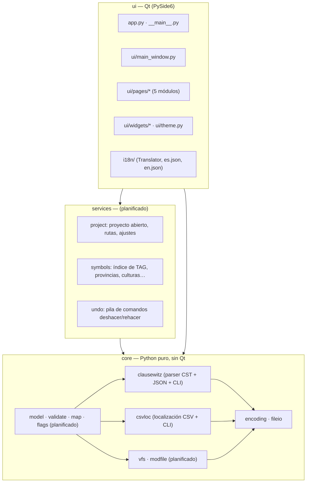

# Victoria II Mod Studio — Arquitectura

Documento de referencia de la arquitectura de **Victoria II Mod Studio**, la
aplicación de escritorio (Windows + Linux) para crear y editar mods de
Victoria II (motor Clausewitz de Paradox, con *A House Divided* y *Heart of
Darkness*) de forma visual.

Estado: **iteración 1**. Las piezas marcadas *(planificado)* todavía no existen
en el código; todo lo demás describe contratos públicos ya fijados o
implementados en esta iteración.

Índice:

1. [Stack tecnológico](#1-stack-tecnológico)
2. [Arquitectura por capas](#2-arquitectura-por-capas)
3. [Herencia Vanilla + Mod (VFS)](#3-herencia-vanilla--mod-vfs)
4. [Motor de parseo](#4-motor-de-parseo)
5. [Árbol de directorios](#5-árbol-de-directorios)
6. [Hoja de ruta y riesgos](#6-hoja-de-ruta-y-riesgos)
7. [Estrategia de pruebas](#7-estrategia-de-pruebas)

---

## 1. Stack tecnológico

### 1.1 Requisitos que condicionan la elección

- **Mapa interactivo**: `map/provinces.bmp` de vanilla mide 5616 × 2160 px a
  24 bits (≈12,1 Mpx, ≈36 MB de píxeles). Hay que leerlo, convertir colores a
  ID de provincia, recolorear por modo de mapa y responder al clic al instante.
- **Windows y Linux** con un único código fuente.
- **Fidelidad absoluta a los archivos**: el juego lee Windows-1252, los mods
  mezclan CRLF/LF, tabs y comentarios; abrir y guardar sin cambios debe dar los
  mismos bytes.
- **Interfaz a medida** con estética victoriana (bronce, pergamino, terciopelo,
  madera, serifas) que siga siendo rápida y usable.
- **i18n en tiempo real** (Español/Inglés) sin reiniciar.
- **Entorno real de desarrollo**: sin red garantizada para instalar
  dependencias; hay que poder ejecutar y probar todo con lo que ya está
  instalado.

### 1.2 Comparativa

| Criterio | Python + PySide6 (Qt 6) | Tauri 2 + Rust + React | Electron + React/TS |
|---|---|---|---|
| Rendimiento del mapa | numpy vectoriza todo el pipeline (ver 1.4); `QGraphicsView` para zoom/paneo; `QOpenGLWidget` con shader si hiciera falta. Medido: decenas de ms por modo de mapa. | Procesado en Rust muy rápido, pero la imagen se dibuja en el WebView: pasar 12 Mpx de Rust a JS por IPC es costoso y WebGL en webkit2gtk es irregular en Linux. | Decodificar BMP en JS/WASM y pintar en Canvas/WebGL es viable, con más memoria y trabajo en *workers*. |
| Tamaño del ejecutable (estimado) | ≈120–200 MB en carpeta (Qt + numpy + intérprete); ≈50–80 MB comprimido. | ≈5–15 MB: usa el WebView del sistema. | ≈150–250 MB en carpeta (Chromium + Node). |
| Empaquetado Windows/Linux | PyInstaller *one-folder* en cada sistema (no compila en cruzado); AppImage opcional. | Bundler propio (MSI/NSIS, deb/rpm/AppImage); en Linux exige webkit2gtk-4.1 en el sistema. | electron-builder (NSIS, AppImage, deb): muy maduro. |
| Curva de aprendizaje | Un solo lenguaje; Qt Widgets es extenso pero estable y bien documentado. | Dos lenguajes (Rust + TS) y un puente IPC entre ellos; Rust (ownership) tiene la curva más alta. | TS/React muy conocidos; acceso a disco vía Node/IPC. |
| Ecosistema útil aquí | `QTableView` con modelo para CSV de 15 000 filas, `QGraphicsView`, `QSettings`, `QPainter` para texturas; numpy y Pillow leen BMP/TGA directamente. | crates `image`, `serde`; librerías de UI de React. | npm enorme; `sharp`/`jimp` para imágenes. |
| Estado del entorno actual | **Instalado**: Python 3.14, PySide6 6.11.2, numpy 2.4.6, Pillow 12.3.0. Se puede ejecutar y probar ya (también *offscreen*). | **No disponible**: no hay `rustc`/`cargo` ni webkit2gtk-4.1. | Node.js está, pero Electron no, y sin red no se puede hacer `npm install`. |

### 1.3 Decisión: Python + PySide6 + numpy + Pillow

En la primera propuesta se recomendó **Tauri + Rust/React** por el tamaño del
ejecutable y el rendimiento nativo de Rust. Se cambió al comprobar el entorno:
en esta máquina **no hay toolchain de Rust ni webkit2gtk-4.1**, y sin red
garantizada no se pueden instalar. En cambio **PySide6 6.11 y numpy ya están
instalados**, así que cada pieza (parser, CSV, ventana principal, capturas
*offscreen*) se puede ejecutar y probar ahora mismo contra el corpus real.

Lo que se acepta a cambio:

- Un ejecutable más grande (≈120–200 MB frente a ≈10 MB de Tauri). Para una
  herramienta de escritorio que se descarga una vez es asumible; se reduce
  excluyendo módulos de Qt no usados.
- Arranque algo más lento del intérprete (decenas a cientos de ms), sin impacto
  en el uso.
- El código Python va dentro del ejecutable de forma legible: no es un
  problema para una herramienta de modding.

### 1.4 Por qué el rendimiento del mapa no es un problema en Python

El trabajo pesado nunca se hace píxel a píxel en Python: cada paso es una
operación vectorizada de numpy sobre el array completo.

1. **Lectura**: Pillow abre `provinces.bmp` (24 bits) y `np.asarray` da un
   array `(H, W, 3) uint8`.
2. **Empaquetado**: `rgb = (r << 16) | (g << 8) | b` en `uint32`.
3. **Color → ID**: se lee `map/definition.csv` (`province;red;green;blue;x;x`,
   separado por `;`, cp1252) y se ordenan sus colores; `np.searchsorted` sobre
   el array empaquetado da el índice de cada píxel y se obtiene un **ráster
   `uint16` de ID de provincia** (24 MB). Los colores que no están en
   `definition.csv` reciben el ID 0 y generan un diagnóstico (`np.unique` del
   array empaquetado lista los colores presentes). Una alternativa equivalente
   es una tabla directa de 2²⁴ entradas `uint16` (32 MB).
4. **Modo de mapa**: cada modo es una **LUT `(N+1, 3) uint8`** (fila 0 = sin
   provincia) calculada a partir del modelo (dueño → color del país, RGO →
   color del bien, `life_rating` → degradado, etc.). La imagen es `lut[raster]`.
   Para pintar, la LUT se empaqueta además como `uint32` ARGB y
   `np.take(lut32, raster)` produce directamente un buffer que `QImage`
   (`Format_RGB32`) usa sin copiar.
5. **Fronteras**: comparación del ráster con sus versiones desplazadas una fila
   y una columna (`raster[:, 1:] != raster[:, :-1]`, ídem vertical) → máscara
   booleana que se dibuja como capa superpuesta.
6. **Picking del clic**: `raster[y, x]` tras convertir la posición de la vista
   a coordenadas de imagen: O(1).
7. **Visualización**: `QGraphicsView` + `QGraphicsPixmapItem` con zoom (rueda,
   `setTransform`) y paneo (arrastre); transformación rápida (sin suavizado) a
   zoom alto para ver píxeles nítidos. Si cambiar de modo tuviera que ser
   instantáneo, se pasa a un `QOpenGLWidget` con un *fragment shader*: el ráster
   se sube una vez como textura entera (`R16UI`) y la LUT como textura de
   (N+1) × 1; cambiar de modo es subir unos 13 KB en lugar de 48 MB.

Mediciones reales con un script sintético del mismo tamaño que vanilla
(5616 × 2160, 3248 provincias; Ryzen 9 7950X3D, numpy 2.4.6, mejor de hasta 5
ejecuciones). El corpus disponible no incluye la carpeta `map/`, así que las
cifras se repetirán en la iteración 3 con un `provinces.bmp` real:

| Paso | Operación | Tiempo |
|---|---|---|
| Lectura | Pillow → `np.asarray` | 26 ms |
| Empaquetado | `(r<<16)\|(g<<8)\|b` | 30 ms |
| Color → ID (una vez al cargar) | `np.searchsorted` → `uint16` | 164 ms |
| Colores presentes | `np.unique` | 85 ms |
| Modo de mapa, LUT `(N+1,3) uint8` | `lut[raster]` | 104 ms |
| Modo de mapa, LUT `uint32` ARGB | `np.take(lut32, raster)` + `QImage` sin copia | 34 ms |
| Fronteras | comparación de rásteres desplazados | 13 ms |
| Picking | `raster[y, x]` | < 1 µs |

Editar el dueño de una provincia solo cambia una fila de la LUT; el repintado
puede limitarse a la caja envolvente de esa provincia (precalculada al cargar).

Otros archivos del mapa:

- **`map/default.map`** (sintaxis Clausewitz, se lee con el mismo parser):
  `max_provinces` (los ID válidos van de 1 a `max_provinces - 1`; fija el
  tamaño de las LUT), `sea_starts = { ... }` (lista de ID de provincias de
  mar), y los nombres del resto de archivos: `definitions`, `provinces`,
  `positions`, `terrain`, `rivers`, `terrain_definition`, `tree_definition`,
  `continent`, `adjacencies`, `region`, `region_sea`, etc. Nunca se asumen los
  nombres: se leen de aquí.
- **`map/terrain.bmp`**: imagen **indexada de 8 bits** (paleta). Pillow la abre
  en modo `P` y `np.asarray` devuelve directamente los índices; `terrain.txt`
  traduce índices de paleta a tipos de terreno. El modo Terreno usa el índice
  mayoritario de cada provincia (`np.bincount` sobre `id * 256 + índice`), y
  respeta las anulaciones `terrain = ...` de `history/provinces`.
- `rivers.bmp` también es indexado de 8 bits (capa opcional).

---

## 2. Arquitectura por capas



Reglas de dependencia:

- **core** no importa PySide6 nunca. Se puede usar desde la línea de comandos,
  desde pruebas sin pantalla y, en el futuro, desde otros programas. Sus
  diagnósticos traen sus propias tablas de mensajes `es`/`en`
  (`Diagnostic.message(lang)`), así que no dependen del traductor de Qt: la UI
  le pasa el idioma activo.
- **services** *(planificado)* coordina el estado de la aplicación (proyecto
  abierto, índice de símbolos, deshacer/rehacer). Es Python puro y, como mucho,
  usa QtCore para señales y tareas en segundo plano; nunca QtWidgets.
- **ui** solo presenta y edita. Toda lectura o escritura de archivos pasa por
  core (y por la VFS cuando exista); ningún widget abre archivos por su cuenta.
- **i18n** pertenece a la capa de UI: `Translator(QObject)` emite
  `languageChanged(str)` y cada página implementa `retranslate()`.

### 2.1 Flujo de datos

```text
 vanilla/ (solo lectura)       mod/ (lectura y escritura)
          \                     /
           +--- VFS (planif.) -+      resuelve la ruta relativa: mod sobre vanilla
                     |
                     v
   bytes ──> encoding.decode_bytes ──> texto + codificación + salto de línea
                     |
          +----------+-----------+
          v                      v
   clausewitz.parse         csvloc.parse_csv
   (CST sin pérdidas         (filas crudas por
    + diagnósticos)           columnas + diagnósticos)
          |                      |
          v                      v
   modelo de dominio / to_json / simplify      (vista para formularios y tablas)
                     |
                     v
   formularios y tablas Qt  ──edición──>  Block.set / append / remove …
                     |                    LocRow.set / LocalisationFile.set …
                     v
   to_source (sin pérdidas: solo cambia lo editado)
                     |
                     v
   encoding.encode_text (si hay caracteres no representables en cp1252,
                     |    error con línea y columna: no se escribe nada)
                     v
   fileio.write_text (atómico + copia .bak) ──> SIEMPRE en la carpeta del mod
```

### 2.2 Modelo de dominio *(planificado)*

El modelo no copia los datos: son envoltorios finos sobre los nodos del CST.
`ProvinceHistory.owner` lee con `Block.get_text("owner")` y escribe con
`Block.set("owner", tag)`, de modo que guardar conserva comentarios, orden y
formato del archivo original. Los bloques fechados (`1861.1.1 = { owner = PRU }`)
se interpretan como cambios históricos; el editor muestra el estado en la fecha
de inicio (1836.1.1) y, más adelante, una línea temporal.

### 2.3 Índice de símbolos *(planificado)*

Recorre el proyecto (vanilla + mod) y extrae: TAG de `common/countries.txt`,
provincias de `definition.csv` y `history/provinces/<región>/<id> - <Nombre>.txt`,
culturas y grupos (`common/cultures.txt`), religiones, bienes, tipos de POP,
tecnologías, invenciones, ideologías, gobiernos, reformas, ID de eventos,
decisiones, modificadores y claves de localización. Alimenta los desplegables y
buscadores, la validación («TAG desconocido») y el renombrado. Se construye en
segundo plano; si con un mod de unos 4000 archivos tarda más de un par de
segundos, se paraleliza con `ProcessPoolExecutor` y se cachea en disco por
(ruta, tamaño, mtime).

### 2.4 Deshacer/rehacer *(planificado)*

Pila de comandos propia en services: cada comando guarda la operación sobre el
CST y su inversa. La UI la conecta a Ctrl+Z / Ctrl+Y y marca los documentos
modificados. Nada se escribe en disco hasta guardar.

---

## 3. Herencia Vanilla + Mod (VFS)

*(planificado para la iteración 2; los principios ya condicionan core.)*

### 3.1 Principios

- **El juego base es de solo lectura.** La VFS rechaza cualquier escritura cuya
  ruta resuelta (siguiendo enlaces simbólicos) caiga dentro de la carpeta de
  vanilla, aunque la UI lo pida.
- **Toda escritura va a la carpeta del mod**, en la misma ruta relativa que
  tendría en el juego, creando las subcarpetas necesarias (`common/`,
  `history/`, `events/`, `decisions/`, `map/`, `localisation/`, `gfx/`…);
  `fileio.atomic_write_bytes` ya crea las carpetas intermedias.
- **Copia al modificar**: editar un archivo de vanilla lo lee de vanilla y, al
  guardar, crea la copia en el mod. Vanilla nunca cambia.

### 3.2 Resolución de un archivo

1. Se normaliza la ruta relativa (`/` como separador). El juego corre en
   Windows, donde las rutas no distinguen mayúsculas; en Linux sí. La VFS indexa
   por ruta en minúsculas y avisa si dos archivos solo se diferencian en
   mayúsculas.
2. Si el mod tiene el archivo, gana el del mod.
3. Si no, y la carpeta no está en `replace_path`, se usa el de vanilla.
4. Listar una carpeta devuelve la unión de ambas (el mod sustituye a vanilla
   archivo por archivo), salvo las carpetas en `replace_path`, donde solo
   cuentan los archivos del mod.

Casos especiales que el validador vigilará:

- **Localización**: el juego no sustituye por ruta sino que carga todos los CSV
  y, ante claves repetidas, gana la primera cargada (ver 4.3).
- **`history/provinces`**: los archivos se llaman `<id> - <Nombre>.txt`; si el
  mod usa otro nombre para el mismo ID, el juego cargaría ambos. Se avisará.
- **`map/`**: `default.map`, `definition.csv` y `provinces.bmp` deben ser
  coherentes entre sí; modificar uno sin los otros se marca como riesgo.

### 3.3 `replace_path`

Cada `replace_path = "history/provinces"` del descriptor indica al juego que no
cargue los archivos de vanilla de esa carpeta: solo se usan los del mod. Sirve
para mods que reestructuran una carpeta entera. Está pendiente comprobar en el
juego si afecta también a las subcarpetas; la VFS lo modela como una opción para
no fijar esa suposición en el código.

### 3.4 Descriptor `.mod`

Vive en `<juego>/mod/<Nombre>.mod`, junto a la carpeta del mod. Ejemplo real
(`VSM.mod`, cp1252 con CRLF):

```text
name = "Shago Mod"
path = "mod/VSM"
user_dir = "VSM"
```

| Campo | Significado |
|---|---|
| `name` | Nombre que muestra el lanzador. |
| `path` | Carpeta del mod relativa a la carpeta del juego (`mod/<carpeta>`). |
| `user_dir` | Carpeta propia en Documentos para partidas y caché, separada de las de vanilla. |
| `replace_path` | Repetible: carpetas de vanilla que el mod sustituye por completo. |

El generador *(planificado, `core/modfile.py`)* crea y edita el descriptor como
un `Document` del parser (así conserva comentarios y formato si ya existía),
valida que `path` apunte a la carpeta del mod, y lo guarda con `write_file` en
cp1252 y CRLF.

---

## 4. Motor de parseo

### 4.1 Clausewitz `.txt` (`vic2studio.core.clausewitz`)

Sintaxis que reconoce: `clave = valor`, operadores `= < > <= >= != ==`, bloques
`{ ... }` anidados, valores sueltos (`{ 1 2 3 }`), bloques mixtos, cadenas entre
comillas (sin secuencias de escape), fechas `1861.1.1` (también como clave),
comentarios `#` hasta fin de línea y tokens pegados (`a={b=c}`).

**CST sin pérdidas.** El árbol (`Document`, `Block`, `Entry`, `Scalar`)
conserva la *trivia*: espacios, tabs, saltos de línea (CRLF incluido) y
comentarios. `to_source(document)` reproduce **exactamente** el texto original
si no hubo ediciones, también en archivos con errores de sintaxis; con
ediciones, solo se reescribe lo editado y el resto queda byte a byte igual.

**Tolerancia a errores.** `parse()` nunca lanza excepciones por un archivo mal
formado: siempre devuelve un `ParseResult` con el documento recuperado y la
lista de `Diagnostic` (`code`, `severity`, `line`/`column` 1-based, `offset`,
`args`, `related` y `message(lang)` con tablas `es` y `en` completas).

| Código | Severidad | Cuándo aparece | Ejemplo |
|---|---|---|---|
| `unclosed_block` | error | Un `{` llega al final del archivo sin cerrar. Posición: la `{`; `args`: `key`, `open_line`; `related`: el final del archivo. | `political_decisions = { …` sin `}` final |
| `unexpected_close_brace` | error | `}` sin bloque abierto. | `a = 1 }` |
| `missing_value` | error | Clave y operador sin valor antes de `}` o del fin del archivo. | `p = { owner = }` |
| `missing_key` | error | Operador sin clave delante. | `= GER` |
| `unterminated_string` | error | Comillas sin cerrar. | `name = "Prusia` |
| `invalid_key` | error | Un bloque usado como clave. | `{ a } = b` |
| `unexpected_operator` | error | Dos operadores seguidos. | `owner = = GER` |
| `invalid_character` | error | Carácter que no puede formar parte de ningún token. | — |
| `multiline_string` | aviso | Una cadena abarca varias líneas: probablemente falta una comilla. | `name = "a` ⏎ `b"` |
| `control_character` | aviso | Caracteres de control invisibles en el archivo. | byte `0x01` |
| `non_game_encoding` | aviso | El archivo no está en Windows-1252 (UTF-8, con o sin BOM). | — |
| `suspicious_close_brace` | info | Una `}` cierra un bloque con menos sangría que la línea que lo abrió: pista de dónde falta una llave. | ver el caso real |

Caso real: `check` sobre el mod del usuario (3927 archivos) da 3 errores,
1 aviso y 1 pista:

- `decisions/somaliland_shago.txt` y `decisions/zulu_expancionshago.txt` no
  cierran el bloque `political_decisions` abierto en la línea 1
  (`unclosed_block`). En el segundo, `suspicious_close_brace` apunta además a
  la línea 155, cuya `}` cierra `imperio_zulu` (abierto en la línea 85) con
  menos sangría de la esperada: la llave que falta está probablemente antes.
- `history/units/v2dd2.txt` no es un script sino el texto de un diario de
  desarrollo copiado por error (también está en la plantilla): `missing_key`
  en la línea 4 (``).
- `history/units/1861/HAI_oob.txt` está en UTF-8 (`non_game_encoding`).

Son errores que pasan fácilmente desapercibidos, y por eso `check` indica
siempre la línea donde se abrió el bloque.

**API de edición** (conserva el formato existente):

| Método | Efecto |
|---|---|
| `get`, `get_all`, `get_text`, `has`, `find`, `find_all`, `keys`, `values` | Consultas por clave (todas con `ignore_case=False`). |
| `set(key, value)` | Sustituye el valor de la primera entrada con esa clave; si no existe, la añade al final. |
| `append`, `append_value`, `insert` | Añaden entradas con clave o valores sueltos. |
| `remove(key)`, `remove_entry(entry)` | Eliminan entradas. |

Valores aceptados: `Scalar`, `Block`, `str` (sin comillas si es una palabra
válida; si no, entre comillas), `int`, `float`, `bool` (→ `yes`/`no`),
`ClausewitzDate`, `list` (→ bloque de valores sueltos) y `dict` (→ bloque de
asignaciones). `Scalar` ofrece `as_int`, `as_float`, `as_bool`, `as_date`,
`is_number` e `is_date`; `ClausewitzDate` es ordenable.

**JSON.** `to_json(node, include_comments=False)` produce este esquema exacto.
Para el texto `owner = GER` seguido de `sea_starts = { 1258 1259 }`:

```json
{"type": "block", "entries": [
  {"key": {"type": "scalar", "text": "owner", "quoted": false}, "op": "=",
   "value": {"type": "scalar", "text": "GER", "quoted": false}},
  {"key": {"type": "scalar", "text": "sea_starts", "quoted": false}, "op": "=",
   "value": {"type": "block", "entries": [
     {"key": null, "op": null, "value": {"type": "scalar", "text": "1258", "quoted": false}},
     {"key": null, "op": null, "value": {"type": "scalar", "text": "1259", "quoted": false}}
   ]}}
]}
```

Con `include_comments=True` cada entrada lleva además `"comments": ["# ..."]`
con los comentarios que la preceden. `from_json(obj)` devuelve un `Document` en
formato canónico. Invariante (comprobado sobre los 7828 archivos `.txt`/`.mod`
sin errores del corpus):

```text
to_json(parse(format_canonical(from_json(to_json(doc)))).document) == to_json(doc)
```

**Otras vistas.**

- `format_canonical(node, indent="\t", newline="\n")`: impresión normalizada
  (`clave = valor`, bloques indentados, listas cortas en línea `{ 1 2 3 }`).
- `simplify(node)`: vista con pérdidas para leer rápido (bloque de valores
  sueltos → `list`; con asignaciones → `dict`, claves repetidas → `list`;
  números → `int`/`float`; `yes`/`no` → `bool`).
- `walk(node)`: recorre en profundidad dando `(ruta, entrada)`.

**CLI.**

```text
python -m vic2studio.core.clausewitz check RUTA... [--lang es|en]
python -m vic2studio.core.clausewitz tojson ARCHIVO [--comments]
```

`check` recorre archivos y carpetas, imprime
`archivo:línea:columna: severidad: mensaje` y sale con código 1 si hay errores.

### 4.2 Lectura y escritura (`core.encoding`, `core.fileio`)

- **Detección**: BOM UTF-8 → `utf-8-sig`; contenido no ASCII que es UTF-8
  válido → `utf-8`; en cualquier otro caso → `cp1252`. Los cinco bytes que
  cp1252 deja sin definir (0x81, 0x8D, 0x8F, 0x90, 0x9D) se conservan con un
  manejador propio, así que decodificar y volver a codificar da los mismos
  bytes. Comprobado con los 7882 archivos de texto del corpus.
- **Codificación al guardar**: por defecto la detectada al leer (cp1252 para
  archivos nuevos). El juego no entiende UTF-8: `parse_file` y `read_csv_file`
  ya avisan con `non_game_encoding`, y el validador global ofrecerá convertir
  esos archivos *(planificado)*. Si el texto tiene caracteres que
  cp1252 no puede representar, `encode_text` lanza `UnencodableTextError` con
  línea y columna de cada uno **antes** de tocar el disco.
- **Saltos de línea**: `detect_newline` y el CST conservan los del archivo. Los
  CSV nuevos usan CRLF, como todos los del corpus; `format_canonical` usa LF
  salvo que se le pase `newline="\r\n"`.
- **Escritura atómica**: archivo temporal en la misma carpeta, `fsync` y
  `os.replace`; un fallo a mitad de guardado nunca deja un archivo a medias.
  `write_file` y `write_csv_file` guardan por defecto una copia del original
  como `<nombre>.bak` (por ejemplo `text.csv.bak`): al no terminar en `.txt` ni
  en `.csv`, el juego no la carga.

### 4.3 Localización CSV (`vic2studio.core.csvloc`)

El juego **no** usa CSV estándar: una entrada por línea, campos separados por
`;`, sin comillas ni escapes, cp1252. Las líneas que empiezan por `#` son
comentarios.

| Columna | 0 | 1 | 2 | 3 | 4 | 5 | 6 | 7 | 8 | 9 | 10 | 11 | 12 | 13 | 14 |
|---|---|---|---|---|---|---|---|---|---|---|---|---|---|---|---|
| Contenido | clave | English | French | German | Polish | Spanish | Italian | Swedish | Czech | Hungarian | Dutch | Portuguese | Russian | Finnish | `x` |

`LANGUAGE_COLUMNS`, `LANGUAGE_CODES` (`"en": 1` … `"es": 5` … `"fi": 13`) y
`END_MARKER = "x"` exponen esta tabla. **El juego vanilla solo muestra English,
French, German y Spanish**; el resto de columnas existen en el formato pero el
juego no las usa.

Lo que muestra el corpus real (comprobado):

- Vanilla suele terminar con la `x` en la columna 14 seguida de campos vacíos
  extra, que hay que conservar:
  `LEDGER_COUNTRY_NAME;Country;Pays;Land;;País;;;;;;;;;x;;;;`
- Muchas filas de vanilla ponen la `x` antes (por ejemplo en la columna 11 en
  `darkness_3_01.csv`), y los archivos del mod del usuario (`00_VSM_*.csv`) no
  tienen ninguna `x` y empiezan con una fila de cabecera
  `key;English;French;…`. Por eso el linter informa (`missing_end_marker`,
  `too_few_columns`, `header_row`) sin bloquear la edición, y al re-serializar
  una fila editada la normaliza a `clave;13 columnas;x` conservando los extras
  tras la `x`.
- Hay comillas como texto literal (por ejemplo `""§Y$PROJ$§!""` en
  `housedivided.csv`). Como el juego no las interpreta, un `;` entre comillas
  desplaza columnas: aviso `semicolon_in_quotes`.
- Los textos usan códigos de color `§Y … §W`/`§!` y variables `$COUNTRY$`; el
  editor debe mostrarlos sin alterarlos.
- Todos los CSV del corpus usan CRLF.

Códigos de diagnóstico (`CsvDiagnostic`, mensajes `es`/`en`):

| Código | Severidad | Significado |
|---|---|---|
| `missing_end_marker` | aviso | Falta la `x` en la columna 14 (o está en otra columna: faltan columnas o un `;` de más desplaza las siguientes). |
| `too_few_columns` | aviso | La fila tiene menos de las 13 columnas de idioma. |
| `duplicate_key` | aviso | Clave repetida en el mismo archivo; el juego usa la primera. |
| `empty_key` | aviso | Fila sin clave. |
| `key_whitespace` | aviso | La clave tiene espacios al principio o al final; las referencias no coincidirán. |
| `semicolon_in_quotes` | aviso | Un texto entre comillas contiene `;`. |
| `non_game_encoding` | aviso | El archivo no está en Windows-1252. |
| `unencodable_character` | error | Caracteres que no se pueden guardar en cp1252. |
| `header_row` | info | Fila de cabecera `key;English;…`: el juego la carga como la clave `key`; inofensiva. |

**Precedencia.** `LocalisationDB.from_dirs([mod/localisation,
vanilla/localisation])` reúne los `*.csv` de las carpetas (si dos carpetas
tienen un archivo con el mismo nombre, gana el de la primera: mod antes que
vanilla) y los carga por orden alfabético de nombre de archivo. Entre claves
repetidas en archivos distintos gana la primera cargada; por eso los mods
nombran sus archivos con el prefijo `00_`. `lookup`, `source_of` y
`overrides()` permiten ver qué texto gana y dónde está definido.

`to_json`/`from_json` producen `{"encoding", "newline", "trailing_newline",
"rows": [...]}` con filas `data` (clave + campos crudos), `comment` y `blank`;
`to_source(from_json(to_json(f))) == to_source(f)` para archivos sin ediciones.

```text
python -m vic2studio.core.csvloc check RUTA... [--lang es|en]
python -m vic2studio.core.csvloc tojson ARCHIVO
python -m vic2studio.core.csvloc fromjson JSON -o SALIDA.csv
```

---

## 5. Árbol de directorios

Lo que no lleva marca existe en la iteración 1; *(planificado)* indica piezas
de iteraciones posteriores. Los módulos internos de `clausewitz/` y `csvloc/`
son detalle de implementación: el contrato es lo que exportan sus `__init__.py`.

```text
victoria2_mod_studio/
├── ARCHITECTURE.md                  este documento
├── README.md                        qué es, cómo ejecutar, probar y usar las CLI
├── pyproject.toml                   metadatos y empaquetado (setuptools, layout src)
├── requirements.txt                 dependencias de ejecución
├── packaging/
│   ├── vic2studio.spec              PyInstaller one-folder "Victoria II Mod Studio"
│   ├── build_linux.sh               construye, comprime y (opcional) instala en ~/.local
│   ├── build_windows.bat            construye y comprime la versión Windows
│   ├── linux/
│   │   └── vic2studio.desktop       lanzador de escritorio (freedesktop)
│   ├── icons/                       (planificado) vic2studio.png/.ico generados por código
│   └── windows/installer.iss        (planificado) instalador Inno Setup
├── tools/
│   ├── screenshot.py                capturas PNG offscreen por idioma y página
│   └── bench_map.py                 (planificado) benchmark del pipeline de mapa
├── src/vic2studio/
│   ├── __init__.py                  __version__, APP_NAME, ORG_NAME
│   ├── __main__.py                  python -m vic2studio → app.main()
│   ├── app.py                       main(argv): QApplication, tema, MainWindow
│   ├── settings.py                  preferencias QSettings (INI); VIC2STUDIO_SETTINGS_DIR las aísla
│   ├── core/                        Python puro, sin Qt
│   │   ├── __init__.py
│   │   ├── encoding.py              detección cp1252/UTF-8 sin pérdidas, saltos de línea
│   │   ├── fileio.py                lectura, escritura atómica y copias .bak
│   │   ├── clausewitz/              parser .txt
│   │   │   ├── __init__.py          API pública (parse, to_source, to_json, …)
│   │   │   ├── __main__.py          CLI check / tojson
│   │   │   ├── lexer.py             tokens con posición y trivia
│   │   │   ├── parser.py            parser tolerante a errores → ParseResult
│   │   │   ├── nodes.py             CST: Document, Block, Entry, Scalar, ClausewitzDate
│   │   │   ├── serializer.py        to_source, format_canonical, write_file
│   │   │   ├── json_bridge.py       to_json, from_json, simplify, walk
│   │   │   └── diagnostics.py       Diagnostic, Severity y mensajes es/en
│   │   ├── csvloc/                  localización CSV
│   │   │   ├── __init__.py          API pública (parse_csv, LocalisationDB, …)
│   │   │   ├── __main__.py          python -m vic2studio.core.csvloc
│   │   │   ├── cli.py               CLI check / tojson / fromjson
│   │   │   ├── model.py             LocRow, LocalisationFile, columnas de idioma
│   │   │   ├── serialization.py     lectura, escritura y JSON
│   │   │   ├── lint.py              validación de un archivo
│   │   │   ├── db.py                LocalisationDB: precedencia mod/vanilla
│   │   │   └── diagnostics.py       CsvDiagnostic, Severity y mensajes es/en
│   │   ├── vfs.py                   (planificado) resolución vanilla + mod, escritura solo en el mod
│   │   ├── modfile.py               (planificado) lectura/generación del descriptor .mod
│   │   ├── model/                   (planificado) envoltorios de dominio sobre el CST
│   │   │   ├── provinces.py         (planificado) historial de provincias y POPs
│   │   │   ├── countries.py         (planificado) países, partidos, historial nacional
│   │   │   └── events.py            (planificado) eventos y decisiones
│   │   ├── map/                     (planificado) default.map, definition.csv, ráster y LUT
│   │   ├── flags.py                 (planificado) conversión de imágenes a banderas .tga
│   │   └── validate/                (planificado) validador global del mod
│   ├── services/                    (planificado) estado de la aplicación
│   │   ├── project.py               (planificado) proyecto abierto: rutas de juego y mod
│   │   ├── symbols.py               (planificado) índice de TAG, provincias, culturas, claves…
│   │   └── undo.py                  (planificado) pila de deshacer/rehacer
│   ├── i18n/
│   │   ├── __init__.py              Translator, translator(), tr(), set_language(), …
│   │   ├── es.json                  textos en español (claves planas "nav.project", …)
│   │   └── en.json                  textos en inglés
│   ├── ui/
│   │   ├── __init__.py
│   │   ├── theme.py                 paleta, apply_theme(), texturas procedurales, fuentes
│   │   ├── style.qss                hoja de estilo Qt
│   │   ├── main_window.py           MainWindow: estandarte, idioma, navegación, páginas, estado
│   │   ├── widgets/
│   │   │   ├── __init__.py
│   │   │   ├── surfaces.py          paneles de madera/terciopelo, marco ornamentado, tarjetas
│   │   │   ├── ornaments.py         marcos de bronce, remaches, medallones, emblema, filetes
│   │   │   ├── banner.py            cabecera-estandarte con emblema y título
│   │   │   ├── navigation.py        placas de navegación con icono, nombre y atajo
│   │   │   ├── icons.py             iconos vectoriales dibujados con QPainter
│   │   │   ├── cards.py             insignias, estados vacíos, cintas, hoja de ruta
│   │   │   └── flow.py              disposición en filas que salta de línea
│   │   └── pages/
│   │       ├── __init__.py          las cinco páginas en el orden de la navegación
│   │       ├── base.py              BasePage: key, título, subtítulo, icono, retranslate()
│   │       ├── planned.py           página de módulo planificado (funcionalidades y hoja de ruta)
│   │       ├── project_page.py      1 · Proyecto y Archivos
│   │       ├── map_page.py          2 · Editor de Mapa
│   │       ├── countries_page.py    3 · Creador de Países
│   │       ├── events_page.py       4 · Estudio de Eventos
│   │       └── localisation_page.py 5 · Localización (CSV)
│   └── assets/                      (opcional) recursos propios, nunca del juego
│       └── fonts/                   .ttf/.otf libres que carga theme.py si existen
└── tests/
    ├── _corpus.py                   localiza el corpus real (variable VIC2_CORPUS)
    ├── _qt.py                       entorno de pruebas Qt: offscreen, preferencias aisladas
    ├── test_encoding.py             codificación, escritura atómica, ida y vuelta del corpus
    ├── test_clausewitz*.py          parser, edición, JSON, CLI y corpus
    ├── test_csvloc_*.py             parse, edit, lint, db, cli y corpus del CSV
    ├── test_i18n.py                 catálogos es/en y cambio de idioma
    └── test_ui_*.py                 ventana principal, navegación e idioma (offscreen)
```

---

## 6. Hoja de ruta y riesgos

### 6.1 Iteraciones

| # | Contenido | Criterio de aceptación |
|---|---|---|
| **1** (esta) | Arquitectura y documentación; `core.encoding`/`fileio`; parser Clausewitz y CSV con JSON y CLI; ventana principal con estética Vic2, selector ES/EN en tiempo real y navegación entre los 5 módulos; capturas offscreen; empaquetado preparado. | Ida y vuelta byte a byte de todo el corpus; los dos archivos rotos del mod del usuario detectados; la UI cambia de idioma sin reiniciar. |
| **2** | VFS vanilla + mod; generador/editor del `.mod`; explorador de archivos del proyecto; editor de localización editable (tabla con filtro, columnas por idioma, sincronización de claves creadas por otros módulos); validador global (llaves, codificación, claves sin traducir, TAG desconocidos). | Abrir vanilla + un mod, editar un texto y comprobar que solo cambia ese archivo, y dentro del mod. |
| **3** | Editor de mapa: carga de `default.map`/`definition.csv`/`provinces.bmp`/`terrain.bmp`, modos Político, Recursos (RGO), Infraestructura, *Life Rating* y Terreno, panel de provincia (`owner`, `controller`, `add_core`, `trade_goods`, `life_rating`, `terrain`, `railroad`, `fort`, `naval_base`) y editor de POPs. | Cambiar el dueño de una provincia recolorea el mapa al instante y guarda solo `history/provinces/...` en el mod. |
| **4** | Asistente de países: TAG único registrado en `common/countries.txt`; color de mapa (`color` en `common/countries/<Nombre>.txt`) y colores de unidades (`common/country_colors.txt`); partidos; historial `history/countries/<TAG> - <Nombre>.txt`; 5 banderas `.tga` (`TAG`, `_monarchy`, `_republic`, `_communist`, `_fascist`) a 93 × 64 px, como las del mod del usuario; claves de localización creadas automáticamente. | Un país nuevo aparece jugable en el juego sin editar nada a mano. |
| **5** | Estudio de eventos y decisiones: `country_event`/`province_event`, constructor visual de triggers (`AND`/`OR`/`NOT`), MTTH con modificadores, opciones con efectos y `ai_chance`; carga de eventos de vanilla. | Crear un evento desde cero y editar uno de vanilla conservando su formato. |
| **6** | Empaquetado y pulido: ejecutables Windows/Linux, icono, instalador, rendimiento, accesibilidad, revisión de textos ES/EN. | Ejecutables que arrancan en un sistema limpio. |

### 6.2 Riesgos y mitigaciones

| Riesgo | Mitigación |
|---|---|
| Corromper archivos del mod o del juego | Vanilla solo lectura (comprobación de ruta en la VFS); escritura atómica con `.bak`; `to_source` sin pérdidas, así que guardar sin cambios no altera nada; deshacer/rehacer antes de guardar. |
| Codificación (cp1252 frente a UTF-8, caracteres no representables) | Detección explícita y conservación de la codificación; `UnencodableTextError` con posición antes de escribir; aviso del validador para archivos UTF-8; prueba de ida y vuelta sobre los 7882 archivos del corpus. |
| Rendimiento del mapa | Todo vectorizado con numpy (medido: decenas de ms por modo); recoloreado parcial por caja envolvente; `QOpenGLWidget` con LUT en GPU como plan B. |
| Rendimiento del índice de un mod grande | Parseo en segundo plano, procesos paralelos y caché por (ruta, tamaño, mtime) si hace falta. |
| Fidelidad del parser (sintaxis rara de mods reales) | CST con trivia y tolerancia a errores; pruebas sobre todo el corpus real; *fuzzing* con mutaciones; los archivos con errores también se reproducen exactos. |
| Semántica del juego no documentada (`replace_path`, orden de carga) | Opciones explícitas en la VFS en lugar de suposiciones fijas; verificación en el juego antes de cerrar la iteración 2. |
| Derechos de autor de Paradox | Ningún gráfico, fuente ni texto del juego en el repositorio: texturas e iconos procedurales; la app lee los archivos del juego instalado por el usuario. |
| Diferencias Windows/Linux (rutas, mayúsculas, fuentes) | `pathlib` en todo el código; índice de rutas sin distinción de mayúsculas; fuentes de reserva; pruebas offscreen en ambos sistemas *(CI planificado)*. |

---

## 7. Estrategia de pruebas

- **Framework**: `unittest` de la biblioteca estándar; sin dependencias extra.
  Cada archivo de prueba añade `<raíz>/src` a `sys.path`, así que no hace falta
  instalar el paquete.
- **Corpus real** (`tests/_corpus.py`): la variable `VIC2_CORPUS` lista carpetas
  de mods separadas por `os.pathsep`. Si no hay corpus, esas pruebas se omiten.
  Se comprueba:
  - ida y vuelta byte a byte de la codificación (ya en verde: 7882 archivos);
  - `to_source(parse(texto)) == texto` para todos los `.txt`/`.gfx`/`.gui`…
    (verificado en esta iteración con los 7832 `.txt`/`.mod` del corpus, que
    se recorren en unos 6 s incluido el invariante JSON);
  - `to_source` de cada CSV igual al original;
  - el invariante JSON en todos los archivos sin errores;
  - que los dos archivos rotos conocidos del mod del usuario den
    `unclosed_block` con la línea de apertura correcta.
- **Fuzzing** con `random` y semilla fija: mutaciones (borrar o duplicar
  llaves, comillas, operadores, bytes aleatorios) sobre archivos del corpus;
  `parse` nunca lanza y `to_source(parse(x)) == x` siempre. Árboles aleatorios
  para el invariante `from_json` → `format_canonical` → `parse`.
- **UI offscreen** (`QT_QPA_PLATFORM=offscreen`): crear `MainWindow`, navegar
  con `set_current_page` y Ctrl+1..Ctrl+5, cambiar de idioma y comprobar que
  ningún texto visible queda sin traducir ni muestra una clave cruda, y que
  `es.json` y `en.json` tienen las mismas claves. `tests/_qt.py` fuerza la
  plataforma offscreen, aísla las preferencias en una carpeta temporal
  (`VIC2STUDIO_SETTINGS_DIR`) para no tocar la configuración del usuario y hace
  fallar la prueba si Qt emite algún aviso.
- **Capturas**: `tools/screenshot.py` genera PNG por idioma y página para
  revisión visual (no se comparan píxel a píxel: las fuentes varían entre
  equipos).
- **Reglas de arquitectura**: importar `vic2studio.core` en un subproceso no
  debe cargar PySide6; todo el código fuente debe pasar
  `ast.parse(src, feature_version=(3, 10))`.
- *(planificado)* **CI** con matriz Windows/Linux y Python 3.10 y última
  versión estable.

Comando completo:

```bash
VIC2_CORPUS="/ruta/Plantilla Mod:/ruta/otro_mod" QT_QPA_PLATFORM=offscreen \
    python3 -m unittest discover -s tests -v
```
